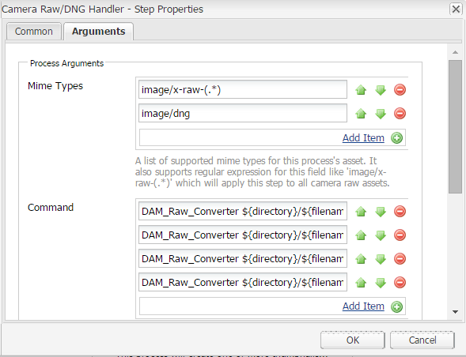
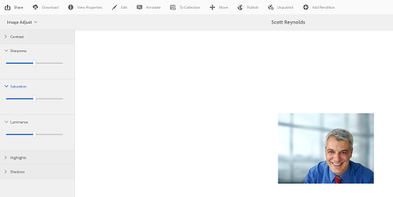

# Processar imagens usando [!DNL Adobe Camera Raw] {#camera-raw-support}

Você pode habilitar o suporte do [!DNL Adobe Camera Raw] para processar formatos de arquivo brutos, como CR2, NEF e RAF, e renderizar as imagens no formato JPEG. A funcionalidade tem suporte no [!DNL Adobe Experience Manager Assets] usando o [pacote Camera Raw](https://experience.adobe.com/#/downloads/content/software-distribution/en/aem.html?package=/content/software-distribution/en/details.html/content/dam/aem/public/adobe/packages/aem630/product/assets/aem-assets-cameraraw-pkg) disponível na Distribuição de Software.

>[!NOTE]
>
>A funcionalidade aceita somente representações do JPEG. Ele é compatível com Windows 64 bits, Mac OS e RHEL 7.x.

Para habilitar o suporte ao [!DNL Camera Raw] em [!DNL Experience Manager Assets], siga estas etapas:

1. Baixe o [[!DNL Camera Raw] pacote](https://experience.adobe.com/#/downloads/content/software-distribution/en/aem.html?package=/content/software-distribution/en/details.html/content/dam/aem/public/adobe/packages/cq650/product/assets/aem-assets-cameraraw-pkg-1.4.8.zip) de [!DNL Software Distribution].
1. Acessar `https://[aem_server]:[port]/workflow`. Abra o fluxo de trabalho **[!UICONTROL Ativo de atualização DAM]**.
1. Edite a etapa **[!UICONTROL Processar Miniaturas]**.
1. Forneça a seguinte configuração na guia **[!UICONTROL Miniaturas]**:

   * **[!UICONTROL Miniaturas]**: `140:100:false, 48:48:false, 319:319:false`
   * **[!UICONTROL Ignorar tipos MIME]**: `skip:image/dng, skip:image/x-raw-(.*)`

   

1. Na guia **[!UICONTROL Imagem Habilitada para Web]**, no campo **[!UICONTROL Ignorar Lista]**, especifique `audio/mpeg, video/(.*), image/dng, image/x-raw-(.*)`.

   

1. No painel lateral, adicione a etapa **[!UICONTROL Camera Raw/DNG Handler]** abaixo da etapa **[!UICONTROL Processar Miniaturas]**.
1. Na etapa **[!UICONTROL Camera Raw/DNG Handler]**, adicione a seguinte configuração na guia **[!UICONTROL Argumentos]**:

   * **[!UICONTROL Tipos MIME]**: `image/dng` e `image/x-raw-(.*)`
   * **[!UICONTROL Comando]**:

     * `DAM_Raw_Converter ${directory}/${filename} ${directory} cq5dam.web.1280.1280.jpeg 1280 1280`
     * `DAM_Raw_Converter ${directory}/${filename} ${directory} cq5dam.thumbnail.319.319.jpeg 319 319`
     * `DAM_Raw_Converter ${directory}/${filename} ${directory} cq5dam.thumbnail.140.100.jpeg 140 100`
     * `DAM_Raw_Converter ${directory}/${filename} ${directory} cq5dam.thumbnail.48.48.jpeg 48 48`

   

1. Clique em **[!UICONTROL Salvar]**.

>[!NOTE]
>
>Certifique-se de que a configuração acima seja a mesma que o **[!UICONTROL Amostra do ativo de atualização do DAM com a configuração Camera Raw e DNG Etapa de manuseio]**.

Agora você pode importar arquivos camera raw para o Assets. Depois de instalar o pacote do Camera Raw e configurar o fluxo de trabalho necessário, a opção **[!UICONTROL Ajuste da imagem]** aparece na lista de painéis laterais.

*Figura: Opções no painel lateral.*

*Figura: use a opção para fazer edições mais leves em suas imagens.*

Depois de salvar as edições em uma imagem [!DNL Camera Raw], uma nova representação `AdjustedPreview.jpg` é gerada para a imagem. Para outros tipos de imagem, exceto [!DNL Camera Raw], as alterações são refletidas em todas as representações.

## Práticas recomendadas, problemas conhecidos e limitações {#best-practices}

A funcionalidade tem as seguintes limitações:

* A funcionalidade aceita somente representações do JPEG. Ele é compatível com Windows 64 bits, Mac OS e RHEL 7.x.
* O write-back de metadados não é compatível com formatos RAW e DNG.
* A biblioteca [!DNL Camera Raw] tem limitações em torno do total de pixels que pode processar de cada vez. Atualmente, ele pode processar no máximo 65.000 pixels no lado longo de um arquivo ou 512 MP em qualquer critério encontrado primeiro.
