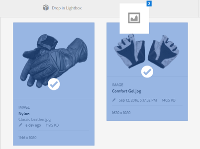

# Lightbox {#lightbox}

O Lightbox é um tipo especial de coleção que fornece acesso fácil aos ativos. Você pode acessar rapidamente o Lightbox para adicionar ou excluir ativos. Ele serve como sua galeria de imagens pessoal.

Se você for um usuário do [!DNL Adobe Experience Manager Assets], o Lightbox será criado automaticamente ao fazer logon no aplicativo pela primeira vez. É exclusivo para o seu login. Outros usuários não podem acessar o Lightbox.

## Adicionar ativos ao lightbox {#adding-assets-to-lightbox}

1. Na interface do usuário do [!DNL Assets], selecione os ativos que deseja adicionar ao Lightbox.
1. Arraste os ativos para a área **[!UICONTROL Soltar na Lightbox]**. Liberar quando a zona de destino se tornar ativa e seu rótulo for alterado para **[!UICONTROL Soltar para Adicionar]**.

   

1. Na caixa de diálogo, clique em **[!UICONTROL Adicionar]** e feche-a para concluir o processo. Os ativos selecionados são adicionados ao Lightbox.
1. Para exibir o Lightbox, acesse o console Coleções.
1. Clique em **[!UICONTROL Lightbox]** para exibir os ativos nela.

   >[!NOTE]
   >
   >Embora o Lightbox se pareça a uma coleção, não é possível executar todas as ações normalmente executadas nas coleções. Por exemplo, não é possível excluir, compartilhar ou exibir configurações de um Lightbox. Além disso, não é possível adicioná-lo a outras coleções. No entanto, você pode editar os ativos dentro de uma lightbox.

## Remover ativos da Lightbox {#removing-assets-from-lightbox}

1. Navegue até o console Coleções e clique em Lightbox para visualizar os ativos.
1. Selecione os ativos que deseja remover.
1. Na barra de ferramentas, clique em **[!UICONTROL Remover]**.
1. Na caixa de diálogo, clique em **[!UICONTROL Remover]** para confirmar a ação de exclusão. Os ativos são excluídos da Lightbox.
