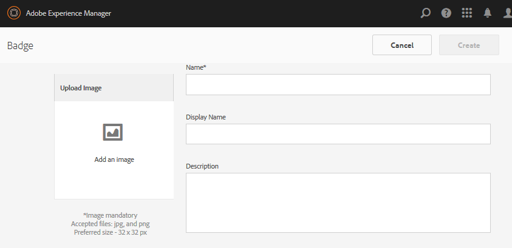

# Console de selos {#badges-console}

## Sobre selos {#about-badges}

O console Selos das comunidades permite adicionar selos personalizados que podem ser exibidos para um membro quando ganho (premiado) ou quando ele assume uma função específica na comunidade (atribuído).

### Visibilidade do selo {#badge-visibility}

Atualmente, as medalhas que um membro da comunidade ganha, ou é atribuído, aparecem junto com seu nome e avatar nos seguintes locais:

* Perfis
* [Fóruns](/help/communities/forum.md)
* [QnA](/help/communities/working-with-qna.md)
* [Placar de líderes](/help/communities/enabling-leaderboard.md)
* [Ideação](/help/communities/ideation-feature.md)

No ambiente de criação, navegue até o console Emblemas:

* Da navegação global: **[!UICONTROL Ferramentas]** > **[!UICONTROL Comunidades]** > **[!UICONTROL Medalhas]**

Esse console exibe os emblemas disponíveis no momento e a partir dos quais novos emblemas podem ser adicionados.

## Criar selo {#create-badge}

Um símbolo é criado ao fazer upload de uma imagem adequadamente pequena (72 dpi com uma altura variando de 26 a 32 pixels) e fornecer um nome. A imagem do selo é armazenada no repositório em `/libs/settings/community/badging/images` e é replicada automaticamente para o ambiente de publicação.

Se o ambiente de publicação for um farm de editores, será necessário configurar a [sincronização de usuário](/help/communities/sync.md).

* **Fazer upload de imagem**

  (*Obrigatório*) Uma imagem de selo com tamanho recomendado de 32 x 32 pixels a 72 dpi no formato JPEG ou PNG.

* **Nome**

  (*Obrigatório*) O nome do selo. É o `Display Name` padrão e o nome do nó do repositório. Se `Name` não for um nome de nó de repositório válido, ele será modificado.

* **Nome de exibição**

  (*Opcional*) O nome a ser exibido para o selo na interface do usuário. O padrão é o texto inalterado inserido para `Name`.

* **Descrição**

  (*Opcional*) Uma descrição para a medalha.

## Informações adicionais {#additional-information}

Para obter detalhes sobre a configuração das regras de pontuação e medalha, consulte [Pontuação e medalhas](/help/communities/implementing-scoring.md).

Para gerenciar selos para membros, consulte [Console de Membros](/help/communities/members.md).
