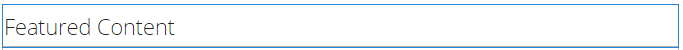
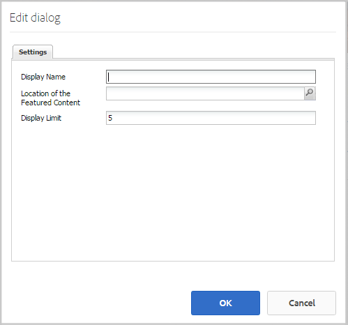
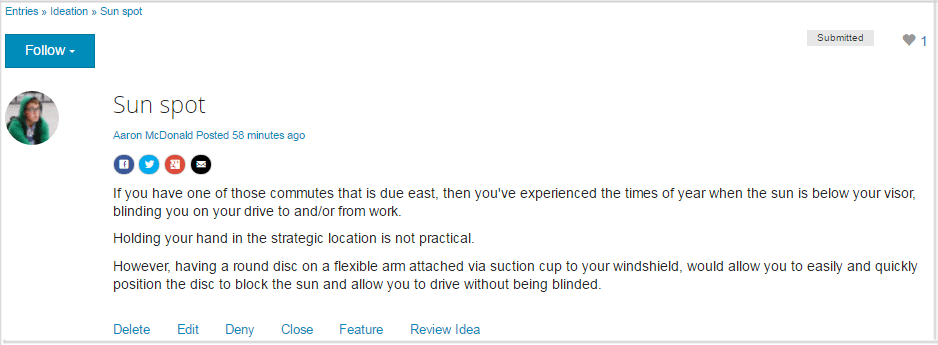
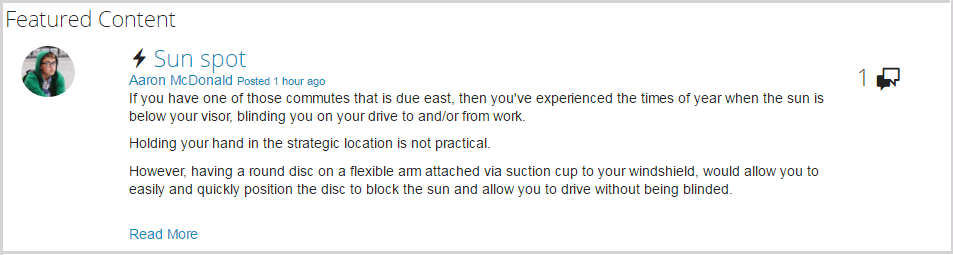

# Recurso de conteúdo em destaque {#featured-content-feature}

## Introdução {#introduction}

O recurso de conteúdo em destaque fornece uma área para visitantes do site conectados (membros da comunidade) no ambiente de publicação para destacar conteúdo para:

* [Blogs](blog-feature.md)
* [Calendários](calendar.md)
* [Fóruns](forum.md)
* [Ideias](ideation-feature.md)
* [QnA](working-with-qna.md)

Depois que o conteúdo é sinalizado como em destaque, ele é listado neste componente, que pode ser colocado em páginas de aterrissagem específicas ou áreas que chamam facilmente a atenção dos membros da comunidade.

A capacidade de apresentar conteúdo pode ser permitida ou não por componente.

Esta seção da documentação descreve:

* Adicionando conteúdo em destaque a um site da comunidade.
* Definições de configuração para o componente `Featured Content`.

## Adicionar conteúdo em destaque a uma página {#adding-featured-content-to-a-page}

Para adicionar um componente `Featured Content` a uma página no modo de autor, use o navegador de componentes para localizar

* `Communities / Featured Content`

E arraste-o para o local em uma página onde o conteúdo em destaque deve aparecer.

Para obter as informações necessárias, visite [Noções básicas sobre componentes das comunidades](basics.md).

Quando as [bibliotecas obrigatórias do lado do cliente](essentials-featured.md#essentials-for-client-side) são incluídas, é assim que o componente `Featured Content` aparece:

## Configuração de conteúdo em destaque {#configuring-featured-content}

Selecione o componente `Featured Content` inserido para que você possa acessar e selecionar o ícone `Configure` que abre a caixa de diálogo de edição.

### Guia Configurações {#settings-tab}

Na guia **[!UICONTROL Configurações]**, identifique o conteúdo a ser apresentado:

* **[!UICONTROL Nome de exibição]**

  O título da lista de conteúdo em destaque. Por exemplo, `Featured Questions` ou `Featured Ideas`. O padrão é `Featured Content` se deixado em branco.

* **[!UICONTROL Local do Conteúdo em Destaque]**

  *(Obrigatório)* Navegue até a página que contém o conteúdo que pode ser apresentado (os componentes dessa página devem ser configurados para Permitir Conteúdo em Destaque). Por exemplo, `/content/sites/engage/en/forum`.

* **[!UICONTROL Limite de exibição]**

  O número máximo de conteúdos em destaque a serem exibidos. O padrão é 5.

## Experiência de visitante do site {#site-visitor-experience}

A capacidade de sinalizar conteúdo como conteúdo em destaque requer privilégios de moderador.

Quando um moderador exibe o conteúdo postado, ele tem acesso aos sinalizadores de moderação no contexto, que incluem o novo sinalizador `Feature`.

Depois de sinalizado como recurso, o sinalizador de moderação torna-se `Unfeature`.

A página contendo o componente `Featured Content`, agora inclui esta publicação.

O `Read More` está vinculado à postagem real.

## Informações adicionais {#additional-information}

Mais informações podem ser encontradas na página [Conteúdo em destaque](essentials-featured.md) para desenvolvedores.

Para sinalizar conteúdo como em destaque, consulte [Moderação de conteúdo gerado pelo usuário](moderate-ugc.md).
