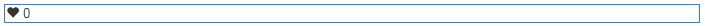

# Usar curtidas {#using-liking}

O componente `Liking` é uma ferramenta útil que permite aos usuários expressar uma opinião sobre um conteúdo específico, como um comentário dentro de um fórum. Com o componente `Liking`, os membros selecionam o ícone do coração para indicar uma opinião positiva.

## Adicionar curtidas a uma página {#adding-liking-to-a-page}

Para adicionar um componente `Liking` a uma página no modo de autor, use o navegador de componentes para localizar

* `Communities / Liking`

E arraste-o para o local na página, como uma posição relativa ao recurso que os usuários desejam.

Para obter as informações necessárias, visite [Noções básicas sobre componentes das comunidades](basics.md).

Quando as [bibliotecas obrigatórias do lado do cliente](essentials-liking.md#essentials-for-client-side) são incluídas, é assim que o componente `Liking` aparece.

## Configuração de curtidas {#configuring-liking}

Selecione o componente `Liking` inserido para que você possa acessar e selecionar o ícone `Configure` que abre a caixa de diálogo de edição.

Na guia **[!UICONTROL Textos e rótulos]**, especifique as propriedades usadas para gravar curtidas.

* **[!UICONTROL Rótulo de Resposta Positiva]**

  (*Obrigatório*) O nome da propriedade para uma resposta positiva.

* **[!UICONTROL Rótulo de resposta negativo]**

  (*Obrigatório*) O nome da propriedade para uma resposta negativa.

* **[!UICONTROL Nome da Tally]**

  (*Obrigatório*) O nome de propriedade interno e identificável para esta instância de um componente de votação.

## Experiência de visitante do site {#site-visitor-experience}

### Membros {#members}

Os membros podem alterar suas curtidas a qualquer momento.

### Anônimo {#anonymous}

Não há suporte para curtidas anônimas. Os visitantes do site devem se registrar (se tornar um membro) e fazer logon para participar da curtida.

## Informações adicionais {#additional-information}

Mais informações podem ser encontradas na página [Curtir o Essentials](essentials-liking.md) para desenvolvedores.
