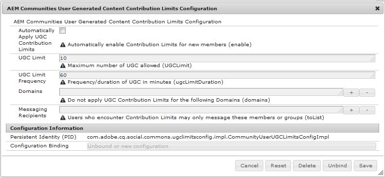

# Limites de contribuição do membro {#member-contribution-limits}

## Visão geral {#overview}

O recurso de limites de contribuição permite limitar as contribuições dos membros da comunidade como meio de proteção contra spam.

Quando um membro é limitado, qualquer postagem que exceda o número permitido de contribuições resulta em um alerta de que o limite foi excedido e a postagem é rejeitada. O membro da comunidade pode então ir para o centro de mensagens da comunidade e entrar em contato com um gerente da comunidade que pode remover os limites, se apropriado.

Os limites de contribuição podem ser habilitados individualmente no [console Membros](members.md) e/ou configurados para serem habilitados automaticamente quando os visitantes do site se tornarem novos membros.

Usando o console Membros, os limites de contribuição podem ser removidos de forma proativa para um membro por um gerente da comunidade a qualquer momento, ou removidos de forma reativa quando um membro envia uma mensagem a um gerente da comunidade que faz essa solicitação.

## Configuração de limites de contribuição de conteúdo gerado pelo usuário do AEM Communities {#aem-communities-user-generated-content-contribution-limits-configuration}

Esta configuração OSGi:

* Define as características dos limites de contribuição (número de postagens em um período de tempo).
* Identifica quem o membro pode enviar uma mensagem quando o limite é atingido.
* Identifica domínios que nunca precisam ser restritos.

Para acessar essa configuração OSGi:

* No editor principal:
* Faça logon com privilégios de administrador.
* Acesse o [Console da Web](../../help/sites-deploying/configuring-osgi.md).

  * Por exemplo, [http://localhost:4503/system/console/configMgr](http://localhost:4503/system/console/configMgr)

* Localizar `AEM Communities User Generated Content Contribution Limits Configuration`.
* Selecione o ícone de edição.

* **[!UICONTROL Aplicar automaticamente os limites de contribuição de UGC]**

  Se marcadas, definem automaticamente limites de contribuição para os usuários quando eles se registrarem como membros da comunidade. Isso é refletido no perfil do membro da comunidade e pode ser ativado/desativado no [console de membros](members.md). Novos membros com um endereço de email de um incluo na lista de permissões de domínios nunca são restritos.

  O padrão está desmarcado.

* **[!UICONTROL Limite de UGC]**

  Número máximo de contribuições.

  O padrão é dez postagens.

* **[!UICONTROL Frequência Limite de UGC]**

  O período que restringe o limite de UGC.

  O padrão é 60 minutos.

* **[!UICONTROL Domínios]**

  Uma lista incluída na lista de permissões de um ou mais domínios de e-mail. Selecione o ícone + para criar entradas adicionais.

  Os usuários com endereços de email no incluo na lista de permissões de domínios não são afetados quando os limites de contribuição UGC são aplicados automaticamente. Por exemplo, se o domínio `mycompany.com` for adicionado à lista de domínios, um membro com endereço de email `me@mycompany.com` nunca será impedido de postar.

  O padrão é um incluo na lista de permissões vazio.

* **[!UICONTROL Destinatários de Mensagens]**

  Lista de uma ou mais IDs autorizadas de membros que podem modificar os limites de contribuição para membros. Selecione o ícone + para criar entradas adicionais.

  Os membros só podem alcançar membros especificados quando o limite foi atingido.

  O padrão é nenhum destinatário de mensagem.

Observação: a configuração padrão resulta em um limite de dez publicações dentro de um período de uma hora.
