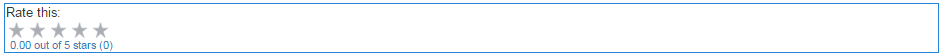

# Uso de classificações {#using-ratings}

O componente `Rating` é usado de forma independente ou com outros recursos das Comunidades. Este componente permite que membros da comunidade conectados expressem suas opiniões por meio de conteúdo de classificação.

## Adicionar uma classificação a uma página {#adding-a-rating-to-a-page}

Para adicionar um componente `Rating` a uma página no modo de autor, localize o componente `Communities / Rating` e arraste-o para o local em uma página, como uma posição relativa ao recurso para que os membros avaliem.

Para obter as informações necessárias, visite [Noções básicas sobre componentes das comunidades](basics.md).

Quando as [bibliotecas obrigatórias do lado do cliente](rating-basics.md#essentials-for-client-side) são incluídas, é assim que o componente `Rating` aparece.

## Configuração da classificação {#configuring-rating}

Selecione o componente `Rating` inserido para que você possa acessar e selecionar o ícone `Configure` que abre a caixa de diálogo de edição.

Na guia **[!UICONTROL Textos e rótulos]**, especifique o identificador interno da classificação.

**[!UICONTROL Nome Tally]**
(*Obrigatório*) Um nome simples para `Rating` que identifica exclusivamente esta instância. Deve ser um nome de nó válido para o repositório.

## Experiência de visitante do site {#site-visitor-experience}

### Membros {#members}

Só é permitida uma classificação por membro. O membro pode alterar a sua classificação a qualquer momento.

### Anônimo {#anonymous}

Não há suporte para postagem anônima de uma classificação. Os visitantes do site devem se registrar (tornar-se membros) e fazer logon para participar.

## Informações adicionais {#additional-information}

Mais informações podem ser encontradas na página [Rating Essentials](rating-basics.md) para desenvolvedores.
