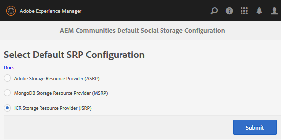

# Configuração de armazenamento {#storage-configuration}

A configuração de armazenamento é o meio de identificar o armazenamento escolhido para o conteúdo da comunidade, também conhecido como conteúdo gerado pelo usuário (UGC).

Essa configuração informa o código AEM Communities sobre qual implementação do SRP (provedor de recursos de armazenamento) é usada ao acessar o UGC. Deve refletir a topologia estabelecida quando o Adobe Experience Manager (AEM) foi implantado.

Para uma discussão sobre opções de armazenamento e topologias de implantação, visite:

* [Armazenamento de conteúdo da comunidade](working-with-srp.md)
* [Topologias recomendadas](topologies.md)

## Console de configuração de armazenamento {#storage-configuration-console}

No ambiente do Author, para acessar o console de configuração de armazenamento.

* Na navegação global, selecione **[!UICONTROL Ferramentas]** > **[!UICONTROL Comunidades]** > **[!UICONTROL Configuração de Armazenamento]**

Para selecionar uma opção de armazenamento diferente do JCR padrão:

* Selecione uma opção
* Configurar adequadamente

  * Veja detalhes para [selecionar MSRP](msrp.md#select-msrp)
  * Veja detalhes para [selecionar DSRP](dsrp.md#select-dsrp)
  * Veja detalhes para [selecionar ASRP](asrp.md#select-asrp)

* Selecione **[!UICONTROL Enviar]**.

### Sobre o armazenamento JCR {#about-jcr-storage}

Se nenhuma seleção for feita, o padrão será o repositório do AEM, JCR.

O JCR *não* é um armazenamento comum compartilhado pelos ambientes Autor e Publicação. O conteúdo da comunidade é visível somente no ambiente de Autor ou Publicação em que foi criado.

Visite a [Loja JCR](jsrp.md) para obter mais informações.

>[!NOTE]
>
>A ausência do nó `srpc` em `/etc/socialconfig` indica o [armazenamento JCR](jsrp.md) padrão.
