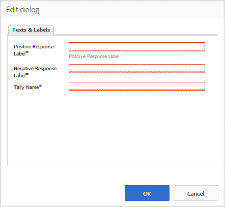

# Usando a votação {#using-voting}

O componente `Voting` é uma ferramenta útil que permite aos membros da comunidade classificar um conteúdo específico, como uma resposta dentro de um componente QnA. Com o componente `Voting`, os membros selecionam setas para cima ou para baixo para indicar sua opinião.

## Adicionando votação a uma página {#adding-voting-to-a-page}

Para adicionar um componente `Voting` a uma página no modo Autor, use o navegador de componentes. Localize `Communities / Voting` e arraste-o para o local em uma página, como uma posição relativa ao recurso para que os usuários possam votar.

Para obter as informações necessárias, visite [Noções básicas sobre componentes das comunidades](basics.md).

Quando as [bibliotecas obrigatórias do lado do cliente](essentials-voting.md#essentials-for-client-side) são incluídas, é assim que o componente `Voting` aparece.

## Configurando a votação {#configuring-voting}

Selecione o componente `Voting` inserido para que você possa acessar e selecionar o ícone `Configure` que abre a caixa de diálogo de edição.

Na guia **[!UICONTROL Textos e rótulos]**, especifique as propriedades usadas para registrar votos.

* **[!UICONTROL Rótulo de Resposta Positiva]**

  (*Obrigatório*) O nome da propriedade interna para uma resposta positiva.

* **[!UICONTROL Rótulo de resposta negativo]**

  (*Obrigatório*) O nome da propriedade interna para uma resposta negativa.

* **[!UICONTROL Nome da Tally]**

  (*Obrigatório*) O nome de propriedade interno e identificável para esta instância de um componente de votação.

## Experiência de visitante do site {#site-visitor-experience}

### Membros {#members}

Os deputados só podem votar uma vez, mas podem alterar o seu voto a qualquer momento.

### Anônimo {#anonymous}

O voto anônimo não é suportado. Os visitantes do site devem se registrar (se tornar um membro) e fazer logon para participar da votação uma vez.

## Informações adicionais {#additional-information}

Mais informações podem ser encontradas na página do [Voting Essentials](essentials-voting.md) para desenvolvedores.
