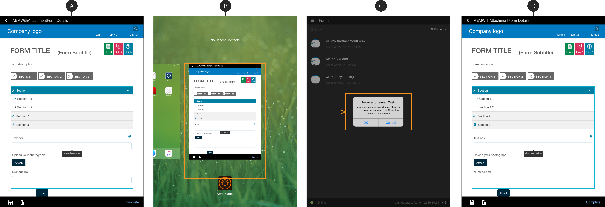

# Uso do salvamento automático no aplicativo AEM Forms{#using-autosave-in-aem-forms-app}

>[!NOTE]
>
>O aplicativo AEM Forms está obsoleto no momento. Para perguntas ou ajuda, contate [aemformsapp-android@adobe.com](mailto:aemformsapp-android@adobe.com).

Quando um usuário insere dados no aplicativo Adobe Experience Manager Forms, o recurso de salvamento automático os salva em intervalos regulares. O recurso de salvamento automático no aplicativo AEM Forms ajuda a evitar a perda de dados se o aplicativo for fechado acidentalmente.

Seu aplicativo pode fechar acidentalmente:

* Se o dispositivo for desligado devido à bateria fraca
* Se o usuário matar o aplicativo
* Se ocorrer uma falha inesperada

Você pode especificar os intervalos após os quais o aplicativo salva os dados inseridos.

>[!NOTE]
>
>Selecione a frequência de salvamento automático criteriosamente. Operações frequentes de salvamento automático podem ter um impacto notável no desempenho do dispositivo.

Execute as seguintes etapas para usar o recurso de salvamento automático no aplicativo AEM Forms:

1. Faça logon no aplicativo e navegue até **Configurações > Geral**.
1. Na tela Geral, use a opção **Frequência de salvamento automático** para selecionar os intervalos em que deseja que o aplicativo salve os dados inseridos.
   

1. Ao reiniciar o aplicativo e fazer logon com o mesmo usuário, você será solicitado a restaurar a tarefa com a caixa de diálogo Recuperar tarefa não salva. Clique em **OK** na caixa de diálogo Recuperar tarefa não salva para continuar a trabalhar com a tarefa salva. Você pode clicar em **Cancelar** para excluir os dados salvos correspondentes ao último salvamento automático acionado e começar a trabalhar com uma nova tarefa.

   Ao clicar em **OK**, a tarefa é restaurada com os dados correspondentes ao salvamento automático mais recente acionados antes da falha do aplicativo. Inclui os dados de formulário e todos os anexos associados à tarefa.
   **A.** Um formulário de trabalho em andamento **B.** O aplicativo foi fechado à força **C.** O aplicativo foi reiniciado com a caixa de diálogo Recuperar Tarefa Não Salva **D.** Formulário restaurado com dados originais
