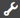
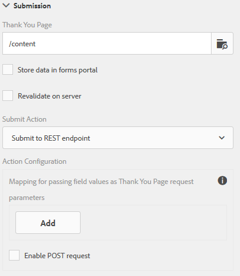

# Configuração da página de redirecionamento{#configuring-redirect-page}

A Adobe  recomenda usar os [Componentes principais](https://experienceleague.adobe.com/docs/experience-manager-core-components/using/adaptive-forms/introduction.html?lang=pt-BR) de captura de dados moderna e extensível para [criar um novo Forms Adaptável](/help/forms/using/create-an-adaptive-form-core-components.md) ou [adicionar o Forms Adaptável às páginas do AEM Sites](/help/forms/using/create-or-add-an-adaptive-form-to-aem-sites-page.md). Esses componentes representam um avanço significativo na criação do Forms adaptável, garantindo experiências de usuário impressionantes. Este artigo descreve a abordagem mais antiga para criar o Forms adaptável usando componentes de base. 

| Versão | Link do artigo |
| -------- | ---------------------------- |
| AEM as a Cloud Service | [Clique aqui](https://experienceleague.adobe.com/docs/experience-manager-cloud-service/content/forms/adaptive-forms-authoring/authoring-adaptive-forms-foundation-components/configure-submit-actions-and-metadata-submission/configuring-redirect-page.html) |
| AEM 6.5 | Este artigo |

Os autores de formulários podem configurar uma página para cada formulário, para a qual os usuários são redirecionados após enviarem um formulário.

1. No modo de edição, selecione um componente e clique em  > **Contêiner de formulário adaptável** e clique em .

1. Na barra lateral, clique em **Envio**.

1. Forneça o URL da página de redirecionamento em Página de agradecimento na seção Envio.
1. Como opção, em Enviar ação, para a ação de endpoint Enviar para REST, é possível configurar o parâmetro a ser transmitido para a página de redirecionamento.

Redirecionar configuração de página

Os autores de formulário podem usar os seguintes parâmetros que são passados para a página Thank you. Para todas as ações de envio disponíveis, `status` e `owner` parâmetros são passados. Além desses dois parâmetros, alguns parâmetros adicionais são transmitidos para as seguintes ações de envio:

* **Ação de conteúdo de repositório** (obsoleto): `contentPath`—o caminho do nó no repositório onde os dados enviados estão armazenados—é passado.

* **Ação de armazenamento do PDF** (desaprovada): `contentPath`—dos dados enviados e do caminho para o nó que armazena o arquivo PDF no repositório—é transmitido.

* **Enviar para fluxo de trabalho do Forms**: os parâmetros de saída retornados do fluxo de trabalho de formulários são passados.

* **Enviar para ponto de extremidade REST**: os parâmetros adicionados para o campo ao mapeamento de parâmetros são passados. Os parâmetros `status` e `owner` não são passados nesta ação de envio. Para obter mais informações, consulte [Configurando a ação de envio Enviar para ponto de extremidade REST](../../forms/using/configuring-submit-actions.md).
