# Criar correspondência{#create-correspondence}

## Criar correspondência na interface do usuário Criar correspondência {#create-correspondence-in-the-create-correspondence-user-interface}

Depois que um [modelo de correspondência for criado no Gerenciamento de Correspondências](../../forms/using/create-letter.md), o usuário final/agente/ajustador de reclamação poderá abrir a correspondência na interface do usuário Criar Correspondência e criá-la inserindo dados, configurando conteúdo e gerenciando anexos. Por fim, o ajustador de reclamações ou o agente pode gerenciar o conteúdo no modo de visualização e enviar a carta.

### Visualizar uma correspondência {#preview-a-correspondence}

Selecione a correspondência a ser visualizada usando as seguintes etapas:

1. Na página Cartas, selecione **Selecionar**.
1. Selecione a letra apropriada tocando nela.

   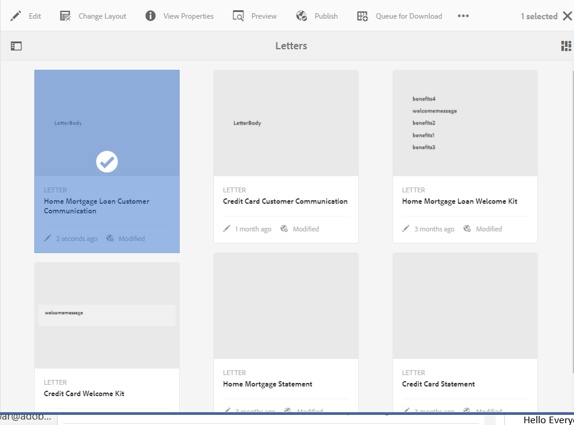

   Selecionar carta

1. Para uma carta baseada no Dicionário de Dados, selecione **Visualizar** > **Visualizar**. Ou, para uma carta que não seja baseada em dicionário de dados, selecione **Visualizar**. Você também pode passar o mouse sobre uma correspondência (sem selecioná-la) e selecionar o ícone Visualização de correspondência para visualizá-la.

   >[!NOTE]
   >
   >Se um dicionário de dados não estiver associado à correspondência, a pré-visualização da correspondência será aberta. Caso contrário, se a correspondência for baseada no dicionário de dados, o Gerenciamento de correspondências exibirá as opções Visualizar e Personalizar no menu Visualizar e você poderá selecionar uma das duas opções. Você também pode associar dados de teste a um dicionário de dados. Quando o [Dicionário de Dados tem dados de teste associados](../../forms/using/data-dictionary.md#p-working-with-test-data-p), ao selecionar a opção de visualização, a visualização normal é aberta com os dados de teste preenchidos.

1. Para poder renderizar uma correspondência ao pré-visualizá-la, você deve ser um administrador ou parte de um dos seguintes grupos:

   * forms-users (para visualizar na instância do autor)
   * cm-agent-users (para representação na instância de publicação)

   Se você não tiver as permissões necessárias, solicite o acesso apropriado ao administrador. Para obter mais informações sobre como criar e adicionar usuários a grupos, consulte [Adicionando Usuários ou Grupos a um Grupo](/help/sites-administering/security.md). Se você tentar renderizar uma correspondência sem ter as permissões apropriadas, a página de erro 404 é exibida.

1. Se você selecionou **Visualizar** > **Personalizar**, uma caixa de diálogo será aberta. Na caixa de diálogo, selecione um arquivo de dados, correspondente ao dicionário de dados, para visualizar a correspondência com e, em seguida, selecione **Visualizar**. Um arquivo de dados é criado com base em um dicionário de dados de uma correspondência específica. Para obter mais informações sobre o arquivo de dados, consulte [Dicionário de Dados](../../forms/using/data-dictionary.md#p-working-with-test-data-p).

   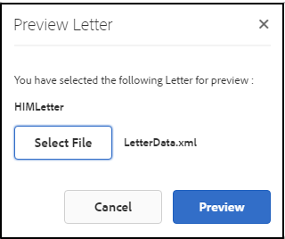

1. A visualização da correspondência HTML (visualização de formulários para dispositivos móveis) é aberta com a guia Dados em foco por padrão.

   Para obter mais informações sobre formulários móveis e os recursos aos quais eles dão suporte, consulte [Diferenciação de recursos entre o Mobile Forms e o PDF forms](https://helpx.adobe.com/livecycle/help/mobile-forms/feature-differentiation-mobile-forms-pdf.html).

   Há três guias: dados, conteúdo e anexos. Se não houver elementos de dados (variáveis de espaço reservado e campos de layout), a correspondência será aberta diretamente no com a guia Conteúdo exibida. A guia Anexos está disponível somente quando há anexos ou quando o acesso à biblioteca está ativado.

   >[!NOTE]
   >
   >Para obter mais informações sobre como alternar entre o modo de representação de pré-visualização de correspondência do HTML ou do PDF, consulte [Alterar modo de representação de carta](#changerenditionmode). Para obter mais informações sobre o suporte do PDF no Gerenciamento de Correspondência e no AEM, consulte [Descontinuação de plug-ins de navegadores NPAPI e seu impacto](https://helpx.adobe.com/br/acrobat/kb/change-in-support-for-acrobat-and-reader-plug-ins-in-modern-web-.html). <!-- and [PDF Forms to HTML5 Forms](https://helpx.adobe.com/aem-forms/kb/pdf-forms-to-html5-forms.html). THIS URL IS A 404 AND NO SUITABLE REPLACEMENT TOPIC WAS FOUND. CONSIDER DELETING OR ADDING NEW LINK. COMMENTING OUT SO USERS DON'T CLICK IT. -->

### Inserir dados {#enterdata}

Na guia Dados, preencha os campos de layout e espaços reservados disponíveis.

1. Insira os dados e as variáveis de conteúdo nos campos, conforme necessário. Preencha todos os campos obrigatórios marcados com um asterisco (&#42;) para habilitar o botão **Enviar**.

   Selecione um valor de campo de dados na pré-visualização de correspondências do HTML para realçar o campo de dados correspondente na guia Data.

   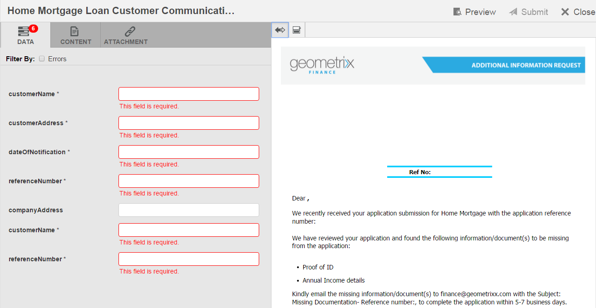 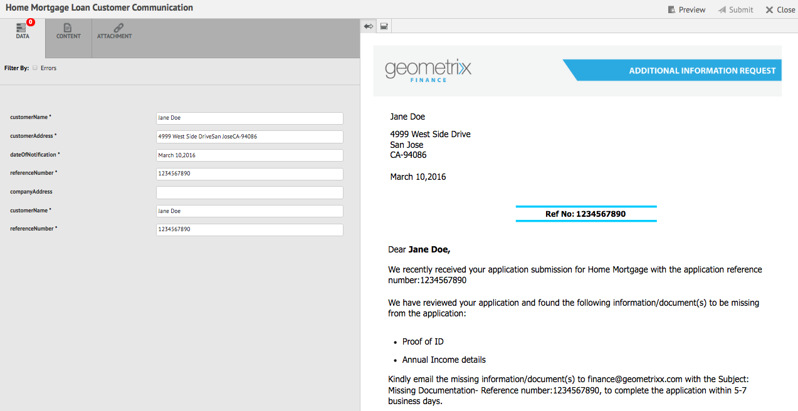

### Gerenciar conteúdo {#managecontent}

Na guia content, gerencie o conteúdo, como fragmentos de documentos e variáveis de conteúdo na correspondência.

1. Selecione **Conteúdo**. O Gerenciamento de correspondências exibe a guia Conteúdo da correspondência.

   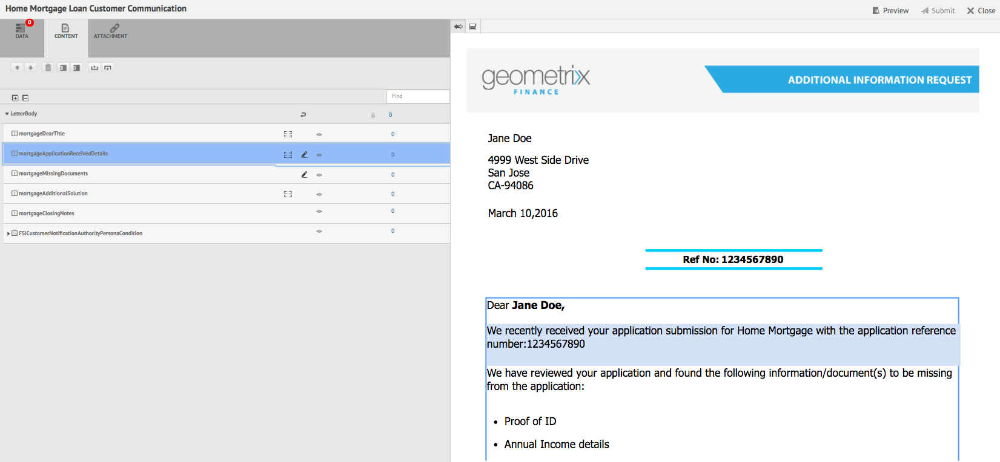

1. Edite os módulos de conteúdo, conforme necessário, na guia Content. Para focalizar o módulo de conteúdo relevante na hierarquia de conteúdo, você pode selecionar a linha ou o parágrafo relevante na pré-visualização de correspondências ou selecionar o módulo de conteúdo diretamente na hierarquia de conteúdo.

   Por exemplo, a linha &quot;Analisamos... &quot; é selecionada no gráfico abaixo e o módulo de conteúdo relevante é selecionado na guia Conteúdo.

   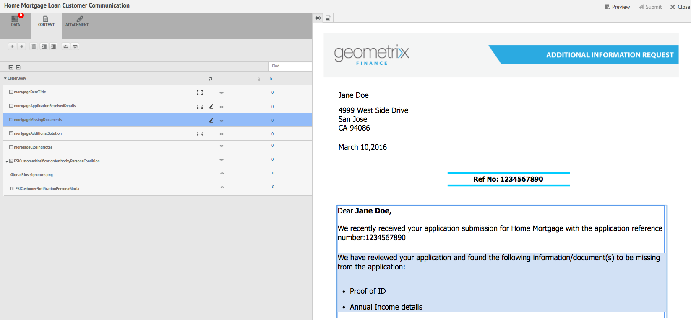

   Na guia Conteúdo ou Dados, ao tocar em Realçar Módulos Selecionados ( 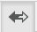) no canto superior esquerdo da visualização de correspondência do HTML, você pode desabilitar ou habilitar a funcionalidade para ir para o módulo de conteúdo/dados quando o texto, parágrafo ou campo de dados relevante for selecionado na visualização de correspondência.

   Para obter mais informações sobre as ações disponíveis para vários módulos na interface do usuário Criar correspondência, consulte [Ações e informações disponíveis na interface do usuário Criar correspondência](#actions-and-info-available-in-the-create-correspondence-content-tab).

1. Para localizar módulos de conteúdo, use o campo Localizar. Insira o nome completo ou parcial ou o título do módulo de conteúdo para pesquisá-lo na correspondência.
1. Selecione o ícone Exibir ( 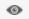) na frente de uma lista, texto, condição ou área de destino para exibi-lo ou ocultá-lo na correspondência.
1. Para editar um módulo de texto incorporado ou editável, selecione o ícone relevante **Editar** ( ) ou clique duas vezes no módulo de texto relevante na visualização de correspondência.

   O sistema exibe um editor de texto para editar e formatar o texto.

   O verificador ortográfico padrão do navegador verifica a ortografia no editor de texto. Para gerenciar a verificação ortográfica e gramatical, você pode editar as configurações do verificador ortográfico do navegador ou instalar plug-ins/complementos do navegador para verificar a ortografia e a gramática.

   Você também pode usar os vários atalhos de teclado no editor de texto para gerenciar, editar e formatar texto. Para obter mais informações sobre [Atalhos de teclado do Editor de Texto](/help/forms/using/keyboard-shortcuts.md#correspondence-management) em Atalhos de Teclado do Gerenciamento de Correspondências.

   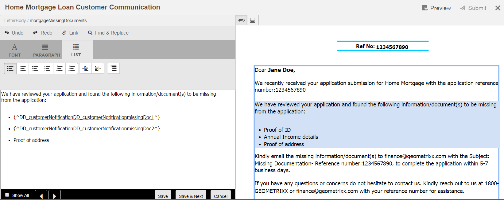

   Talvez você queira reutilizar um ou mais parágrafos de texto que existem em outro aplicativo do documento. Você pode copiar e colar texto diretamente, como de páginas do MS Word, HTML ou qualquer outro aplicativo.

   Você pode copiar e colar um ou mais parágrafos de texto em um módulo de texto editável. Por exemplo, você pode ter um documento do MS Word com uma lista com marcadores de provas de residência aceitáveis, como as seguintes:

   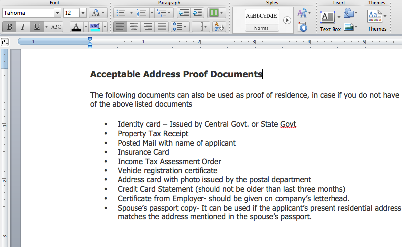

   Você pode copiar e colar diretamente o texto do documento do MS Word em um módulo de texto editável. A formatação, como lista com marcadores, fonte e cor do texto, é mantida no módulo de texto.

   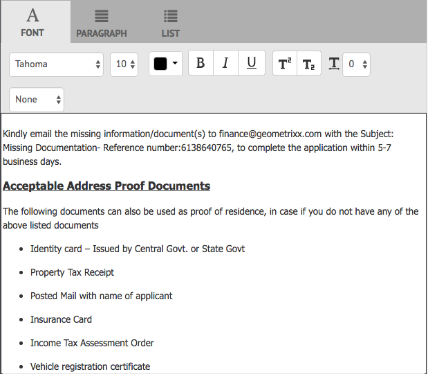

   >[!NOTE]
   >
   >No entanto, a formatação do texto colado tem algumas [limitações](https://helpx.adobe.com/aem-forms/kb/cm-copy-paste-text-limitations.html).

   Você pode recuar o texto e os números na sua carta usando a tecla Tab. Por exemplo, você pode usar a tecla Tab para alinhar várias colunas de texto em uma lista em um formato tabular.

   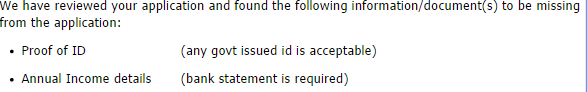

   Exemplo: uso da tecla Tab para alinhar várias colunas de texto em um formato tabular

   >[!NOTE]
   >
   >Para obter mais informações sobre como configurar o espaçamento entre guias para seus módulos de texto e letras, consulte [Mais informações sobre como usar o espaçamento entre guias para organizar o texto](https://helpx.adobe.com/aem-forms/kb/cm-tab-spacing-limitations.html).

1. Se necessário, insira caracteres especiais na correspondência. Por exemplo, você pode usar a paleta Caracteres especiais para inserir:

   * Símbolos de moeda, como €,¥ e £
   * Símbolos matemáticos como ∑, √, ‖ e ^
   * Símbolos de pontuação, como ‟ e &quot;

   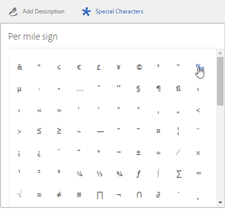

   O Gerenciamento de correspondências incorporou suporte para 210 caracteres especiais. O administrador pode [adicionar suporte para mais caracteres especiais/personalizados através da personalização](../../forms/using/custom-special-characters.md).

1. Para destacar\enfatizar partes do texto em um módulo incorporado editável, selecione o texto e selecione Realçar cor.

   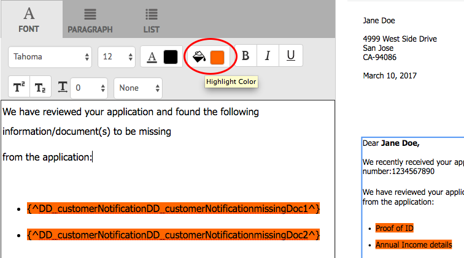

   Você pode selecionar diretamente uma cor básica `**[A]**` presente na paleta de Cores Básicas ou selecionar **Selecionar** depois de usar o controle deslizante `**[B]**` para escolher a sombra apropriada da cor.

   Como opção, você também pode ir para a guia Avançado para selecionar o Matiz, a Luminosidade e a Saturação `**[C]**` apropriados para criar a cor precisa e selecionar Selecionar `**[D]**` para aplicar a cor e destacar o texto.

   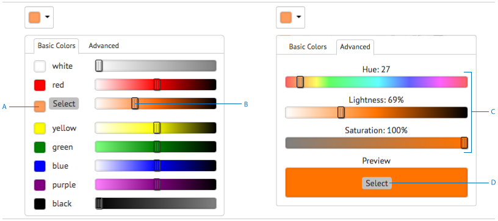

1. Faça as alterações apropriadas no conteúdo e formato e selecione **Salvar**. Selecione ( ) para mover-se entre módulos de texto editáveis ou selecione **Salvar e Avançar** para salvar as alterações e ir para o próximo módulo de texto editável.
1. O sistema também exibe as variáveis não preenchidas para cada ramificação. Quando não há variáveis não preenchidas, as variáveis não preenchidas são mostradas como 0. Se houver uma variável não preenchida, é possível selecionar uma ramificação para expandi-la e localizar a variável não preenchida. Use a barra de ferramentas Conteúdo para Excluir o conteúdo, aumentar/diminuir o recuo do conteúdo e inserir quebras de página antes/depois do conteúdo.

   Você pode inserir quebras de página acima e abaixo dos módulos de dados mesmo quando eles fazem parte de listas e condições.

1. Selecione Abrir/Fechar Variável de Conteúdo ( 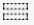) para abrir as variáveis de conteúdo e preenchê-las adequadamente.
1. Depois de preencher corretamente a variável não preenchida, a contagem da variável não preenchida é definida como 0.

   Na interface do usuário Criar correspondência, a contagem de variáveis não preenchidas é exibida em cada nível da hierarquia de qualquer módulo que contenha pelo menos uma variável. Se um módulo contiver variáveis não preenchidas, a contagem será exibida no nível da variável, módulo, área de destino e modelo de correspondência.

   A contagem variável não preenchida inclui:

   * Somente dicionário de dados desprotegido e variáveis de espaço reservado. A contagem de variáveis não inclui variáveis de layout ou de dicionário de dados protegido.
   * Campos obrigatórios.
   * Campos de layout se forem obrigatórios e vinculados ao usuário.
   * Somente instâncias de variáveis exclusivas. Se um módulo, área de destino ou modelo de correspondência contiver duas ou mais instâncias da mesma variável, a contagem será exibida como 1 (uma). No entanto, para cada uma das instâncias, a contagem é exibida como 1.

   A contagem de variáveis não preenchidas não inclui módulos desmarcados. Se um módulo for incluído em um modelo de correspondência, mas não estiver na correspondência, a contagem de variáveis não preenchidas nesse módulo não será exibida.

   Para a área de destino, o módulo e a variável, a contagem é exibida à direita de cada objeto no modelo de correspondência. No entanto, para o modelo completo, a contagem é exibida na barra de status Criar correspondência.

   Os módulos em um modelo de correspondência exibem a contagem de variáveis não preenchidas, conforme descrito abaixo:

   * **Texto** Exibe a soma das variáveis de espaço reservado não preenchidas exclusivas e dos elementos do dicionário de dados contidos no módulo de texto.
   * **Condição** Exibe a soma das variáveis de condição não preenchidas exclusivas contidas na condição e as variáveis contidas nos módulos resultantes.
   * **Lista** Exibe a soma de todas as variáveis não preenchidas contidas nos módulos atribuídos à lista.
   * **Área de destino** Exibe a soma de todas as variáveis não preenchidas contidas nos módulos atribuídos à área de destino.

   Observe o seguinte em relação às variáveis com valores padrão:

   * O padrão de um campo de variável booleana é *false*. No entanto, a variável é considerada não preenchida. Isso implica que a contagem de variáveis inclui todos os campos de variáveis booleanas com o valor *false*.

   * O padrão de um campo de variável numérica é *0 (zero)*. No entanto, a variável é considerada não preenchida. Isso implica que a contagem de variáveis inclui todos os campos de variáveis numéricas com valor *0 (zero)*.

#### Ações e informações disponíveis na guia Criar conteúdo de correspondência {#actions-and-info-available-in-the-create-correspondence-content-tab}

**Área de destino**

* Inserir linha em branco: insere uma nova linha em branco.
* Inserir texto incorporado: insere um novo módulo de texto.
* Order Lock (info): indica que a ordem do conteúdo não pode ser alterada.
* Valores não preenchidos (informações): indica o número de variáveis não preenchidas na área de destino.

**Módulo**

* Seleção (ícone de olho): Inclui\exclui o módulo da carta.
* Ignorar marcadores (aplicável a módulos de lista e seus módulos filhos): ignora marcadores em um módulo específico.
* Quebra de página antes (aplicável a módulos secundários da área de destino): insere a quebra de página antes do módulo.
* Quebra de página depois de (aplicável a módulos secundários da área de destino): insere a quebra de página antes do módulo.
* Valores não preenchidos (informações): indica o número de variáveis não preenchidas na área de destino.
* Editar (somente módulos de texto): abrir o editor de rich text para editar o módulo de texto.
* Painel de dados (módulos de texto e condição): abra todas as variáveis do módulo.

**Listar Módulo**

* Inserir linha em branco: insere uma nova linha em branco.
* Biblioteca de conteúdo: abre a biblioteca de conteúdo para adicionar módulos à lista.
* Configuração de lista (somente lista aninhada):
* Order Lock (info): indica que a ordem dos itens da lista não pode ser alterada.

### Gerenciar anexos {#manage-attachments}

1. Selecione **Anexos**. O Gerenciamento de correspondências exibe os anexos disponíveis, conforme configurado durante a criação do modelo de correspondência.
1. Você pode optar por não enviar um anexo junto com a carta tocando no ícone de exibição e pode selecionar a cruz no anexo para excluí-lo da carta. Para os anexos especificados, ao criar um modelo de correspondência, como Obrigatório, os ícones Exibir e Excluir ficam desativados.
1. Selecione o ícone de Acesso à biblioteca ( 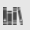) para acessar a Biblioteca de conteúdo e inserir ativos DAM como anexos.

   >[!NOTE]
   >
   >O ícone de Acesso à biblioteca está disponível somente quando o acesso à biblioteca foi ativado durante a criação da carta.

1. Se a ordem dos anexos não tiver sido bloqueada durante a criação da correspondência, você poderá reordenar os anexos selecionando um anexo e tocando nas setas para baixo e para cima.

   Para obter mais informações, consulte [Entrega de anexo](#attachmentdelivery).

### Gerenciar conteúdo na pré-visualização e enviar a carta {#manage-content-in-preview-and-submit-the-letter}

Você pode fazer alterações no layout e no conteúdo para garantir que a correspondência tenha a aparência desejada e enviá-la para os vários processos de publicação.

1. Para destacar todo o conteúdo editável na correspondência, selecione **Destacar seções editáveis**.

   O conteúdo editável da carta é realçado com o plano de fundo cinza.

   

1. Edite os módulos de conteúdo, conforme necessário, na guia Content. Para focalizar o módulo de conteúdo relevante na hierarquia de conteúdo, você pode selecionar a linha ou o parágrafo relevante na pré-visualização de correspondências ou selecionar o módulo de conteúdo diretamente na hierarquia de conteúdo.

   Por exemplo, a linha &quot;Para permitir que acessemos...&quot; for selecionada no gráfico abaixo e o módulo de conteúdo correspondente for selecionado na guia Content.

   Ao tocar em Realçar módulos selecionados no conteúdo ( ), você pode desabilitar ou habilitar a funcionalidade para realçar o módulo de conteúdo na guia Conteúdo quando o texto, parágrafo ou campo de dados relevante for tocado na pré-visualização de correspondência.

   Para obter mais informações sobre as ações disponíveis para vários módulos na interface do usuário Criar correspondência, consulte [Ações e informações disponíveis na interface do usuário Criar correspondência](#actions-and-info-available-in-the-create-correspondence-content-tab).

1. Para adicionar uma quebra de página à correspondência, selecione onde deseja inserir uma quebra de página e selecione Quebra de Página Antes ou Quebra de Página Depois ( 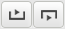).

   Um espaço reservado para quebra de página explícita é inserido na correspondência. Para ver como uma quebra de página explícita afeta a correspondência, consulte a visualização nivelada do PDF.

   >[!NOTE]
   >
   >Como os formulários móveis não são compatíveis com quebras de página, os cabeçalhos e rodapés são exibidos apenas uma vez. No entanto, é possível definir explicitamente cabeçalhos e rodapés no layout (por página) para serem exibidos na pré-visualização de formulários para dispositivos móveis. Além disso, as páginas em branco na carta, se houver, não aparecem na pré-visualização de formulários para dispositivos móveis.

   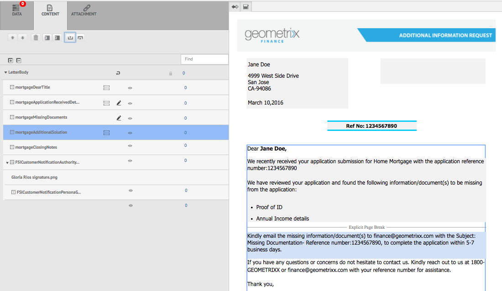

1. Para salvar a carta como rascunho, na qual você poderá continuar trabalhando posteriormente, selecione Salvar como rascunho. Para usar esta opção, sua carta precisa ser [publicada](../../forms/using/publishing-unpublishing-forms.md#publishanasset). Para obter mais informações, consulte Instância de rascunho em [Salvar rascunhos e enviar instâncias de cartas](#savingdrafts).

   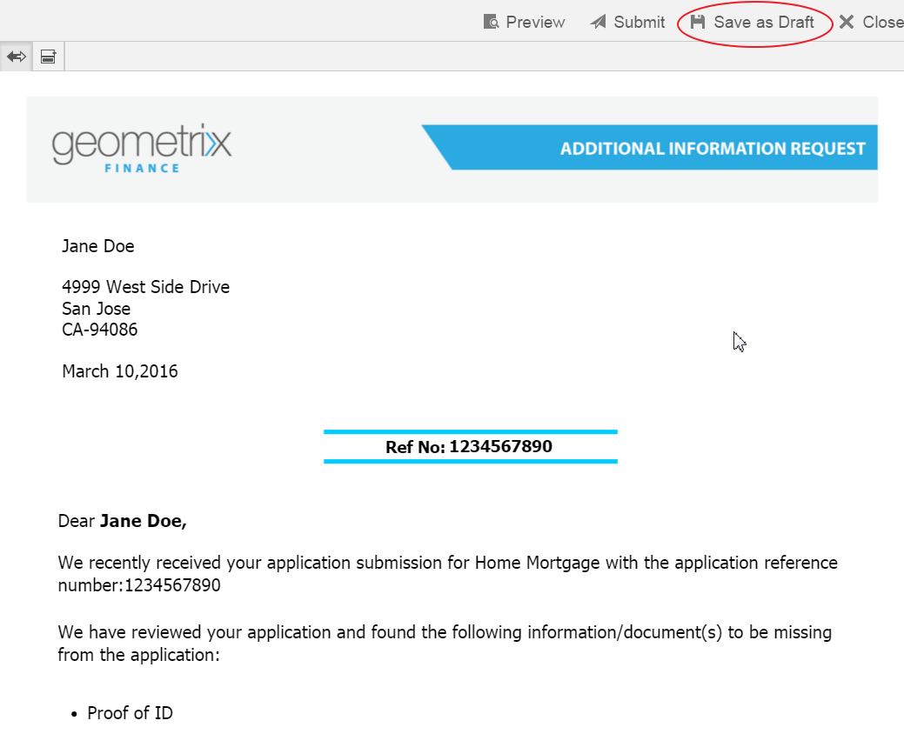

   A caixa de diálogo Nome da carta de rascunho é exibida com a ID da instância da carta. Você pode, opcionalmente, editar essa ID. Anote a ID da carta e selecione **Concluído**. Posteriormente, você poderá usar essa ID para [recarregar a carta de rascunho](submit-letter-topostprocess.md#reloaddraft).

1. Para visualizar a carta como um PDF nivelado com o layout exato e as quebras de página como ela será enviada, selecione ( 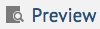) Visualizar.

   A carta aparece como um PDF nivelado. O PDF achatado é a representação exata da letra, pois ela será enviada com as fontes, quebras e layout corretos da letra.

   >[!NOTE]
   >
   >Se você estiver usando o Mozilla Firefox e o tipo de representação HTML, para visualizar a letra como um PDF nivelado, certifique-se de usar o plug-in do navegador nativo e não o plug-in do Acrobat. Para selecionar o plug-in do navegador nativo, vá para as configurações do Mozilla Firefox e, para o tipo de conteúdo PDF, selecione Visualizar no Firefox.

1. Se você achar a visualização plana do PDF satisfatória, selecione **Enviar** para enviar a carta. Ou, para alterar a correspondência, selecione **Sair da visualização** para voltar para a visualização Criar interface de correspondência da correspondência e fazer alterações na correspondência. Quando você seleciona Enviar, se a configuração Gerenciar instância de carta estiver ativada na instância de Publicação, a instância de carta de envio é gerada.

   Para obter mais informações, consulte Instância de rascunho em Salvar rascunhos e enviar instâncias de cartas.

   Você também pode salvar a carta como rascunho para alterá-la posteriormente.

   Depois de fazer as alterações necessárias, você pode enviar a correspondência da pré-visualização do HTML5 ou selecionar Visualizar novamente para revisar a saída nivelada do PDF.

   Para obter informações sobre as diferenças entre os formulários HTML5 e o PDF forms, consulte [Diferenciação de recursos entre os formulários HTML5 e o PDF forms](../../forms/using/feature-differentiation-html5-forms-pdf-forms.md).

## Salvar rascunhos e enviar instâncias de carta {#savingdrafts}

Quando uma correspondência é renderizada na interface do usuário Criar correspondência, você pode salvá-la como visualizada.

Há dois tipos de instâncias de correspondência que podem ser salvas: Instância de rascunho e Instância de envio.

* **Instância de rascunho**: a instância de rascunho captura o estado atual da carta que você está visualizando. Para salvar uma instância de rascunho, primeiro verifique se a carta e todos os ativos aos quais a carta faz referência estão no estado Publicado. Para obter informações sobre como publicar uma carta, consulte [Publicar um ativo](../../forms/using/publishing-unpublishing-forms.md#publishanasset). É necessário Publicar uma carta antes de salvá-la como rascunho, pois, ao publicá-la, você cria uma versão da carta, seus ativos dependentes e dados nesse ponto. A versão publicada de uma correspondência não pode ser editada por você ou por outro usuário e pode ser restaurada posteriormente sem discrepâncias inesperadas em relação à versão publicada. Você pode retornar para essa instância mais tarde e continuar de onde parou.

* **Enviar Instância**: as instâncias de envio capturam o estado da carta como foi enviada. A instância de envio armazena o estado PDF da instância de carta depois de ser pós-processada junto com os dados inseridos pelo usuário na interface do usuário Criar correspondência.

Essas instâncias só podem ser salvas quando a carta está sendo exibida na instância de publicação. Por padrão, o salvamento em instâncias é desativado. Para ativar o salvamento de instâncias de cartas, execute as seguintes etapas.

1. No AEM, abra Configuração do console da Web do Adobe Experience Manager para o servidor usando o seguinte URL: https://&lt;server>:&lt;port>/&lt;contextpath>/system/console/configMgr
1. Localize as **[!UICONTROL Configurações de Gerenciamento de Correspondência]** e clique nela.
1. Marque a configuração **[!UICONTROL Gerenciar instâncias de correspondência ao publicar]** e clique em **[!UICONTROL Salvar]**.

### Ativar o recurso Salvar rascunho {#enable-save-draft-feature}

Antes de publicar cartas ou salvar rascunhos na instância de publicação, execute as seguintes etapas na instância de criação e publicação para ativar o recurso Salvar como rascunho:

As propriedades *cq:lastReplicationAction*, *cq:lastreplicated* e *cq:lastReplicatedBy* não são transferidas para a instância de publicação por padrão. Para transferir as propriedades *cq:lastReplicationAction*, *cq:lastreplicated* e *cq:lastReplicatedBy* para publicar a instância, desabilite o componente [!UICONTROL com.day.cq.replication.impl.ReplicationPropertiesFilterFactory]. Para desativar o componente:

1. Na instância do autor, abra o console Componentes do Adobe Experience Manager Web Console. A URL padrão é `http://author-server:port/system/console/components`

1. Pesquise o componente **[!UICONTROL com.day.cq.replication.impl.ReplicationPropertiesFilterFactory]**.

1. Clique no ícone do  para desabilitar o componente [!UICONTROL com.day.cq.replication.impl.ReplicationPropertiesFilterFactory].

Para habilitar o recurso salvar como rascunho, substitua a URL existente na [!UICONTROL URL do Autor do VersionRestoreManager] pela URL da instância do autor. Para substituir o URL:

1. Na instância de publicação, abra [!UICONTROL Configuração do Console da Web do Aode Manager]. A URL padrão é `https://publish-server:port/system/console/configMgr`

1. Pesquise e abra o componente **[!UICONTROL Gerenciamento de correspondência - Restauração de versão da instância do autor]**.

1. Localize o campo **[!UICONTROL URL do Autor do VersionRestoreManager]** e especifique a URL da instância do autor.

1. Clique em Salvar.

Quando a opção para salvar as ocorrências de cartas está ativada, você tem a opção para selecionar onde salvar as ocorrências de cartas. Há duas opções para salvar as instâncias de carta: Salvar local ou Salvar remoto.

### Salvamento local {#local-save}

As instâncias de correspondência são salvas na instância de publicação e são replicadas revertidas na instância de autoria.

### Salvamento remoto {#remote-save}

Essa opção existe para pessoas que têm preocupações com o salvamento de dados do usuário em instâncias de publicação, que em geral estão fora do firewall corporativo. Quando o salvamento remoto está ativado, as instâncias de correspondência não são salvas na instância de publicação, mas são salvas remotamente no autor de processamento especificado pelas configurações do LiveCycle Client SDK.

#### Habilitar salvamento remoto {#enable-remote-save}

1. No AEM, abra Configuração do Console da Web do Adobe Experience Manager para o servidor usando a seguinte URL: `https://<server>:<port>/<contextpath>/system/console/configMgr`
1. Pesquise por **[!UICONTROL Configurações de gerenciamento de correspondência]** e clique nele.
1. Localize a configuração **[!UICONTROL Salvar Remoto]**, verifique-a e clique em **[!UICONTROL Salvar]**.

#### Especificar as configurações de processamento do autor {#specify-processing-author-settings}

1. No AEM, abra Configuração do Console da Web do Adobe Experience Manager para o servidor usando a seguinte URL: `https://<server>:<port>/system/console/configMgr`

   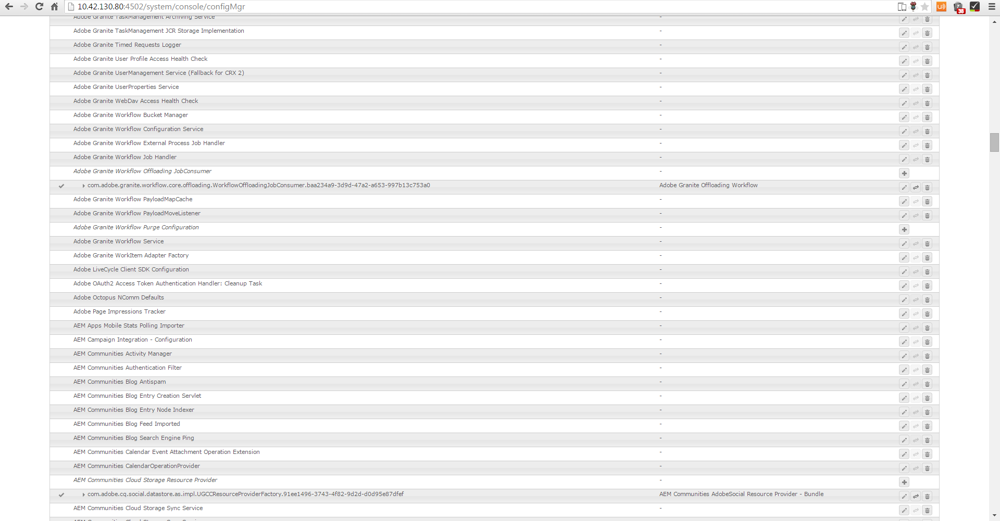

1. Nesta página, localize a Configuração do SDK do cliente do Adobe LiveCycle e expanda-a clicando nela.

1. Na URL do Servidor de Processamento, digite o nome do seu servidor LiveCycle, forneça as informações de logon e clique em **Salvar**.

   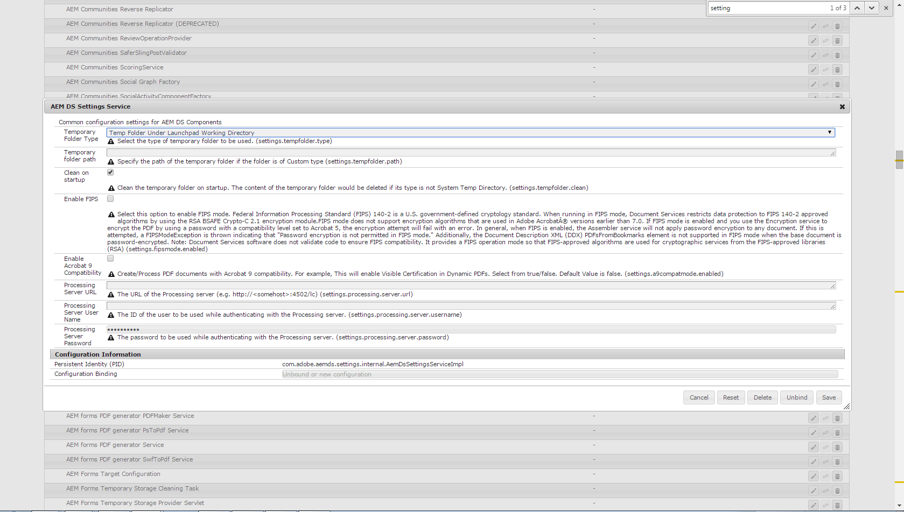

1. Se necessário, defina o nome de usuário e a senha com os quais deseja acessar o servidor.

#### Entrega do anexo {#attachmentdelivery}

* Os anexos de correspondência estão disponíveis no pós-processo na PDF, que é criado após o envio da correspondência.
* Quando a carta é renderizada usando APIs do lado do servidor como um PDF interativo ou não interativo, o PDF renderizado contém anexos como anexos do PDF.
* Quando um processo de publicação associado a um modelo de correspondência é carregado como parte das operações Enviar ou Concluir correspondência usando a interface do usuário Criar correspondência, os anexos são passados como a Lista&lt;com.adobe.idp.Document> no parâmetro AttachmentDocs.
* Os mecanismos de delivery prontos para uso, como email e impressão, também fornecem anexos junto com o PDF da correspondência gerada.

## Modos de representação da pré-visualização de cartas: pré-visualização de formulários para dispositivos móveis e pré-visualização de PDF {#rendition-modes-of-letter-preview-mobile-forms-preview-and-pdf-preview}

O AEM Forms Correspondence Management exibe uma correspondência como HTML na interface de usuário Criar correspondência. No entanto, o Gerenciamento de correspondência ainda é compatível com a reversão para a visualização do PDF em vez da pré-visualização do HTML. Para obter mais informações sobre como alternar entre o modo de visualização do HTML e do PDF, consulte [Alterar modo de representação da carta](#changerenditionmode).

A seguir estão os benefícios e a funcionalidade disponíveis na pré-visualização do HTML e do PDF.

**Vantagens dos formulários para dispositivos móveis/visualização do HTML**

* **Selecione um valor de campo de dados para destacar o campo de dados correspondente**: na interface do usuário Criar correspondência, você pode selecionar um valor de campo de dados na correspondência para destacar o campo de dados correspondente na guia Dados. Para obter mais informações, consulte [Inserir dados](#enterdata).

* **Suporte ao navegador**: os navegadores removem gradualmente o suporte para NPAPI, o que afeta a visualização da carta no PDF. A visualização da carta nos formulários HTML/móveis não é afetada por isso.
* **Realçar conteúdo editável em uma correspondência**: na interface do usuário Criar correspondência, você pode selecionar Realçar conteúdo editável para realçar todo o conteúdo editável na correspondência em cinza. Para obter mais informações, consulte [Gerenciar conteúdo](#managecontent).

`<li>` `<li>Benefits of HTML preview  <ul>   <li>Right to left</li>   <li>NPAPI</li>   <li>Highlight Editable Content</li>  </ul> </li>` `<li>Benefits of PDF preview  <ul>   <li>Page Break</li>   <li>Final Preview</li>  </ul> </li>`
`<li>` `<li>Benefits of HTML preview  <ul>   <li>Right to left</li>   <li>NPAPI</li>   <li>Highlight Editable Content</li>  </ul> </li>` `<li>Benefits of PDF preview  <ul>   <li>Page Break</li>   <li>Final Preview</li>  </ul> </li>` **Vantagens da visualização do PDF**

* **Quebra de página**: na visualização do PDF, você pode visualizar exatamente como as quebras de página na correspondência afetam sua saída.
* **Visualização final**: na visualização do PDF, você pode visualizar a formatação e a aparência exatas da letra, pois ela aparecerá na saída.

Para obter informações sobre suporte a scripts no PDF forms, consulte [Suporte a scripts](https://help.adobe.com/pt_BR/livecycle/11.0/ScriptingSupport/index.html).

Para obter mais informações sobre suporte a script em formulários HTML5, consulte [Suporte a script para formulários HTML5](/help/forms/using/scripting-support.md).

### Alterar modo de representação da carta {#changerenditionmode}

Por padrão, a interface Criar correspondência usa o HTML ou formulários móveis para renderizar a pré-visualização de correspondência. A visualização de formulários móveis não tem problemas de renderização em nenhum navegador, pois usa o plug-in nativo do navegador e não requer plug-ins adicionais. É possível alterar o modo de visualização de correspondência para PDF. No entanto, as restrições do navegador podem criar problemas para diferentes recursos da pré-visualização interativa da carta no PDF.

Para obter mais informações sobre a compatibilidade do navegador com a visualização de correspondência, consulte [Descontinuação de plug-ins de navegador NPAPI e seu impacto](https://helpx.adobe.com/br/acrobat/kb/change-in-support-for-acrobat-and-reader-plug-ins-in-modern-web-.html).

Para alterar o modo de visualização da correspondência, conclua as seguintes etapas:

1. Vá para `https://[system]:'port'/system/console/configMgr` e, se necessário, faça logon como Administrador.
1. Vá para **[!UICONTROL Configurações do Gerenciamento de Correspondências]** > **[!UICONTROL Tipo de Representação]** e selecione **Representação do HTML** (Padrão) ou **Representação do PDF**.
1. Clique em **[!UICONTROL Salvar]**.
