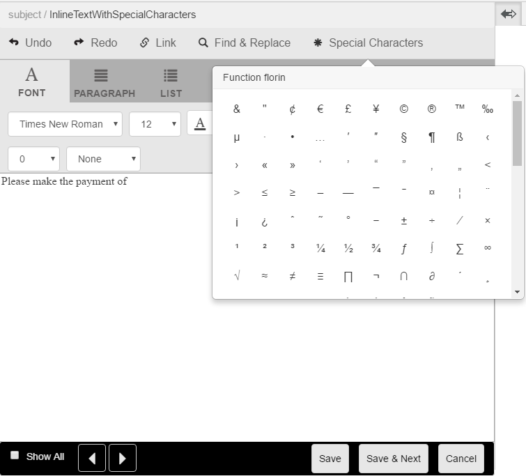

# Caracteres especiais personalizados no Gerenciamento de correspondência{#custom-special-characters-in-correspondence-management}

## Visão geral {#overview}

O Gerenciamento de correspondências tem suporte padrão integrado para 210 caracteres especiais que podem ser inseridos em correspondências com facilidade.

Por exemplo, você pode inserir os seguintes caracteres especiais:

* Símbolos de moeda, como €,¥ e £
* Símbolos matemáticos como ∑, √, ‖ e ^
* Símbolos de pontuação como ‟ e &quot;

É possível inserir caracteres especiais nas letras:

* No [editor de texto](/help/forms/using/document-fragments.md#createtext)
* Em um módulo [editável, incorporado em uma correspondência](../../forms/using/create-correspondence.md#managecontent)

O administrador pode adicionar suporte para caracteres especiais adicionais/personalizados por personalização. Este artigo fornece as instruções sobre como adicionar suporte para caracteres especiais adicionais e personalizados.

## Adicionar ou modificar suporte para caracteres especiais personalizados no Gerenciamento de correspondência {#creatingfolderstructure}

Use as seguintes etapas para adicionar suporte a caracteres especiais personalizados:

1. Vá para `https://'[server]:[port]'/[ContextPath]/crx/de` e faça logon como Administrador.
1. Na pasta de aplicativos, crie uma pasta chamada **[!UICONTROL specialcharacters]** com caminho/estrutura semelhante à pasta specialcharacters (na pasta textEditorConfig em libs):

   1. Clique com o botão direito do mouse na pasta **specialcharacters** no seguinte caminho e selecione **Sobrepor Nó**:

      `/libs/fd/cm/ma/gui/configuration/textEditorConfig/specialcharacters`

   1. Certifique-se de que a caixa de diálogo Sobrepor nó tenha os seguintes valores:

      **Caminho:** /libs/fd/cm/ma/gui/configuration/textEditorConfig/specialcharacters

      **Local de Sobreposição:** /apps/

      **Corresponder Tipos De Nó:** Marcado

      >[!NOTE]
      >
      >Não altere a ramificação /libs. As alterações feitas podem ser perdidas, pois essa ramificação pode mudar sempre que você:
      >
      >
      >
      >    * Atualizar na sua instância
      >    * Aplicar um hot fix
      >    * Instalar um pacote de recursos
      >
      >

   1. Clique em **OK** e em **Salvar tudo**. A pasta de caracteres especiais é criada no caminho especificado.

      Depois de criar a sobreposição, verifique as tags de estrutura do nó. Cada nó criado em /apps usando a sobreposição deve ter a mesma classe e propriedades conforme definido em /libs para esse nó. Se qualquer propriedade ou tag estiver ausente na estrutura do nó no local /apps, sincronize suas tags com o nó correspondente em /libs.

1. Verifique se o nó **[!UICONTROL textEditorConfig]** tem as seguintes propriedades e valores:

   | Nome | Tipo | Valor |
   |---|---|---|
   | cmConfigurationType | String | cmTextEditorConfiguration |
   | cssPath | String | /libs/fd/cm/ma/gui/components/admin/createasset/textcontrol/clientlibs/textcontrol |

1. Clique com o botão direito do mouse na pasta **[!UICONTROL caracteres especiais]** no seguinte caminho e selecione **Criar > Nó Filho** e clique em **Salvar Tudo**:

   /apps/fd/cm/ma/gui/configuration/textEditorConfig/specialcharacters/&lt;YourChildNode>

1. Atualize a página Editor de Texto\Criar Interface de Correspondência. O nó adicionado é o último na lista de caracteres especiais na interface do usuário.
1. Clique em **Salvar tudo**.
1. Alterações nos caracteres especiais conforme necessário:

<table>
 <tbody>
  <tr>
   <td><strong>Para...</strong></td>
   <td><strong>Complete as etapas a seguir</strong></td>
  </tr>
  <tr>
   <td>Adicionar um caractere especial personalizado</td>
   <td>
    <ol>
     <li>Adicione um nó secundário em "/apps/fd/cm/ma/gui/configuration/textEditorConfig/specialcharacters" com propriedades obrigatórias.</li>
     <li>Clique em Salvar tudo</li>
     <li>Atualize o Editor de texto\Criar interface de correspondência para que você possa ver as alterações.</li>
    </ol> </td>
  </tr>
  <tr>
   <td>Atualizar as propriedades de um caractere especial existente</td>
   <td>
    <ol>
     <li>Sobreponha o nó a ser atualizado conforme explicado acima e verifique as tags e classes.</li>
     <li>Altere quaisquer valores, como caption, value, endValue e multipleCaption. </li>
     <li>Clique em Salvar tudo. </li>
     <li>Atualize o Editor de texto\Criar interface de correspondência para que você possa ver as alterações.</li>
    </ol> </td>
  </tr>
  <tr>
   <td>Ocultar um caractere especial</td>
   <td>
    <ol>
     <li>Sobrepor o nó a ser oculto em "/apps/fd/cm/ma/gui/configuration/textEditorConfig/specialcharacters"</li>
     <li>Adicione a propriedade sling:hideResource (Booleano) ao nó (em aplicativos) para ser oculta. </li>
     <li>Clique em Salvar tudo. </li>
     <li>Atualize o Editor de Texto\Criar Interface de Correspondência para que você possa ver as alterações.  </li>
    </ol> </td>
  </tr>
  <tr>
   <td>Ocultar vários caracteres especiais</td>
   <td>
    <ol>
     <li>Adicione a propriedade "sling:hideChildren (String ou String[])" a "/apps/fd/cm/ma/gui/configuration/textEditorConfig/specialcharacters". </li>
     <li>Adicione nomes de nó (caracteres especiais a serem ocultados) como valores para a propriedade "sling:hideChildren". </li>
     <li>Clique em Salvar tudo. </li>
     <li>Atualize o Editor de Texto\Criar Interface de Correspondência para que você possa ver as alterações.  </li>
    </ol> </td>
  </tr>
  <tr>
   <td>Solicitar caracteres especiais</td>
   <td>
    <ol>
     <li>Adicione um nó secundário em "/apps/fd/cm/ma/gui/configuration/textEditorConfig/specialcharacters" com propriedades obrigatórias. </li>
     <li>Adicione a propriedade "sling:orderBefore (String)" ao nó filho recém-criado. </li>
     <li>Adicione o nome do nó como o valor antes do qual o caractere especial recém-adicionado deve ser exibido. </li>
     <li>Clique em Salvar tudo. </li>
     <li>Atualize o Editor de Texto\Criar Interface de Correspondência para que você possa ver as alterações.  </li>
    </ol> </td>
  </tr>
 </tbody>
</table>
