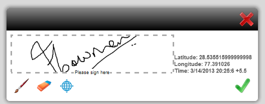

# Criação de modelos de formulário para formulários HTML5{#designing-form-templates-for-html-forms}

O componente de formulários do HTML5 no AEM pode renderizar o modelo de formulário XFA para o formato HTML5. Os designers de formulário podem criar modelos de formulário usando o [Forms Designer](https://www.adobe.com/go/learn_aemforms_designer_63) e usar o recurso de representação do HTML5. Esses modelos de formulário, juntamente com seus ativos, podem residir no repositório do AEM, no sistema de arquivos ou expostos via http. No entanto, se você planeja gerenciar seus formulários usando o Forms Manager, os modelos e os ativos devem residir no repositório do AEM.

Embora os formulários HTML5 correspondam ao comportamento do PDF forms em grande parte, há alguns recursos em ambos os formatos que não se aplicam ao outro formato. Por exemplo, a forma como os códigos de barras são aplicados em um formulário do PDF no Adobe Reader varia de um formulário do Mobile ou como um formulário é assinado digitalmente também varia entre os formatos. Para obter mais informações sobre essas variações, consulte [Diferenciação de recursos entre formulários HTML5 e o PDF forms](../../forms/using/feature-differentiation-html5-forms-pdf-forms.md).

Para obter recursos XFA comuns, consulte as seguintes práticas recomendadas e diretrizes para criar um formulário que funcione em ambos os formatos.

## Práticas recomendadas {#best-practices}

A maioria das etapas para criar um modelo de formulário, como associações de esquema ou escrever lógica de formulário, são as mesmas. No entanto, devido a diferenças inerentes entre a renderização e o mecanismo de script de um cliente thick como o Adobe Reader e os formulários baseados em navegador, há algumas recomendações descritas no artigo [práticas recomendadas](/help/forms/using/design-accessible-html5-forms.md). Essas práticas recomendadas ajudam você a criar modelos de formulário para funcionar conforme esperado em ambos os formatos.

### Recursos do AEM Forms Designer para HTML5 Forms {#capabilities-in-aem-forms-designer-for-html-forms}

#### Visualizar HTML {#preview-html}

A guia Visualizar HTML é adicionada no modo Design para que os designers de formulários visualizem formulários no formato HTML5 durante o processo de design. Para obter mais informações sobre como habilitar e configurar este recurso no AEM Forms Designer, consulte [Visualizar HTML](../../forms/using/preview-xdp-forms-html.md).

#### Assinatura escrita {#scribble-signature}

O principal público-alvo para os formulários HTML5 são os dispositivos de toque. Portanto, um novo controle de assinatura de rabisco é adicionado ao AEM Forms Designer. Você pode clicar ou arrastar e soltar o controle de assinatura de rabisco no modelo de formulário e configurá-lo. Ele é renderizado como um campo de rabisco na representação do HTML5 e pode ser usado para rabiscar a assinatura em dispositivos de toque. Em computadores desktop, ele pode ser usado como um campo de rabisco usando o controle do mouse. Para obter mais informações sobre como usar este recurso, consulte [Campo de Rabisco do XFA](../../forms/using/scribble-signature.md).

#### Formato Rich Text {#rich-text-format}

É possível converter um campo de texto em um campo rich text. Ele adiciona uma lista de opções de formatação ao campo de texto. Para converter, abra o Forms Designer, selecione o campo de texto no **[!UICONTROL Modo de Exibição de Design]**. Na guia **[!UICONTROL Campo]**, selecione **[!UICONTROL Rich Text]** na lista suspensa **[!UICONTROL Formato do Campo]**. Agora, quando o formulário XFA é renderizado como um formulário HTML5, o campo é renderizado como um campo de rich text. Selecione  para exibir opções de formatação adicionais.
