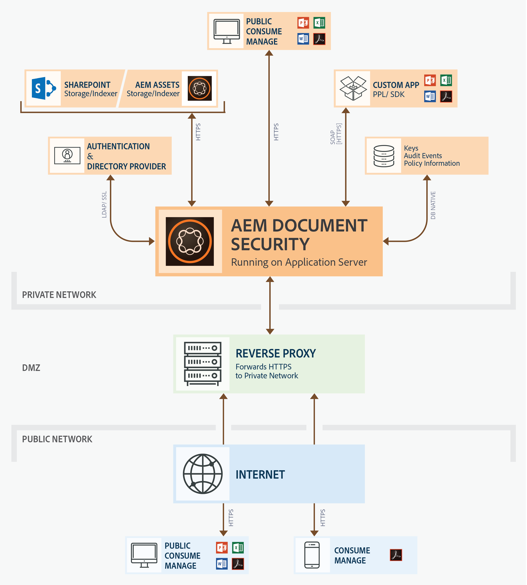
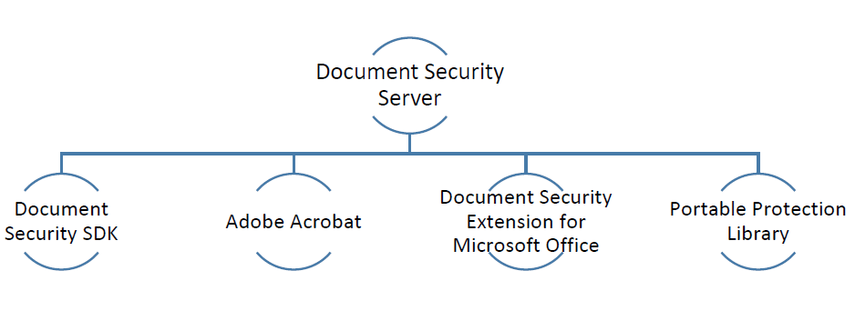

# Ofertas de segurança de documentos{#document-security-offerings}

A segurança de documentos do Adobe Experience Manager Forms garante que somente usuários autorizados possam usar seus documentos. Com a segurança de documentos, você pode distribuir com segurança qualquer informação que tenha sido salva em um formato compatível. Os formatos de arquivo compatíveis incluem Adobe Portable Document Format (PDF) e arquivos do Microsoft® Word, Excel e PowerPoint.

Você pode proteger documentos usando políticas. As configurações de confidencialidade especificadas em uma política determinam como um destinatário pode usar um documento ao qual você aplica a política. Por exemplo, você pode especificar se os destinatários podem imprimir ou copiar texto, editar texto ou adicionar assinaturas e comentários a documentos protegidos.

As políticas são armazenadas no servidor de Segurança de documentos; você aplica as políticas aos documentos por meio do aplicativo cliente. Quando você aplica uma política a um documento, as configurações de confidencialidade especificadas na política protegem as informações contidas no documento. Você pode distribuir o documento protegido por política para recipients autorizados pela política.

O diagrama a seguir mostra a arquitetura típica da Segurança de documentos do AEM Forms:

## Clientes de Segurança de documentos {#document-security-clients}

A Segurança de documentos fornece vários clientes para proteger documentos, exibir e editar documentos protegidos e indexadores para ativar a pesquisa de texto completo em documentos protegidos. Você pode escolher um cliente com base em seus requisitos e nos recursos do cliente.

O Servidor de segurança de documentos é o componente central por meio do qual a Segurança de documentos executa transações, como autenticação de usuários, gerenciamento de políticas em tempo real e aplicação de confidencialidade. O servidor também fornece um repositório central para políticas, registros de auditoria e outras informações relacionadas.

O servidor de Segurança de documentos fornece uma interface baseada na Web (página da Web) para criar políticas, gerenciar documentos protegidos por política e monitorar eventos associados a documentos protegidos por política. Os administradores também podem configurar opções globais, como autenticação de usuário, auditoria e mensagens para usuários convidados, e gerenciar contas de usuários convidados.

O servidor está incluído na oferta complementar de Segurança de documentos do AEM Forms. Você pode entrar em contato com a [equipe de vendas](https://business.adobe.com/request-consultation/experience-cloud.html?s_osc=70114000002JNwKAAW&s_iid=70114000002JHs3AAG) da AEM Forms para adquirir o complemento Segurança de documentos.

### Proteger documentos {#protect-documents}

A Segurança de documentos do AEM Forms fornece várias ferramentas para aplicar políticas de segurança. Você pode escolher uma ferramenta de acordo com seus requisitos e especificações.

Você pode usar o Document Security SDK, Adobe Acrobat, Document Security Extension for Microsoft® Office ou Portable Protection Library para aplicar e rastrear as políticas de segurança:

* **SDK de Segurança de Documentos:** O SDK é um cliente rico em recursos. Você pode usar o Document Security SDK para acessar a funcionalidade do servidor de documentos, abrir documentos protegidos por política e desenvolver extensões, plug-ins ou aplicativos personalizados. Por exemplo, você pode desenvolver extensões para proteger formatos de arquivo personalizados ou integrar o SDK com soluções de Prevenção de perda de dados (DLP). Extensões, aplicativos e plug-ins desenvolvidos com o uso do Document Security SDK para enviar documentos para o AEM Forms Server designado, e as políticas são aplicadas no servidor. O AEM Forms Document Security Client SDK (CSDK) não pode desproteger os documentos protegidos usando a Portable Protection Library (PPL) e vice-versa.

  O Document Security SDK está disponível para Java™ e C++. O Java™ SDK está incluído na oferta de Segurança de documentos da AEM Forms e é instalado na implantação do AEM Forms no JEE. Entre em contato com o [Suporte ao Cliente da AEM](https://experienceleague.adobe.com/?support-solution=General&support-tab=home#support) para adquirir o SDK C++. O SDK C++ pode ser compilado com o Microsoft® Visual Studio 2013. Visite o site [Documentação da API de Segurança de documentos](https://help.adobe.com/en_US/livecycle/11.0/Services/WS92d06802c76abadb76c48dfe12dbeb3e281-7ff0.2.html), onde você pode aprender e usar os recursos do SDK.

* **Adobe Acrobat:** Você pode usar o Adobe Acrobat para aplicar políticas de segurança a documentos do PDF criados com aplicativos de desktop populares, como o Microsoft® Office, navegadores da Web ou qualquer aplicativo que ofereça suporte para impressão no formato PDF.

  Você pode comprar e baixar o Adobe Acrobat do [site do Adobe](https://www.adobe.com/acrobat/free-trial-download.html). O artigo [configuração de políticas de segurança para PDFs](https://helpx.adobe.com/acrobat/using/setting-security-policies-pdfs.html) da Adobe Acrobat fornece informações detalhadas sobre como criar e aplicar políticas no Adobe Acrobat.

* **Document Security Extension for Microsoft® Office**: você pode usar o Document Security Extension for Microsoft® Office para aplicar políticas predefinidas a seus arquivos do Microsoft® Office de dentro dos programas do Microsoft® Office. A extensão garante que somente pessoas autorizadas possam usar arquivos do Microsoft® Word, Excel e PowerPoint protegidos por política. Somente os usuários autorizados que têm o plug-in instalado podem usar os arquivos protegidos por política.

  A extensão Segurança de documentos está disponível como um plug-in do Microsoft® Office. Entre em contato com o [Suporte ao Cliente da AEM](https://helpx.adobe.com/ca/marketing-cloud/contact-support.html) para obter a extensão. Posteriormente, você poderá visitar a ajuda do [Document Security Extension for Microsoft® Office](https://experienceleague.adobe.com/docs/experience-manager-document-security/using/download-installer.html?lang=pt-BR) para saber mais sobre como instalar, configurar e usar a extensão.

* **Biblioteca de Proteção Portátil:** O PPL protege um documento localmente, sem enviá-lo para o AEM Forms Server. Somente as credenciais de segurança e os detalhes da política viajam pela rede. O PPL também permite limitar o acesso de recuperação de política somente a usuários conectados. Você pode buscar políticas com o contexto do usuário conectado no AEM.

  Além disso, o PPL tem todos os recursos do Document Security SDK. Você pode usar o Document Security SDK para acessar a funcionalidade do servidor de documentos, abrir documentos protegidos por política e desenvolver extensões, plug-ins ou aplicativos personalizados. O PPL não pode desproteger os documentos protegidos usando o AEM Forms document security client SDK (CSDK) e vice-versa.

  O PPL está disponível para as linguagens Java™ e C++ nas versões de 32 e 64 bits. Também está disponível como um pacote OSGi para o AEM Forms no OSGi. A PPL do C++ pode ser compilada com o Microsoft® Visual Studio 2013. Se você tiver licenciado o complemento Segurança de documentos do AEM Forms, poderá entrar em contato com a equipe de suporte da [Segurança de documentos da AEM Forms](https://experienceleague.adobe.com/?support-solution=General&support-tab=home#support) para obter o PPL. Posteriormente, você poderá usar a Ajuda da PPL (fornecida com a biblioteca) para configurar e usar a PPL.

### Exibir ou editar documentos protegidos {#view-or-edit-protected-documents}

* Para **documentos do PDF**, você pode usar o Adobe Acrobat DC, o Acrobat Reader e o Acrobat Reader Mobile para exibir documentos protegidos do PDF. A maioria dos usuários já tem o Acrobat Reader instalado em seus dispositivos, de modo que não precisam obter ou aprender software adicional para visualizar documentos protegidos. Você também pode baixar a Acrobat Reader do [site de downloads da Acrobat Reader](https://get.adobe.com/reader/).

* Para **documentos do Microsoft® Office**, você precisa do Microsoft® Office e do AEM Forms Document Security Extension for Microsoft® Office. A extensão Segurança de documentos está disponível como um plug-in do Microsoft® Office. Você pode baixar a extensão no site da Adobe.

### Indexar documentos protegidos {#index-protected-documents}

Os mecanismos de pesquisa de texto completo do Microsoft® Windows (SharePoint Index server) e do Adobe Experience Manager (AEM) podem executar pesquisa de texto completo em formatos de documento comumente usados, como arquivos de texto simples, documentos do Microsoft® Office e documentos do PDF. Você pode usar indexadores de Segurança de documentos para permitir que mecanismos de pesquisa de texto completo pesquisem documentos protegidos do PDF:

* **Indexador do iFilter:** você pode usar o indexador do iFilter para indexar documentos protegidos do PDF e habilitar os mecanismos de pesquisa de texto completo do Microsoft® Windows (Serviço de Indexação de Área de Trabalho e Servidor de indexação do SharePoint) para pesquisar documentos protegidos do PDF. Para obter informações detalhadas, consulte [AEM SharePoint IFilter para Documentos Protegidos](assets/sharepoint-ifilter-doc-security.pdf).

* **Indexador de Segurança de Documentos do AEM Forms:** você pode usar o indexador de Segurança de Documentos do AEM Forms para indexar documentos protegidos do PDF e habilitar o Adobe Experience Manager para pesquisar documentos protegidos do PDF. Os indexadores fazem parte da oferta de Segurança de documentos do AEM Forms. Eles estão incluídos no AEM Forms em instaladores JEE.
