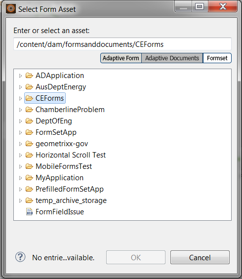

# Trabalhar com conjuntos de formulários no espaço de trabalho do AEM Forms{#working-with-formsets-in-aem-forms-workspace}

Um conjunto de formulários é uma coleção de formulários HTML5 agrupados e apresentados como um único conjunto de formulários para os usuários finais. Quando os usuários finais começam a preencher um conjunto de formulários, eles são perfeitamente transferidos de um formulário para outro. O conjunto de formulários pode ser enviado com apenas um clique. Para obter mais informações sobre conjuntos de formulários e como configurá-los, consulte [Conjunto de formulários no AEM Forms](../../forms/using/formset-in-aem-forms.md).

O espaço de trabalho do AEM Forms é compatível com conjuntos de formulários. Com conjuntos de formulários, vários formulários relacionados a um serviço ou processo podem ser agrupados para automatizar um processo de negócios e apresentados aos usuários finais. Nesse cenário, os usuários podem preencher todo o conjunto como um só e não há necessidade de arquivar, enviar e rastrear formulários ou processos individuais.

## Anexar um conjunto de formulários ao ponto de partida em um aplicativo do espaço de trabalho do AEM Forms {#attaching-a-formset-to-startpoint-in-an-aem-forms-workspace-app-br}

1. Crie o workflow do processo empresarial no Workbench. Para obter mais informações, consulte [Ajuda do Workbench](https://www.adobe.com/go/learn_aemforms_workbench_63).
1. Nas propriedades do processo do ponto de partida, selecione **Usar um Ativo do CRX** em Apresentação e Dados.

   

1. Clique em  (Procurar) ao lado do caminho do ativo do CRX. A caixa de diálogo Selecionar ativo de formulário é exibida.

   

1. Clique na guia **Formset**, selecione o conjunto de formulários relevante na lista e clique em **OK**.

1. Implante o aplicativo depois de atualizar outras propriedades relevantes do processo.

## Uso do conjunto de formulários no espaço de trabalho do AEM Forms {#using-formset-in-nbsp-aem-forms-workspace}

Depois que um conjunto de formulários é anexado a um ponto inicial, o ponto inicial pode ser chamado, como qualquer outro ponto inicial, do espaço de trabalho do AEM Forms.

As operações compatíveis com o conjunto de formulários por meio do espaço de trabalho do AEM Forms são:

* Salvar como rascunho
* Bloquear
* Desistir
* Enviar
* Adicionar anexos
* Adicionar Notas
* Mover entre formulários em um conjunto de formulários usando os botões Voltar ou Avançar

>[!NOTE]
>
>Para melhorar o desempenho durante a movimentação dos formulários anteriores e seguintes em um conjunto de formulários, todos os botões do espaço de trabalho (Voltar, Avançar, Salvar, Enviar e ... (Mais)) são desativados até que o formulário relevante seja totalmente renderizado.
