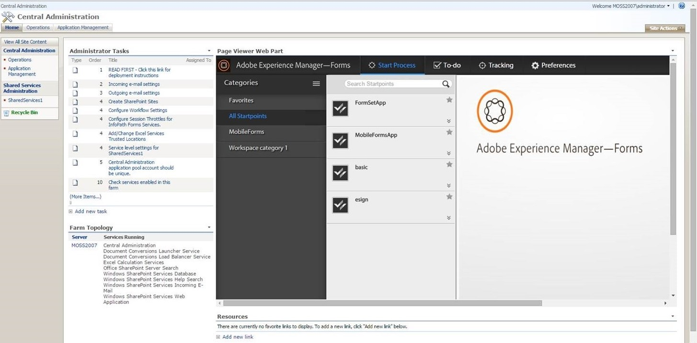

# Integração do espaço de trabalho do AEM Forms com o Microsoft Office SharePoint Server{#integrating-aem-forms-workspace-with-microsoft-office-sharepoint-server}

**- Requisitos**

**Conhecimento de pré-requisito**
Antes de adicionar o AEM Forms Workspace ao SharePoint Server, você deve ter acesso ao SharePoint Server com os privilégios apropriados e saber o URL para acessar o Workspace. As etapas abaixo pressupõem que você tenha conhecimento sobre o SharePoint Server. Para obter mais informações sobre Web Parts no Servidor do SharePoint, consulte Web Parts no Windows SharePoint Services.

**Nível de usuário**
Início

Você pode usar o AEM Forms Workspace como uma Web Part no Microsoft Office SharePoint Server( Por exemplo, Microsoft Office SharePoint Server 2007). Os usuários podem acessar o AEM Forms Workspace conectando-se ao SharePoint Server usando um navegador da Web para fornecer uma experiência unificada. Neste artigo, você aprenderá as etapas básicas para exibir o AEM Forms Workspace as a Web Part no Microsoft Office SharePoint Server. Você pode executar as etapas descritas neste artigo para fornecer uma experiência unificada para que os usuários conectados ao servidor do SharePoint possam acessar o AEM Forms Workspace na mesma porta.

>[!NOTE]
>
>As etapas listadas neste artigo são específicas do Microsoft SharePoint Server 2007. Você também pode configurar o HTML Workspace com outras versões compatíveis do Microsoft SharePoint.

## Integrar o AEM Forms Workspace com o Microsoft Office SharePoint Server 2007 {#integrate-aem-forms-workspace-with-microsoft-office-sharepoint-server}

Execute as seguintes etapas para integrar o AEM Forms Workspace em uma Web Part:

1. Em um navegador da Web, navegue até o site do SharePoint, como `https://[myMOSSserver]:44299/default.aspx`, em que `[myMOSSserver]` é o nome ou o endereço IP do servidor Sharepoint.

   >[!NOTE]
   >
   >44299 é o número de porta padrão do servidor SharePoint. O número da porta depende da instalação do SharePoint Server.

1. No lado superior direito da página da Web, clique em **Ações do Site** e selecione **Editar Página**.
1. Clique no botão **Adicionar uma Web Part**.
1. Na caixa de diálogo Adicionar Web Parts - Página da Web, em Miscelânea, selecione **Web Part do Visualizador de Páginas** e clique em **Adicionar**.
1. Na caixa Web Part do Visualizador de Páginas, clique em **editar** e selecione **Modificar Web Part Compartilhada**.

   >[!NOTE]
   >
   >A caixa Web Part do Visualizador de Páginas aparece sob o botão **Adicionar uma Web Part** que você clicou na etapa 3, conforme mostrado na ilustração a seguir (Figura 1):

   

   Figura 1. - A caixa Web Part do Visualizador de Páginas no servidor do Microsoft Office SharePoint.

1. Na página Visualizador de páginas, execute as seguintes tarefas:

   1. Na caixa Link, digite a URL do AEM Forms Workspace, como `https://[AEM_forms_Server]:8080/lc/ws`, onde `[AEM_forms_Server]` representa o IP ou o Nome do AEM Forms Server.
   1. Clique em **Aparência** e modifique a altura, a largura e o título para poder ver toda a interface de usuário do Workspace. Por exemplo, você pode definir a altura e a largura como 6 polegadas e 11 polegadas, respectivamente.
   1. Clique em **Testar link**. Uma nova janela do navegador da Web é exibida com o Workspace.
   1. (Opcional) Clique em **Layout** e modifique o layout do Workspace na Web Part.
   1. (Opcional) Clique em **Avançado** e modifique outras configurações, como a descrição e se o Workspace pode ser minimizado ou fechado na Web Part.

      Clique em **Aplicar**.

1. Clique em **Sair do modo de edição** e verifique se você pode acessar o Workspace.

Depois de concluir as etapas acima, seu site do SharePoint será semelhante à seguinte ilustração (Figura 2):

Figura 2: AEM Forms Workspace integrado ao Microsoft Office SharePoint Server
