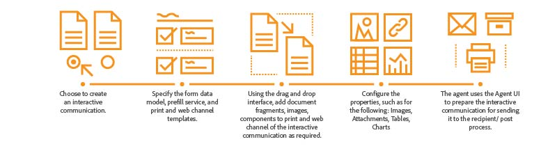

# Visão geral das comunicações interativas {#interactive-communications-overview}

| Versão | Link do artigo |
| -------- | ---------------------------- |
| AEM as a Cloud Service | [Clique aqui](https://experienceleague.adobe.com/pt-br/docs/experience-manager-cloud-service/content/interactive-communication/overview/introduction) |
| AEM 6.5 | Este artigo |

Este artigo inclui visão geral, exemplos de casos de uso, fluxo de trabalho de criação e diferenças entre a comunicação interativa e a correspondência.

As Comunicações interativas centralizam e gerenciam a criação, montagem e delivery de correspondências seguras, personalizadas e interativas, como correspondência comercial, documentos, declarações, avisos de benefícios, emails de marketing, contas e kits de boas-vindas.

## Principais recursos {#key-capabilities}

A seguir estão os principais recursos das Comunicações interativas:

- Integração imediata com o modelo de dados de formulário para permitir acesso fácil e simplificado a bancos de dados de back-end e outros sistemas de CRM, como o MS® Dynamics
- Interface de criação integrada para canais de impressão e da Web com capacidade de gerar automaticamente o canal da Web a partir do canal de impressão
- Gráficos para apresentar informações em formatos visuais facilmente compreensíveis em impressão e na Web
- Os fragmentos de documento são compatíveis com o editor de regras e o modelo de dados de formulário
- A interface do usuário do agente exibe a impressão e a visualização da Web da comunicação interativa
- Arraste e solte componentes para construir rapidamente canais de impressão e da Web

## Criação de comunicação interativa {#interactive-communication-creation}

### Fluxo de trabalho {#workflow}

Para criar uma Comunicação Interativa, prepare os [blocos de construção](#buildingblocks) para a Comunicação Interativa e, em seguida, conclua as seguintes etapas:

1. Escolha [criar uma Comunicação Interativa](/help/forms/using/create-interactive-communication.md).

1. Especifique o [modelo de dados de formulário](/help/forms/using/data-integration.md), o serviço de preenchimento prévio e os [modelos de canal da Web e de impressão](/help/forms/using/web-channel-print-channel.md). Você pode optar por gerar um canal da Web a partir do canal de impressão.

1. Usando a [interface de arrastar e soltar](/help/forms/using/introduction-interactive-communication-authoring.md), adicione fragmentos de documentos, imagens, componentes a impressão e ao canal da Web da Comunicação Interativa, conforme necessário.
1. Configure as propriedades dos componentes inseridos, como as seguintes:

   1. [Imagens](/help/forms/using/create-interactive-communication.md#step2)
   1. [Tabelas](/help/forms/using/create-interactive-communication.md#tables) (Incluindo Fragmentos De Layout)
   1. [Gráficos](/help/forms/using/chart-component-interactive-communications.md)
   1. [Fragmentos do documento](/help/forms/using/create-interactive-communication.md#document-fragment-properties)

1. Visualize canais de impressão e da Web e, se necessário, edite a Comunicação interativa.
1. O agente usa a interface do usuário do Agente para [preparar a Comunicação Interativa](/help/forms/using/prepare-send-interactive-communication.md) para enviá-la ao processo de destinatário/postagem.

### Blocos de construção {#buildingblocks}

A seguir estão os componentes necessários para criar uma Comunicação interativa:

- [Modelo de dados do formulário](/help/forms/using/data-integration.md)
- [Modelos de canal da Web e de impressão](/help/forms/using/web-channel-print-channel.md)
- [Fragmentos do documento](/help/forms/using/document-fragments.md)
- Imagens
- [Temas](/help/forms/using/themes.md) do canal Web

## Comunicações Interativas Vs Gerenciamento De Correspondência {#interactive-communications-vs-correspondence-management}

A comunicação interativa é a abordagem padrão e recomendada para criar comunicações com o cliente. Para continuar usando as letras criando no AEM 6.3 Forms e no AEM 6.2 Forms, você precisa [instalar um pacote de compatibilidade](/help/forms/using/compatibility-package.md). Veja a seguir uma comparação entre os recursos de Comunicação interativa e cartas.

<table>
 <tbody>
  <tr>
   <td><strong>Recurso</strong></td>
   <td><strong>Comunicação interativa</strong></td>
   <td><strong>Carta</strong></td>
  </tr>
  <tr>
   <td>Saída</td>
   <td>Impressão e Web</td>
   <td>Imprimir</td>
  </tr>
  <tr>
   <td>Esquema</td>
   <td>Modelo de dados do formulário </td>
   <td>Dicionário de dados </td>
  </tr>
  <tr>
   <td>Localização</td>
   <td>Não compatível com o modelo de dados de formulário</td>
   <td>Compatível com o dicionário de dados</td>
  </tr>
  <tr>
   <td>Editor de regras</td>
   <td>
    <ul>
     <li>Editor de regras de suporte a texto e condição para criar condições em linha</li>
     <li>O Editor de comunicação interativa oferece suporte à aplicação de regras em componentes do canal da Web</li>
    </ul> </td>
   <td>Nenhuma interface para a criação de expressão condicional</td>
  </tr>
  <tr>
   <td>Criação</td>
   <td>Interface de arrastar e soltar para construir canais de impressão e da Web</td>
   <td>Nenhum mecanismo de arrastar e soltar </td>
  </tr>
  <tr>
   <td>Gráficos</td>
   <td>Gráficos compatíveis com impressão e canal da Web</td>
   <td>Não suportado</td>
  </tr>
  <tr>
   <td>Temas</td>
   <td>Usa temas para estilizar o canal da Web</td>
   <td>Não suporta temas</td>
  </tr>
   <tr>
   <td>Rascunhos</td>
   <td>Compatível</td>
   <td>Compatível</td>
  </tr>
   <tr>
   <td>Envios</td>
   <td>Compatível</td>
   <td>Compatível</td>
  </tr>
  <tr>
  <tr>
   <td>Auditoria</td>
   <td>Incompatível</td>
   <td>Compatível</td>
  </tr>
   <tr>
   <td>Versões</td>
   <td>Incompatível</td>
   <td>Compatível</td>
  </tr>
   <td>Processamento em lote</td>
   <td>Compatível </td>
   <td>Compatível</td>
  </tr>
  <tr>
   <td>Assinatura do agente</td>
   <td>Não suportado</td>
   <td>Compatível</td>
  </tr>
  <tr>
   <td>Funções remotas</td>
   <td>Não suportado</td>
   <td>Compatível</td>
  </tr>
 </tbody>
</table>
