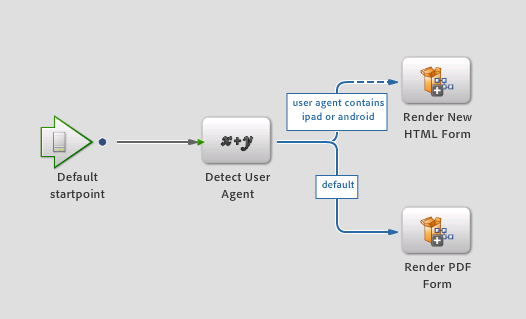
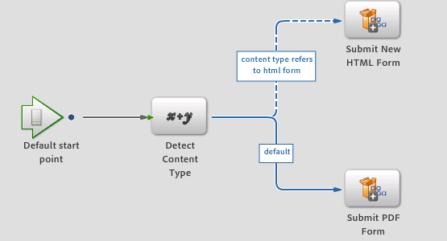

# Novo serviço de renderização e envio{#new-render-and-submit-service}

## Introdução {#introduction}

No Workbench, ao definir uma operação `AssignTask`, especifique um formulário específico (formulário XDP ou PDF). Além disso, especifique um conjunto de serviços Renderizar e Enviar, por meio do perfil de ação.

Um XDP pode ser renderizado como um formulário do PDF ou um formulário do HTML. Os novos recursos incluem a capacidade de:

* Renderizar e enviar um formulário XDP como HTML
* Renderize e envie um formulário XDP como PDF no desktop e como HTML em dispositivos móveis (por exemplo, um iPad)

### Novo serviço HTML Forms {#new-html-forms-service}

O novo serviço HTML Forms usa o novo recurso no Forms para oferecer suporte à renderização de formulários XDP como HTML. O novo serviço HTML Forms expõe os seguintes métodos:

```java
/*
 * Generates a URL (for the HTML Form) to be passed to client, given a TaskContext.
 * The output of this API is something like this - /lc/content/xfaforms/profiles/default.ws.html?ContentRoot=repository://Applications/MyApplication/MyFolder&template=MyForm.xdp
 * @param taskContext task context
 * @param profileName Forms servlet URL.
 * @return form URL string
 */
public String generateFormURL(TaskContext taskContext, String profileName);

/*
 * Render the XDP Form as HTML. Can be used directly for updating the runtimeMap in render.
 * It adds the following keys to the map -
 * hint:new html form = true
 * newHTMLFormURL = the URL returned after calling 'generateFormURL' API.
 * @param TaskContext taskContext
 * @param profileName Forms servlet URL.
 * @param runtimeMap runtime map<string,object> associated with form rendering.
 * return runtimeMap
 */
public Map<String, Object> renderHTMLForm (TaskContext taskContext, String profileName, Map<String,Object> runtimeMap);
```

Mais informações sobre perfis de Formulários para publicação de conteúdo para dispositivos móveis podem ser encontradas em [Criando um perfil personalizado](/help/forms/using/custom-profile.md).

## Novos processos de renderização e envio do formulário do HTML {#new-html-form-render-amp-submit-processes}

Para cada operação &quot;AssignTask&quot;, especifique um Processo de renderização e um Processo de envio com o formulário. Esses processos são chamados pelo Gerenciador de Tarefas `renderForm` e `submitForm` APIs para permitir o manuseio personalizado. Semântica desses processos para o Novo formulário do HTML:

### Renderizar um novo formulário do HTML {#render-a-new-html-form}

O novo processo para renderizar o HTML, como todos os processos de renderização, tem os seguintes parâmetros de E/S -

Entrada - `taskContext`

Saída - `runtimeMap`

Saída - `outFormDoc`

Este método simula o comportamento exato da API `renderHTMLForm` do NewHTMLFormsService. Ele chama a API `generateFormURL` para obter a URL para a representação HTML do formulário. Em seguida, ele preenche o runtimeMap com a seguinte chave ou valores:

novo formulário html = true

newHTMLFormURL = a URL retornada após chamar a API `generateFormURL`.

### Enviar um novo formulário do HTML {#submit-a-new-html-form}

Esse processo para enviar um novo formulário do HTML funciona com os seguintes parâmetros de E/S -

Entrada - `taskContext`

Saída - `runtimeMap`

Saída - `outputDocument`

O processo define o `outputDocument` como `inputDocument` recuperado de `taskContext`.

## Processos padrão de Renderização ou Envio e perfis de ação {#default-render-or-submit-processes-and-action-profiles}

Os serviços padrão Renderizar e Enviar permitem o suporte para renderizar PDFs em um desktop e o HTML em dispositivos móveis (iPad).

### Formulário de renderização padrão {#default-render-form}

Esse processo renderiza um formulário XDP em várias plataformas, de maneira contínua. O processo recupera o agente de usuário de `taskContext` e usa os dados para chamar o processo para renderizar o HTML ou o PDF.



### Formulário de envio padrão {#default-submit-form}

Esse processo envia um formulário XDP em várias plataformas perfeitamente. Ele recupera o agente do usuário de `taskContext` e usa os dados para chamar o processo para enviar HTML ou PDF.



## Alternar a renderização de formulários móveis do PDF para o HTML {#switch-the-rendering-of-mobile-forms-from-pdf-to-html}

Os navegadores estão removendo gradualmente o suporte para plug-ins baseados em NPAPI, incluindo plug-ins para Adobe Acrobat e Adobe Acrobat Reader. Você pode alterar a renderização dos formulários móveis de PDF para HTML usando as seguintes etapas:

1. Faça logon no Workbench como um usuário válido.
1. Selecione **Arquivo** > **Obter Aplicativos**.

   A caixa de diálogo Obter aplicativos é exibida.

1. Selecione os aplicativos para os quais deseja alterar a renderização do formulário para publicação de conteúdo para dispositivos móveis e clique em **OK**.
1. Abra o processo para o qual deseja alterar a renderização.
1. Abra o ponto de partida/tarefa de destino, navegue até a seção Apresentação e Dados e clique em **Gerenciar Perfis de Ação**.

   A caixa de diálogo Gerenciar perfis de ação é exibida.
1. Altere as configurações do perfil de renderização Padrão do PDF para o HTML e clique em **OK**.
1. Faça check-in no processo.
1. Repita as etapas para alterar a renderização de outros processos.
1. Implante o aplicativo relevante para os processos que você alterou.

### Perfil de ação padrão {#default-action-profile}

O Perfil de ação padrão renderizou o Formulário XDP como PDF. Esse comportamento foi alterado para usar os processos Renderizar formulário padrão e Enviar formulário padrão.

Estas são algumas das perguntas frequentes sobre perfis de ação:

 **Que processos de Renderização/Envio estarão disponíveis imediatamente?**

* Guia de renderização (o Guides foi descontinuado)
* Guia de formulários de renderização
* Renderizar formulário do PDF
* Renderizar formulário do HTML
* Renderizar Novo formulário do HTML (novo)
* Formulário de renderização padrão (novo)

E, processos de Envio equivalentes.

 **Que Perfis de Ação estarão disponíveis imediatamente?**

Para XDP Forms:

* Padrão (renderizar/enviar usando os novos processos &#39;Renderizar/Enviar padrão&#39;)

 **O que precisa ser feito pelo designer de processos para habilitar o formulário a ser renderizado no HTML em um dispositivo e no PDF em um desktop?**

Nada. O Perfil de ação padrão é escolhido automaticamente, e o modo de renderização também é cuidado, automaticamente.

 **O que precisa ser feito para habilitar o formulário a ser renderizado no HTML em um desktop?**

O usuário deve selecionar o botão de opção HTML para o perfil padrão.

 **Haverá algum impacto de atualização na alteração do comportamento do perfil de ação padrão?**

Sim, como os serviços de renderização e envio anteriores associados ao perfil de ação padrão eram diferentes, eles são tratados como uma personalização dos formulários existentes. Ao clicar em **Restaurar Padrões**, os serviços de renderização e envio padrão são definidos.

Se você tiver modificado os serviços existentes Renderizar ou Enviar formulário do PDF ou criado serviços personalizados (digamos custom1) e quiser usar a mesma funcionalidade para representação do HTML. Você precisa replicar o novo serviço de renderização ou envio (como custom2) e aplicar personalizações semelhantes a elas. Agora, modifique o perfil de ação para seu XDP para começar a usar serviços custom2 em vez de custom1 para renderizar ou enviar.

O que precisa ser feito pelo designer de processos para permitir que o formulário seja renderizado no HTML em um dispositivo e no PDF em um desktop?
O que precisa ser feito pelo designer de processos para permitir que o formulário seja renderizado no HTML em um dispositivo e no PDF em um desktop?
