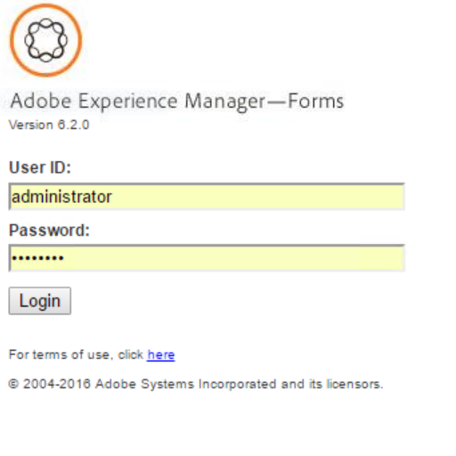

# Introdução ao Process Reporting{#introduction-to-process-reporting}

Relatórios de processos é uma ferramenta baseada em navegador usada para criar e exibir relatórios sobre processos e tarefas do AEM Forms.

O Process Reporting fornece um conjunto de relatórios prontos para uso que permitem filtrar, exibir informações sobre processos de longa execução, duração do processo e volume do fluxo de trabalho.

Além disso, o Process Reporting fornece uma interface para executar consultas adhoc e integrar exibições de relatórios personalizadas à interface do usuário do Process Reporting.

Para obter a lista de navegadores compatíveis, consulte [Plataformas compatíveis com AEM Forms](/help/forms/using/aem-forms-jee-supported-platforms.md).

O Process Reporting é construído em módulos que:

* Ler dados do processo do Banco de Dados do AEM Forms
* Publicar dados do processo em um repositório incorporado do Process Reporting
* Fornece uma interface de usuário baseada em navegador para exibir relatórios

## Principais recursos {#key-capabilities}

### Relatório sempre ativo {#always-on-reporting}

Visualize a lista de processos de longa execução, gráficos de duração do processo e executar consultas personalizadas usando filtros.

Process Reporting também oferece a opção de exportar o relatório e consultar dados no formato CSV.

### Relatórios Ad Hoc {#adhoc-reports}

Use filtros para obter uma visualização específica dos seus dados.

Você pode pesquisar processos ou tarefas por ID, duração, datas de início e término, iniciador do processo e assim por diante.

É possível combinar vários filtros para criar relatórios específicos.

É possível salvar os filtros de relatório para execução em uma data ou hora posterior.

### Histórico de Processos/Tarefas {#process-task-history}

Os servidores da AEM Forms executam vários processos em paralelo. Esses processos continuam em transição de um estado para outro. Ao publicar dados do Forms no repositório do Process Reporting em intervalos regulares, o Process Reporting retém as informações de transição sobre os processos em execução no AEM Forms.

### Controle de acesso {#access-control-br}

O Process Reporting fornece acesso baseado em permissão à interface do usuário.

Isso significa que somente os usuários com permissões de relatório têm acesso à interface do usuário do Process Reporting.
