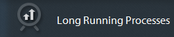
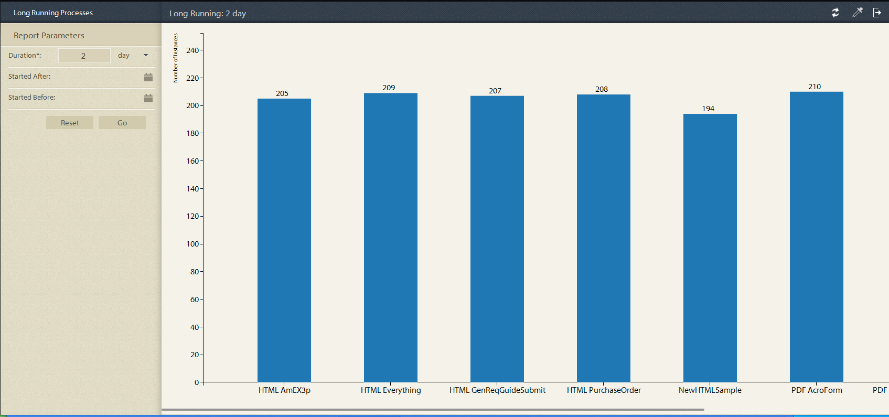
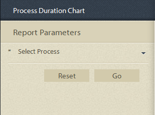

# Relatórios predefinidos em relatórios de processo {#pre-defined-reports-in-process-reporting}

## Relatórios predefinidos em relatórios de processo {#pre-defined-reports-in-process-reporting-1}

O AEM Forms Process Reporting vem com os seguintes *relatórios prontos para uso*:

* **[Processos de Longa Execução](#long-running-processes)**: Um relatório de todos os processos do AEM Forms que levaram mais tempo do que o especificado para serem concluídos
* **[Gráfico de Duração do Processo](#process-duration-report)**: Um relatório de um processo do AEM Forms especificado por duração
* **[Volume do Fluxo de Trabalho](#workflow-volume-report)**: um relatório das instâncias em execução e concluídas do processo especificado por data

## Processos de longa execução {#long-running-processes}

O relatório Processos de Longa Execução exibe os processos do AEM Forms que levaram mais de um tempo especificado para serem concluídos.

### Para executar um relatório de Processo de Longa Execução {#to-execute-a-long-running-process-report}

1. Para exibir a lista de relatórios predefinidos em Relatórios de Processo, no modo de exibição de árvore **Relatórios de Processo**, clique no nó **Relatórios**.
1. Clique no nó de relatório **Processos de Longa Execução**.

   

   Quando você seleciona um relatório, o painel **Parâmetros do relatório** é exibido à direita do modo de exibição em árvore.

   

   Parâmetros:

   * **Duração** (*obrigatório*): especifique uma duração e uma unidade de tempo. Exibir todos os processos do AEM Forms que foram executados por mais do que a duração especificada.
   * **Iniciado após** (*opcional*): selecione uma data. Filtre o relatório para exibir instâncias de processo iniciadas após a data especificada.
   * **Iniciado antes** (*opcional*): selecione uma data. Filtre o relatório para exibir instâncias de processo iniciadas antes da data especificada.

1. Clique em **Ir** para executar o relatório.

   O relatório é exibido no painel **Relatório** à direita da janela **Relatórios do Processo**.

   

   Use as opções no canto superior direito do painel **Relatório** para executar as seguintes operações no relatório.

   * **Atualizar**: atualiza o relatório com os dados mais recentes contidos no armazenamento
   * **Alterar cor da legenda**: selecione e altere a cor da legenda do relatório
   * **Exportar para CSV**: exporte e baixe os dados do relatório para um arquivo separado por vírgulas

## Relatório de duração do processo  {#process-duration-report}

O relatório Duração do processo exibe o número de instâncias de um processo do Forms por número de dias que cada instância foi executada.

### Para executar um relatório de Duração do processo {#to-execute-a-process-duration-report}

1. Para exibir os relatórios predefinidos em Relatórios de Processo, na exibição em árvore **Relatórios de Processo**, clique no nó **Relatórios**.
1. Clique no nó de relatório **Duração dos processos**.

   

   Quando você seleciona um relatório, o painel **Parâmetros do relatório** é exibido à direita do modo de exibição em árvore.

   

   Parâmetros:

   * **Selecionar Processo** (*obrigatório*): Selecione um processo do AEM Forms.

1. Clique em **Ir** para executar o relatório.

   O relatório é exibido no painel **Relatório**, à direita da janela Relatórios do Processo.

   

   Use as opções no canto superior direito do painel **Relatório** para executar as seguintes operações no relatório.

   * **Atualizar**: atualiza o relatório com os dados mais recentes contidos no armazenamento
   * **Alterar cor da legenda**: selecione e altere a cor da legenda do relatório
   * **Exportar para CSV**: exporte e baixe os dados do relatório para um arquivo separado por vírgulas

## Relatório de volume do fluxo de trabalho {#workflow-volume-report}

O relatório Volume do fluxo de trabalho exibe o número de instâncias atualmente em execução e concluídas de um processo do AEM Forms por dia do calendário.

### Para executar um relatório de Volume de Workflow {#to-execute-a-workflow-volume-report}

1. Para exibir os relatórios predefinidos em Relatórios de Processo, na exibição em árvore **Relatórios de Processo**, clique no nó **Relatórios**.
1. Clique no nó de relatório **Volume do Fluxo de Trabalho**.

   

   Quando você seleciona um relatório, o painel **Parâmetros do relatório** é exibido à direita do modo de exibição em árvore.

   

   Parâmetros:

   * **Selecionar Processo** (*obrigatório*): Selecione um processo do AEM Forms.

   * **Iniciado após** (*opcional*): selecione uma data. Filtra o relatório para exibir instâncias de processo iniciadas após a data especificada.

   * **Iniciado antes** (*opcional*): selecione uma data. Filtra o relatório para exibir instâncias de processo iniciadas antes da data especificada.

1. Clique em **Ir** para executar o relatório.

   O relatório é exibido no painel **Relatório** à direita da janela **Relatórios do Processo**.

   

   Use as opções no canto superior direito do painel **Relatório** para executar as seguintes operações no relatório.

   * **Atualizar**: atualiza o relatório com os dados mais recentes contidos no armazenamento
   * **Alterar cor da legenda**: selecione e altere a cor da legenda do relatório
   * **Exportar para CSV**: exporte e baixe os dados do relatório para um arquivo separado por vírgulas
