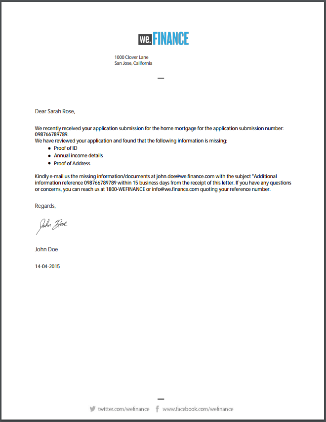
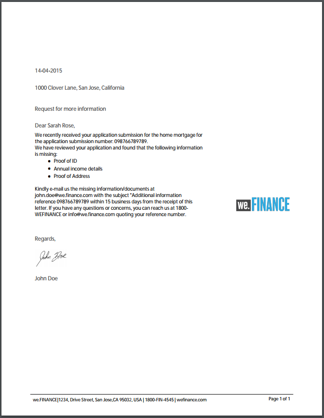
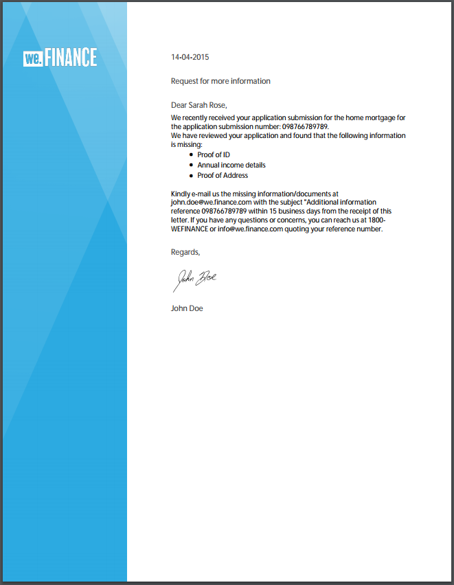
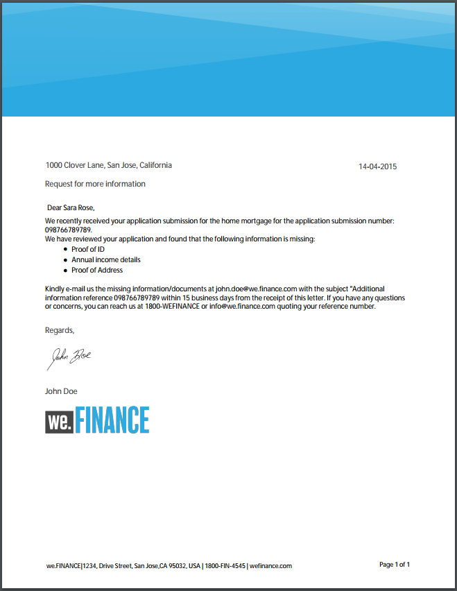

# Modelos de carta de referência {#reference-letter-templates}

No Gerenciamento de correspondências, um modelo de correspondência contém campos de formulário típicos, recursos de layout como cabeçalho e rodapé e &quot;áreas de destino&quot; vazias para a inserção de conteúdo.

O Gerenciamento de Correspondências fornece modelos de correspondência no [pacote complementar do AEM Forms](https://experienceleague.adobe.com/docs/experience-manager-release-information/aem-release-updates/forms-updates/aem-forms-releases.html?lang=en). Você pode personalizar os modelos no Designer de acordo com suas necessidades comerciais e de marca. O pacote inclui os seguintes templates:

* Clássico
* Simples clássico
* Balanceado à esquerda
* Equilibrado à direita
* Visual à esquerda
* Visual superior
* Visual Top - Classic

Após instalar o pacote, os modelos de layout (XDPs) são listados na pasta de modelos no seguinte local:

`https://'[server]:[port]'/[context-root]/aem/forms.html/content/dam/formsanddocuments/templates-folder`

A seguir estão os campos comuns em todos os templates neste pacote:

* Data
* Saudação
* Texto de encerramento
* Texto da assinatura

Após instalar o pacote AEM-FORMS-6.3-REFERENCE-LAYOUT-TEMPLATES, os modelos são listados na pasta templates

## Clássico {#classic}

Com um logotipo em cima, modelo clássico é adequado para uma carta profissional simples.

Visualização no PDF de uma carta criada usando o modelo Clássico

## Simples clássico {#classic-simple}

Inclui campos para capturar número de telefone e endereço de email. Um modelo Simples Clássico é semelhante ao modelo Clássico, exceto que não tem campos em que você possa inserir o endereço do destinatário.

Visualização no PDF de uma carta criada usando o modelo Simples Clássico

## Balanceado à esquerda {#balanced-left}

O modelo Balanced Left inclui o logotipo à esquerda da letra.

Visualização PDF de uma carta criada usando o modelo Balanceado à Esquerda

## Equilibrado à direita {#balanced-right}

O modelo Balanced Right tem o logotipo da empresa à esquerda e fornece espaço para inserir o endereço dos destinatários na própria carta. O modelo Equilibrado à direita também inclui um rodapé que flui quando a carta tem várias páginas.

Visualização PDF de uma carta criada usando o modelo Balanced Right

## Visual à esquerda {#visual-left}

O modelo Visual Esquerdo tem um lado esquerdo à esquerda da página com o logotipo da empresa colocado sobre o lado esquerdo. O modelo Visual Left tem um campo de assunto, mas nenhum rodapé.

Visualização PDF de uma carta criada usando o modelo Visual Esquerdo

## Visual superior {#visual-top}

O modelo Visual Superior tem margem visual na parte superior. O modelo Visual Top tem um campo para inserir o endereço do recipient na própria página. O modelo Visual Superior tem o campo de assunto e um rodapé que reflui para cartas que se estendem por várias páginas.

Visualização PDF de uma carta criada usando o modelo Visual Top

## Visual Top - Classic {#visual-top-classic}

O modelo Visual Top - Classic tem um cabeçalho na parte superior da página com o logotipo da empresa. O modelo Visual Top - Classic tem um campo para inserir um assunto, mas nenhum rodapé.

Visualização PDF de uma carta criada usando o modelo Visual Top - Classic
