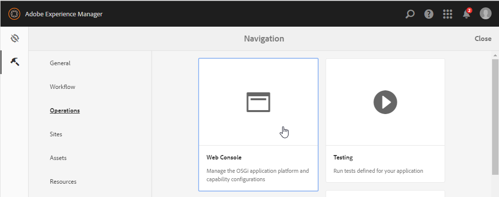
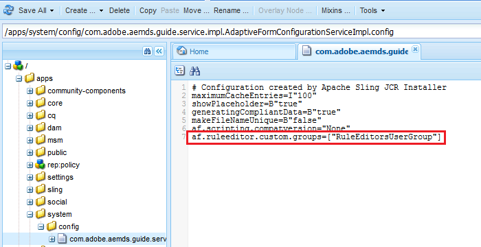

# Conceder acesso ao editor de regras para grupos de usuários selecionados{#grant-rule-editor-access-to-select-user-groups}

A Adobe  recomenda usar os [Componentes principais](https://experienceleague.adobe.com/docs/experience-manager-core-components/using/adaptive-forms/introduction.html?lang=pt-BR) de captura de dados moderna e extensível para [criar um novo Forms Adaptável](/help/forms/using/create-an-adaptive-form-core-components.md) ou [adicionar o Forms Adaptável às páginas do AEM Sites](/help/forms/using/create-or-add-an-adaptive-form-to-aem-sites-page.md). Esses componentes representam um avanço significativo na criação do Forms adaptável, garantindo experiências de usuário impressionantes. Este artigo descreve uma abordagem mais antiga para a criação do Forms adaptável usando componentes de base. 

## Visão geral {#overview}

Você pode ter diferentes tipos de usuários com habilidades variadas que trabalham com o Adaptive Forms. Embora os usuários especialistas possam ter o conhecimento certo para trabalhar com scripts e regras complexas, pode haver usuários de nível básico que precisam trabalhar somente com o layout e as propriedades básicas dos formulários adaptáveis.

O AEM Forms permite limitar o acesso do editor de regras aos usuários com base em sua função. Nas definições do Serviço de Configuração do Forms Adaptive, você pode especificar os [grupos de usuários](/help/sites-administering/security.md) que podem exibir e acessar o editor de regras.

## Especificar grupos de usuários que podem acessar o editor de regras {#specify-user-groups-that-can-access-rule-editor}

1. Faça logon no AEM Forms como administrador.
1. Na instância do autor, clique em Adobe Experience Manager > Ferramentas  > Operações > Console da Web. O Console da Web é aberto em uma nova janela.

   

1. Na janela Console da Web, localize e clique em **[!UICONTROL Configuração do canal da Web de formulário adaptável e comunicação interativa]**. A caixa de diálogo **[!UICONTROL Configuração do canal da Web de formulário adaptável e comunicação interativa]** é exibida. Não altere nenhum valor e clique em **Salvar**.

   Ele cria um arquivo /apps/system/config/com.adobe.aemds.guide.service.impl.AdaptiveFormConfigurationServiceImpl.config no repositório do CRX.

1. Faça logon no CRXDE como administrador. Abra o arquivo /apps/system/config/com.adobe.aemds.guide.service.impl.AdaptiveFormConfigurationServiceImpl.config para edição.
1. Use a propriedade a seguir para especificar o nome de um grupo que possa acessar o editor de regras (por exemplo, RuleEditorsUserGroup) e clique em **Salvar Tudo**.

   `af.ruleeditor.custom.groups=["RuleEditorsUserGroup"]`

   Para habilitar o acesso para vários grupos, especifique uma lista de valores separados por vírgula:

   `af.ruleeditor.custom.groups=["RuleEditorsUserGroup", "PermittedUserGroup"]`

   

   Agora, quando um usuário que não faz parte do grupo de usuários especificado (aqui RuleEditorsUserGroup) toca em um campo, o ícone Editar regra ( ) não está disponível para ele na barra de ferramentas dos componentes:

   

   Barra de ferramentas Componentes visível para um usuário com acesso ao editor de regras

   

   Barra de ferramentas Componentes conforme visível para um usuário sem acesso ao editor de regras

   Para obter instruções sobre como adicionar usuários a grupos, consulte [Administração e Segurança do Usuário](/help/sites-administering/security.md).
