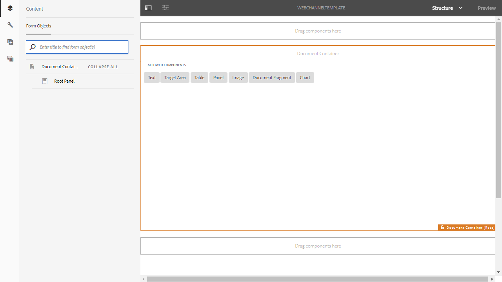
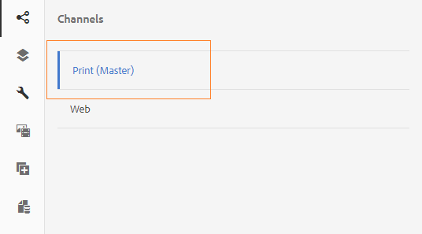
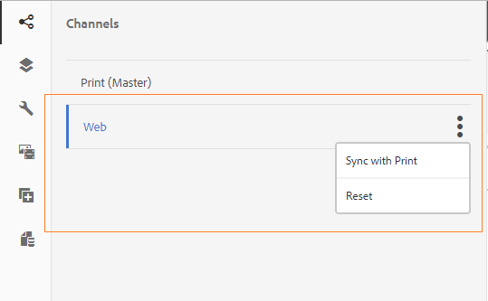

# Canal de impressão e canal da Web{#print-channel-and-web-channel}

As Comunicações interativas podem ser fornecidas por meio de dois canais: impressão e Web. O canal de impressão é usado para criar PDFs e comunicações em papel, como uma carta impressa como lembrete para pagamento de prêmio de seguro, enquanto o canal da Web é usado para fornecer experiências online, como um extrato de cartão de crédito em um site.

Os autores da comunicação interativa podem reutilizar ativos como fragmentos de documentos e imagens para criar versões impressas e da Web da comunicação interativa.

Um dos pré-requisitos para [Criar uma Comunicação Interativa](../../forms/using/create-interactive-communication.md) é ter os modelos para impressão e/ou canal da Web disponíveis no servidor. Enquanto os autores de modelo criam o modelo de canal da Web no próprio AEM, o XDP do modelo de canal de impressão é criado no Adobe Forms Designer e carregado no servidor.

## Canal de impressão {#printchannel}

O canal de impressão de uma comunicação interativa usa o modelo de formulário XFA, XDP. Um XDP foi projetado no Adobe Forms Designer. Para obter mais informações sobre como criar modelos de canal de impressão, consulte [Design de Layout](../../forms/using/layout-design-details.md). Para usar um modelo de canal de impressão em sua Comunicação interativa, é necessário fazer upload do modelo no servidor do AEM Forms.

### Fazer upload do modelo de canal de impressão de Comunicação interativa {#upload-interactive-communication-print-channel-template}

Para carregar o modelo, você precisa ser membro do grupo de usuários de formulários. Use as seguintes etapas para fazer upload do modelo de canal de impressão (XDP) no AEM Forms:

1. Selecione **[!UICONTROL Forms]** > **[!UICONTROL Forms e Documentos]**.

1. Selecione **[!UICONTROL Criar]** > **[!UICONTROL Carregar arquivo]**.

   Navegue e selecione o modelo de canal de impressão (XDP) apropriado e selecione **[!UICONTROL Abrir]**.

## Canal da Web {#web-channel}

Os autores e administradores de modelos podem criar, editar e ativar modelos da Web. Para permitir que outros usuários criem modelos da Web, é necessário conceder direitos a eles. Para obter mais informações, consulte [Administração de Usuários, Grupos e Direitos de Acesso](/help/sites-administering/user-group-ac-admin.md).

### Criação do modelo de canal da Web {#authoring-web-channel-template}

Para criar um modelo de canal da Web, primeiro crie uma pasta Modelo. Depois de criar um modelo da Web dentro de uma pasta de modelo, é necessário habilitar o modelo para permitir que os usuários de formulários criem um canal da Web de uma comunicação interativa com base no modelo.

Para criar um modelo de canal da Web, conclua as seguintes etapas:

1. Crie uma pasta Modelo para manter os modelos da Web de Comunicação interativa, caso ainda não tenha um. Para obter mais informações, consulte Pastas de Modelos em [Modelos de Página - Editáveis](/help/sites-developing/page-templates-editable.md).

   1. Selecione **[!UICONTROL Ferramentas]**  > **[!UICONTROL Navegador de Configuração]**.
      * Consulte a documentação do [Navegador de Configuração](/help/sites-administering/configurations.md) para obter mais informações.
   1. Na página Navegador de Configuração, selecione **[!UICONTROL Criar]**.
   1. Na caixa de diálogo Criar configuração, especifique um título para a pasta, marque **[!UICONTROL Modelos editáveis]** e selecione **[!UICONTROL Criar]**.

      A Pasta é criada e listada na página Navegador de configuração.

1. Navegue até a pasta de modelo apropriada e crie um modelo da Web.

   1. Navegue até a pasta de modelo apropriada selecionando **[!UICONTROL Ferramentas]** > **[!UICONTROL Modelos]** > **`[Folder]`**.
   1. Selecione **[!UICONTROL Criar]**.
   1. Selecione **[!UICONTROL Comunicação interativa - Canal da Web]** e selecione **[!UICONTROL Avançar]**.
   1. Insira um título e uma descrição para o Modelo e selecione **[!UICONTROL Criar]**.

      O modelo é criado e uma caixa de diálogo é exibida.

   1. Selecione **[!UICONTROL Abrir]** para abrir o modelo criado no Editor de modelo.

      O Editor de modelo é exibido.

      

      Ao criar ou editar um modelo, há vários aspectos que um Autor de modelo pode definir. A criação ou edição de um modelo é semelhante à criação de página. Para obter mais informações, consulte Edição de Modelos - Autores do Modelo em [Criação de Modelos de Página](/help/sites-authoring/templates.md).

1. Para permitir o uso desse modelo para a criação de Comunicações interativas, habilite o modelo.

   1. Selecione **[!UICONTROL Ferramentas]**  > **[!UICONTROL Modelos]**.
   1. Navegue até o modelo apropriado, selecione-o e selecione **[!UICONTROL Habilitar]**. Na mensagem de alerta, selecione **[!UICONTROL Habilitar]**.

      O modelo é ativado e seu status é exibido como Enabled. Agora você pode prosseguir para a criação de uma Comunicação interativa, onde é possível usar o modelo de canal da Web recém-criado.

### Canal de impressão como mestre para canal da Web {#print-channel-as-master-for-web-channel}

Ao criar uma comunicação interativa, os autores podem selecionar essa opção para criar o canal da Web em sincronia com o canal de impressão. Usar o canal de impressão como mestre para o canal da Web garante que o conteúdo, a herança e a vinculação de dados do canal da Web sejam derivados do canal de impressão, e as alterações feitas no canal de impressão podem ser refletidas no canal da Web. Os autores da Comunicação interativa podem, no entanto, interromper a herança de componentes específicos no canal da Web, conforme necessário.

 
