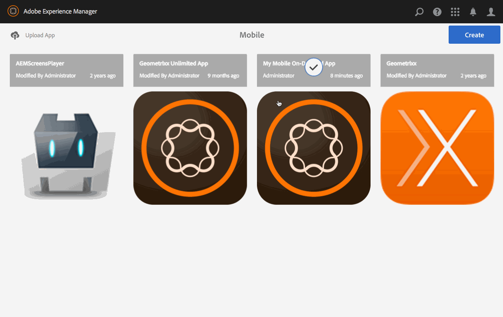

# Visualização com simulação {#previewing-with-preflight}

Esta página explica a visualização com o aplicativo Comprovação.

{{ue-over-mobile}}

As ações a seguir são executadas no aplicativo como um todo.

Com o aplicativo Comprovação por demanda para dispositivos móveis, é possível visualizar todos os projetos aos quais você tem acesso. Depois de selecionar um projeto, você pode pré-visualizar o conteúdo do aplicativo, incluindo navegar pelas páginas e artigos para ter uma ideia de como o aplicativo é exibido e executado em vários dispositivos.

>[!NOTE]
>
>O aplicativo Preflight é semelhante à natureza do visualizador do PhoneGap Enterprise.

## Visualização com simulação {#previewing-with-preflight-1}

1. Em Dispositivo móvel, escolha seu aplicativo móvel por demanda no catálogo.
1. Clique nas reticências (...) no bloco **Gerenciar artigos** (ou Banners/Coleções).
1. Selecione **Comprovação** na barra de ações.
1. Clique em **Ativar simulação** na caixa de diálogo.
1. Seu aplicativo está pronto para visualização no aplicativo de simulação por demanda móvel.

>[!NOTE]
>
>O aplicativo Comprovação do AEM é usado para visualizar conteúdo e navegar pelas páginas. Para saber mais detalhes sobre o Aplicativo de Comprovação, clique [aqui](https://helpx.adobe.com/digital-publishing-solution/help/aem-mobile-end-of-life-faq.html).
>

### Avançando {#getting-ahead}

Se ainda precisar de mais informações sobre criação de conteúdo, consulte os seguintes recursos para criar e gerenciar conteúdo em um aplicativo do AEM Mobile:

* [Painel de aplicativos do AEM Mobile](/help/mobile/mobile-apps-ondemand-application-dashboard.md)
* [Gerenciamento de conteúdo](/help/mobile/mobile-apps-ondemand-manage-content-ondemand.md)

## Recursos adicionais {#additional-resources}

Para entender mais sobre as outras duas funções e responsabilidades para criar um aplicativo AEM Mobile On-demand Services, consulte os seguintes recursos:

* [Desenvolvimento de conteúdo do AEM para o AEM Mobile On-demand Services](/help/mobile/aem-mobile-on-demand.md)
* [Criação de conteúdo do AEM para aplicativo do AEM Mobile On-demand Services](/help/mobile/mobile-apps-ondemand.md)
