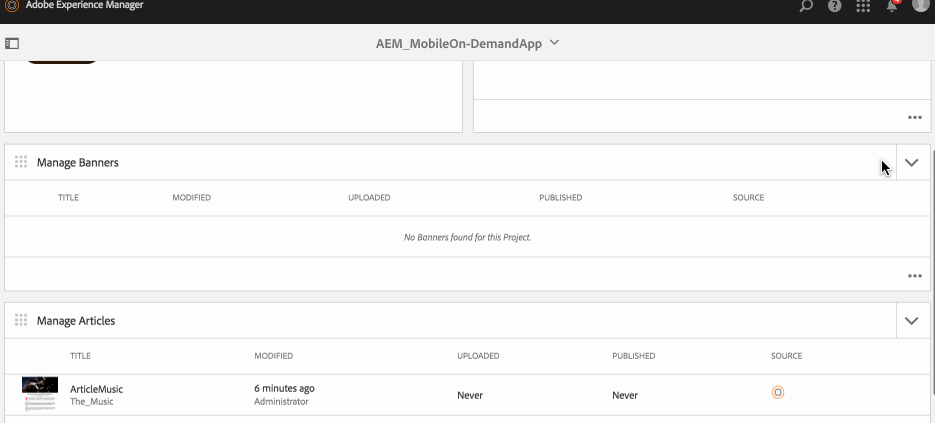
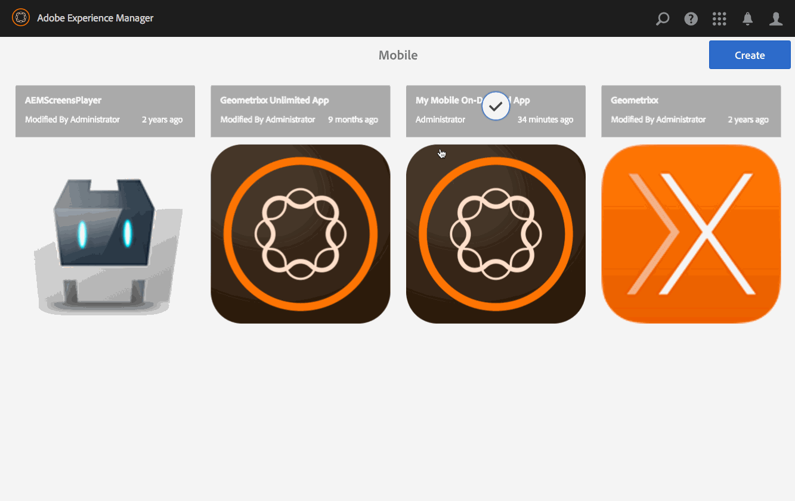

# Gerenciamento de banners{#managing-banners}

{{ue-over-mobile}}

As ações de gerenciamento de conteúdo são os blocos fundamentais que ajudam a criar e gerenciar conteúdo em um aplicativo. As ações a seguir são executadas no conteúdo do aplicativo.

## Visão geral dos banners {#banners-overview}

Os banners geralmente representam links promocionais gráficos.

>[!NOTE]
>
>Consulte os seguintes recursos na Ajuda online para saber mais sobre os seguintes tópicos em aplicativos AEM Mobile:
>
>* [Considerações sobre o design](https://helpx.adobe.com/digital-publishing-solution/help/design-app.html)
>
>* [Criando banners](https://helpx.adobe.com/digital-publishing-solution/help/creating-banners.html)
>

## Criação de um banner {#creating-a-banner}

O fluxo de trabalho geral para criar um artigo é o seguinte:

1. Selecione **Dispositivo móvel** no painel lateral.
1. Em Dispositivo móvel, escolha seu aplicativo móvel por demanda no catálogo.
1. Clique na seta para baixo no canto superior direito do bloco **Gerenciar banners**.
1. Analise cada etapa do assistente para continuar criando seu novo banner.
1. Quando estiver pronto, clique em **Criar**.
1. Seu novo banner aparece no bloco **Gerenciar banners**.

## Importação de um novo banner {#importing-a-new-banner}

O conteúdo do Mobile On-Demand existente pode ser baixado (importado) do Mobile On-Demand para o AEM. Isso permite a edição e a exibição de conteúdo local.

>[!NOTE]
>
>A importação não inclui imagens.

O fluxo de trabalho para importar um novo artigo

1. Em Dispositivo móvel, escolha seu aplicativo móvel por demanda no catálogo.
1. Clique na seta para baixo no canto superior direito do bloco **Gerenciar banners** e selecione Importar banners.
1. Clique em **Importar banner** na caixa de diálogo e em Fechar.
1. Seus artigos do Mobile On-Demand agora aparecem no bloco **Gerenciar banners**.

>[!CAUTION]
>
>Associe uma conexão do Mobile On-Demand primeiro.

## Edição de um banner {#editing-a-banner}

Use o editor de arrastar e soltar integrado do AEM para adicionar ou alterar um artigo. Componentes como texto e imagens podem ser adicionados/removidos. As imagens do Assets do DAM podem ser inseridas.

>[!CAUTION]
>
>Somente os banners criados no AEM podem ser abertos no editor.

O workflow para editar um artigo:

1. Em Dispositivo móvel, escolha seu aplicativo móvel por demanda no catálogo.
1. Selecione um banner originado na AEM no bloco ** Gerenciar banners**.
1. Clique no banner destacado da exibição de lista para abri-lo no editor de conteúdo.
1. Use o editor de conteúdo para arrastar o conteúdo do banner (manuscritos, imagens, texto etc.).

### Visualização e edição de metadados em um banner {#viewing-and-editing-the-metadata-within-a-banner}

Os banners têm várias propriedades, como títulos, descrições e imagens. Esta ação é usada para exibir e modificar essas propriedades. Como opção, essas alterações podem ser carregadas no Mobile On-Demand ao salvar.

O workflow geral para exibir/editar um artigo:

1. Em Dispositivo móvel, escolha seu aplicativo móvel por demanda no catálogo.
1. Escolha um banner no bloco **Gerenciar banners**.

1. Selecione **Propriedades** na barra de ações.
1. Visualize todos os metadados disponíveis para esse artigo.
1. Edite os metadados, se desejar, e clique em **Salvar** quando terminar.
1. Como opção, carregue as alterações imediatamente no Mobile On-Demand.

## Carregamento de um banner {#uploading-a-banner}

A ação de upload copia o conteúdo selecionado e o adiciona a um projeto do Mobile On-Demand. O conteúdo já existente do Mobile On-Demand é substituído pela nova versão.

O fluxo de trabalho geral para carregar um banner:

1. Em **Mobile**, escolha seu aplicativo Mobile On-Demand no catálogo.
1. No bloco **Gerenciar banners**, selecione um banner para carregar no Mobile On-Demand.
1. Adicione mais banners, se necessário, da exibição de lista.
1. Selecione **Carregar** na barra de ações e clique em Carregar na caixa de diálogo.
1. Seus banners agora são carregados no Mobile On-Demand.

## Excluir um banner {#deleting-a-banner}

Essa operação exclui o banner selecionado do Mobile On-Demand e, opcionalmente, da instância local do AEM.

O fluxo de trabalho geral para excluir um banner:

1. Em Dispositivo móvel, escolha seu aplicativo móvel por demanda no catálogo.
1. Selecione o banner a ser excluído no bloco **Gerenciar banners**.
1. Verifique se ele está selecionado na lista (selecione outros para excluir conforme necessário).
1. Clique em **Excluir** da barra de ações.
1. Verifique se você deseja excluir o AEM e o Mobile On-Demand.
1. Clique em **Excluir**.
1. Seu banner foi removido da lista.

### Próximas etapas {#the-next-steps}

Depois de aprender sobre o gerenciamento de banners, consulte

* [Gerenciamento de artigos](/help/mobile/mobile-on-demand-managing-articles.md)
* [Gerenciar coleções](/help/mobile/mobile-on-demand-managing-collections.md)
* [Upload de recursos compartilhados](/help/mobile/mobile-on-demand-shared-resources.md)
* [Publicar/desfazer publicação do conteúdo](/help/mobile/mobile-on-demand-publishing-unpublishing.md)
* [Visualização com simulação](/help/mobile/aem-mobile-manage-ondemand-services.md)
