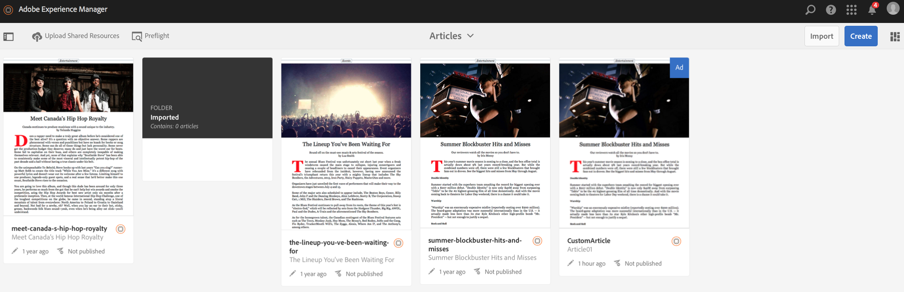

# Upload de recursos compartilhados {#uploading-shared-resources}

{{ue-over-mobile}}

As ações de gerenciamento de conteúdo são os blocos fundamentais que ajudam a criar e gerenciar conteúdo em um aplicativo. As ações a seguir são executadas no conteúdo do aplicativo.

>[!NOTE]
>
>Para saber mais sobre as considerações de design para aplicativos do AEM Mobile, consulte [Considerações de design para aplicativos do AEM Mobile](https://helpx.adobe.com/digital-publishing-solution/help/design-app.html) na Ajuda Online.

>[!CAUTION]
>
>Associe uma conexão do Mobile On-Demand primeiro.

## Upload de recursos compartilhados {#uploading-shared-resources-1}

Normalmente, o conteúdo, como artigos, precisa ter a mesma aparência em todos os autores e até mesmo aplicativos. Portanto, é essencial disponibilizar scripts, css e fontes para todos. Essa operação envia esses recursos compartilhados para o Mobile On-Demand, que podem ser consumidos conforme necessário.

Depois de configurar e associar seu aplicativo a uma Configuração na nuvem, você pode fazer upload dos recursos compartilhados. Para obter etapas detalhadas sobre como associar seu aplicativo a uma configuração de nuvem, clique [aqui](/help/mobile/mobile-apps-ondemand-application-create-configure-action.md).

>[!NOTE]
>
>Os Recursos compartilhados usam ContentSync para coletar todos os recursos diferentes. Consulte [Mobile com ContentSync](/help/mobile/mobile-ondemand-contentsync.md) para obter mais detalhes.

Siga estas etapas para fazer upload dos recursos compartilhados de um artigo:

1. Selecione o artigo no bloco **Gerenciar artigos**.
1. Clique em **Carregar Recursos Compartilhados** para carregar seus recursos compartilhados do HTML.

   

### A próxima etapa {#the-next-step}

Depois de saber como criar e publicar conteúdo, consulte

* [Desenvolvimento de conteúdo do AEM para o AEM Mobile On-demand Services](/help/mobile/aem-mobile-on-demand.md)
* [Administração de conteúdo para usar o AEM Mobile On-demand Services](/help/mobile/aem-mobile.md)

Ou ainda precisa aprender sobre os tópicos de criação, consulte

[Criação de conteúdo do AEM para aplicativos AEM Mobile On-demand Services](/help/mobile/mobile-apps-ondemand.md)
