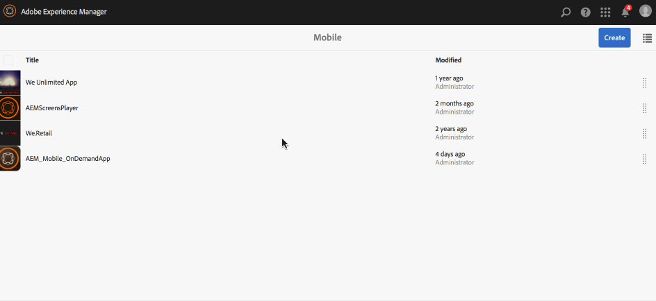

# Definições do aplicativo{#app-definitions}

{{ue-over-mobile}}

As definições de aplicativo são uma maneira de identificar quais espaços e outras configurações são apropriados para o aplicativo. As definições do aplicativo permitem que o usuário adicione espaço, sem ter que recompilar o aplicativo. A definição do aplicativo é atualizada e incluirá as informações de todos os novos espaços.

>[!NOTE]
>
>As definições de aplicativo estão vinculadas a um aplicativo, portanto, exigem a criação de um Aplicativo no console de Aplicativos AEM Mobile.

## Criação de uma nova definição de aplicativo {#creating-a-new-app-definition}

1. Escolha **Dispositivo móvel** no Console de Navegação do AEM.

   

1. Escolha **Aplicativos** em **Celular** e clique em **Criar.**

   Escolha **Aplicativo** para e insira os detalhes para criar seu novo aplicativo.

   

### Próximas etapas {#the-next-steps}

Depois de conhecer as Definições do aplicativo, saiba mais sobre os seguintes recursos de criação:

* [Importar um aplicativo híbrido existente](/help/mobile/phonegap-adding-content-to-imported-app.md)
* [Criar um novo aplicativo usando o Assistente para criação de aplicativos](/help/mobile/phonegap-create-new-app.md)
* [Serviços de conteúdo](/help/mobile/develop-content-as-a-service.md)

## Recursos adicionais {#additional-resources}

Para saber mais sobre as funções e responsabilidades de um Administrador e Desenvolvedor, consulte os recursos abaixo:

* [Desenvolvimento para o Adobe PhoneGap Enterprise com o AEM](/help/mobile/developing-in-phonegap.md)
* [Administração de conteúdo para o Adobe PhoneGap Enterprise com o AEM](/help/mobile/administer-phonegap.md)
