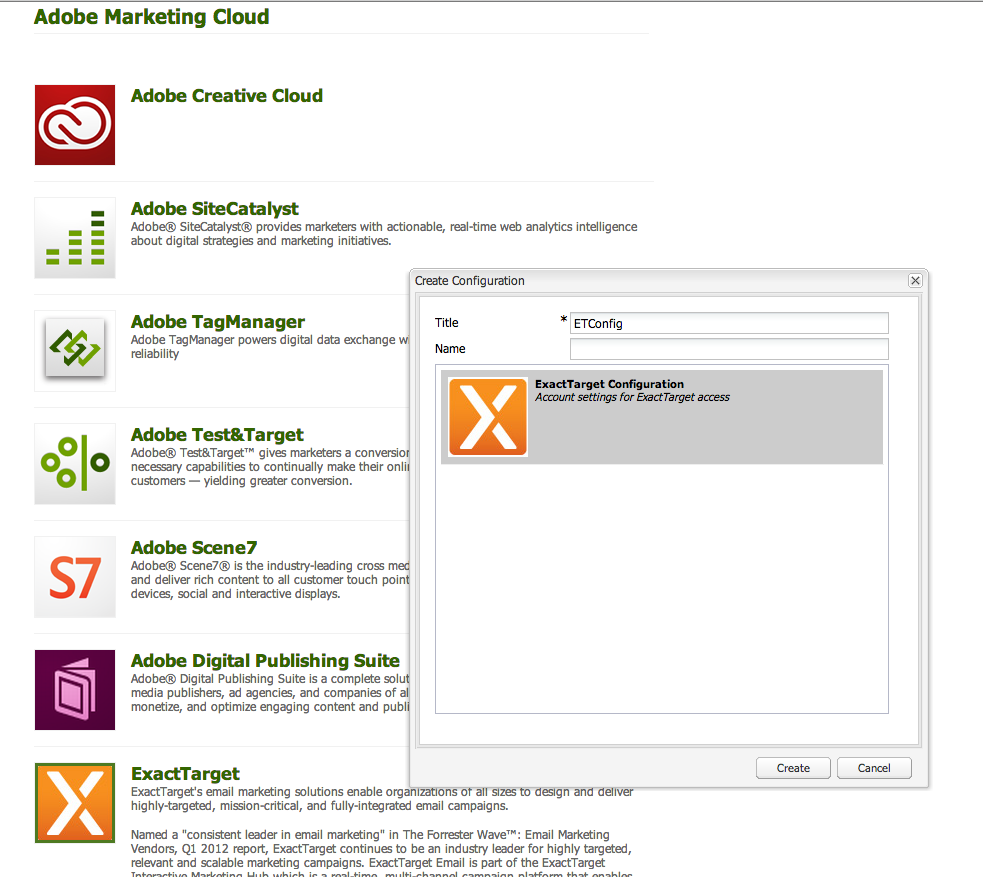
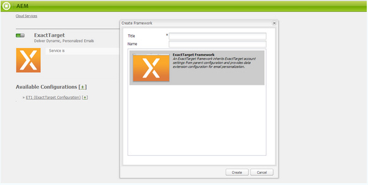
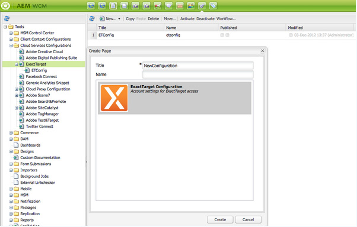

# Integração com o ExactTarget{#integrating-with-exacttarget}

A integração do Adobe Experience Manager (AEM) com o Exact Target permite gerenciar e enviar emails criados no AEM por meio do Exact Target. Ele também permite usar os recursos de gerenciamento de clientes potenciais do Exact Target por meio de formulários do AEM em páginas do AEM.

A integração do oferece os seguintes recursos:

* A capacidade de criar emails no AEM e publicá-los no Exact Target para distribuição.
* A capacidade de definir a ação de um formulário do AEM para criar um assinante do Exact Target.

Depois que o ExactTarget é configurado, você pode publicar informativos ou emails no ExactTarget. Consulte [Publicar informativos em um serviço de email](/help/sites-authoring/personalization.md).

## Criação de uma configuração ExactTarget {#creating-an-exacttarget-configuration}

As configurações do ExactTarget podem ser adicionadas por meio do Cloud Services ou das Ferramentas. Ambos os métodos são descritos nesta seção.

### Configuração do ExactTarget por meio dos serviços em nuvem {#configuring-exacttarget-via-cloudservices}

Para criar uma configuração ExactTarget no Cloud Services:

1. Na página de boas-vindas, clique em **Cloud Services**. (Ou acesse diretamente em `https://<hostname>:<port>/etc/cloudservices.html`.)
1. Clique em **ExactTarget** e depois em **Configurar**. A janela de configuração ExactTarget é aberta.

   

1. Insira um título, opcionalmente um nome e clique em **Criar**. A janela de configuração **Configurações ExactTarget** é aberta.

   

1. Insira o nome de usuário, a senha e selecione um ponto de extremidade de API (por exemplo, **https://webservice.exacttarget.com/Service.asmx**).
1. Clique em **Conectar ao ExactTarget.** Depois de se conectar com êxito, você verá uma caixa de diálogo de sucesso. caixa Clique em **OK** para sair da janela.

   

1. Selecione uma conta, se disponível. A conta é para clientes do Enterprise 2.0. Clique em **OK**.

   O ExactTarget foi configurado. Você pode editar a configuração clicando em **Editar**. Você pode ir para ExactTarget clicando em **Ir para ExactTarget**.

1. O AEM agora fornece um recurso de extensão de dados. Você pode importar colunas de extensão de dados ExactTarget. Ele pode ser configurado clicando no sinal &quot;+&quot; que aparece ao lado da configuração ExactTarget criada com sucesso. Qualquer extensão de dados existente pode ser selecionada na lista suspensa. Para obter mais informações sobre como configurar extensões de dados, consulte a [documentação do ExactTarget](https://help.salesforce.com/s/articleView?id=sf.mc_es_data_extension_data_relationships_classic.htm&type=5).

   Colunas de extensão de dados importadas podem ser usadas posteriormente por meio do componente **Text e Personalization**.

   

### Configuração do ExactTarget por meio das Ferramentas {#configuring-exacttarget-via-tools}

Para criar uma configuração ExactTarget em Ferramentas:

1. Na página de boas-vindas, clique em **Ferramentas**. Ou navegue diretamente até `https://<hostname>:<port>/misadmin#/etc`.
1. Selecione **Ferramentas**, depois **Configurações de Cloud Services** e depois **ExactTarget**.
1. Clique em **Novo** para abrir a janela **Criar página**.

   

1. Insira o **Título** e, opcionalmente, o **Nome** e clique em **Criar**.
1. Insira as informações de configuração conforme descrito na etapa 4 do procedimento anterior. Siga esse procedimento para concluir a configuração do ExactTarget.

### Adição de várias configurações {#adding-multiple-configurations}

Para adicionar várias configurações:

1. Na página de boas-vindas, clique em **Cloud Services** e em **ExactTarget**. Clique em **Mostrar Configurações**, que aparecerá se uma ou mais configurações do ExactTarget estiverem disponíveis. Todas as configurações disponíveis são listadas.
1. Clique no sinal **+** ao lado de Configurações disponíveis. Isso abre a janela **Criar Configurações**. Siga o procedimento de configuração anterior para criar uma configuração.
