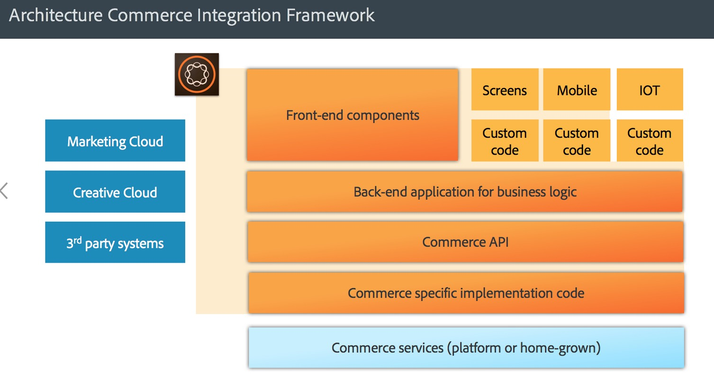

# AEM Commerce - Disponibilidade do GDPR{#aem-commerce-gdpr-readiness}

>[!IMPORTANT]
>
>O GDPR é usado como exemplo nas seções abaixo, mas os detalhes abordados se aplicam a todas as regulamentações de proteção e privacidade de dados; como o GDPR e o CCPA.

O Regulamento Geral sobre a Proteção de Dados da União Europeia entra em vigor em maio de 2018. Consulte a [página do GDPR no Centro de privacidade da Adobe](https://business.adobe.com/br/privacy/general-data-protection-regulation.html).

>[!NOTE]
>
>Consulte [Preparação do GDPR da AEM](/help/managing/data-protection-and-privacy.md) para obter mais detalhes.

Com as integrações Commerce prontas para uso da Adobe, o AEM é a camada de experiência, consumindo serviços e enviando dados de volta para a plataforma de comércio do cliente, que é executada em um modo headless.

Para algumas plataformas de comércio, o Adobe armazena informações de perfil ( `/home/users`) e tokens de comércio (para fazer logon na plataforma de comércio) no AEM. Para estes casos de uso, leia [Manipulando solicitações do GDPR para a plataforma AEM](/help/sites-administering/handling-gdpr-requests-for-aem-platform.md).

## Lidar com solicitações do GDPR para o AEM Commerce {#handling-gdpr-requests-for-aem-commerce}

Para a integração do Salesforce Commerce Cloud, a AEM Commerce não armazena informações relevantes do GDPR. Encaminhe a solicitação para a [Salesforce Cloud](https://documentation.b2c.commercecloud.salesforce.com/DOC1/index.jsp).

Para as integrações hybris e HCL WebSphere® Commerce, há alguns dados no AEM. Use as [instruções do GDPR da Plataforma AEM](/help/sites-administering/handling-gdpr-requests-for-aem-platform.md) e considere estas perguntas:

1. **Onde meus dados são armazenados/usados?** Informações de perfil de usuário em cache, como nome, identificador de usuário de comércio, token, senha e dados de endereço, conforme mostrado no AEM.
1. **Com quem compartilho os dados cobertos do GDPR?** Nenhuma atualização de dados relevantes para o GDPR na AEM Commerce é armazenada (exceto as informações de perfil relevantes, como mencionado acima), mas é enviada por proxy para a plataforma de comércio.
1. **Como excluir meus dados de usuário**? Exclua o perfil de usuário no AEM e chame a exclusão de usuário na plataforma de comércio.

>[!NOTE]
>
>Consulte a [hybris wiki](https://wiki.hybris.com/) ou a [documentação do HCL WebSphere® Commerce](https://help.hcltechsw.com/commerce/index.html), se necessário.
