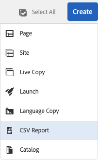
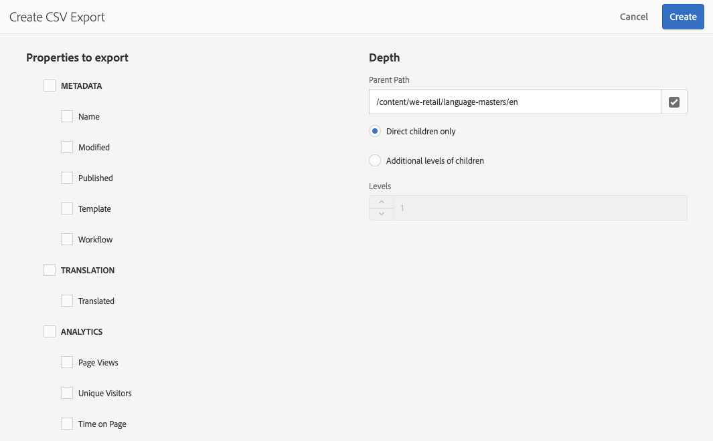

# Exportar para CSV{#export-to-csv}

**Criar relatórios de arquivos CSV** permite exportar informações sobre suas páginas para um arquivo CSV em seu sistema local.

* O arquivo baixado é chamado de `export.csv`
* Os conteúdos dependem das propriedades que você selecionar.
* É possível definir o caminho junto com o detalhamento da exportação.

>[!NOTE]
>
>O recurso para download e o destino padrão do seu navegador são usados.

O assistente **Criar exportação de arquivos CSV** permite selecionar:

* Propriedades para exportar
  * Metadados
    * Nome
    * Modificado
    * Publicado
    * Modelo
    * Fluxo de trabalho
  * Tradução
    * Traduzido
  * Analytics
    * Visualizações de página
    * Visitantes únicos
    * Tempo na página
* Profundidade
  * Caminho principal
  * Apenas filhos diretos
  * Níveis adicionais de filhos
  * Níveis

O arquivo `export.csv` resultante pode ser aberto no Excel ou qualquer outro aplicativo compatível.

A opção criar **Relatório CSV** está disponível ao navegar pelo console **Sites** (no modo de exibição de Lista): é uma opção do menu suspenso **Criar**:

Para criar uma exportação de arquivos CSV:

1. Abra o console **Sites** e navegue até o local desejado, se necessário.
1. Na barra de ferramentas, selecione **Criar**, em seguida, **Relatórios de arquivos CSV** para abrir o assistente:

   

1. Selecione as propriedades necessárias para exportar.
1. Selecione **Criar**.
