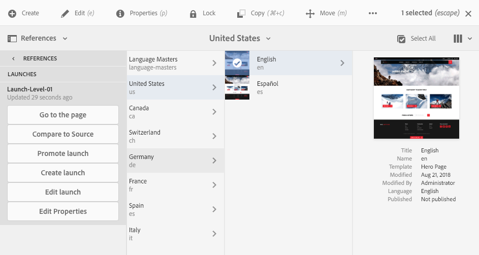

# Edição de inicializações{#editing-launches}

## Editar páginas de lançamento {#editing-launch-pages}

Quando uma inicialização é criada para uma página (ou conjunto de páginas), é possível editar o conteúdo na cópia de inicialização das páginas.

1. Acesse [Inicialização a partir de Referências (console Sites)](/help/sites-authoring/launches.md#launches-in-references-sites-console) para mostrar as ações disponíveis.
1. Selecionar **Ir para a página** para abrir a página para edição.

>[!NOTE]
>
>Você não tem permissão para mover uma página em um lançamento. Tentar esta ação acionará uma mensagem de aviso:
>
>* Aviso: esta página é a origem de um lançamento. Não é permitido mover a página.

### Edição de páginas de lançamento sujeitas a uma live copy {#editing-launch-pages-subject-to-a-live-copy}

Se a sua inicialização for baseada em uma [live copy](/help/sites-administering/msm.md), você:

* consulte símbolos de bloqueio (pequenos cadeados) ao editar um componente (conteúdo e/ou propriedades).
* consulte a guia **Live Copy** em **Propriedades da página**

Uma livecopy é usada para sincronizar o conteúdo da *ramificação de origem* para a *ramificação de inicialização* (para manter a inicialização atualizada com as alterações feitas na origem).

É possível fazer alterações da mesma maneira que você edita uma live copy padrão; por exemplo:

* Clicar em um cadeado fechado interromperá essa sincronização e permitirá que você faça novas atualizações no conteúdo em sua inicialização. Uma vez desbloqueadas (cadeado aberto), suas alterações não serão substituídas por quaisquer alterações feitas no mesmo local dentro da ramificação de origem.
* **Suspender** (e **Retomar**) herança de uma página específica.

Consulte [Alterar conteúdo da live copy](/help/sites-administering/msm-livecopy.md#changing-live-copy-content) para obter mais informações.

## Comparação de uma página de lançamento à sua página de origem {#comparing-a-launch-page-to-its-source-page}

Para rastrear as alterações feitas, é possível exibir a inicialização em **Referências** e comparar a página de inicialização com a página de origem:

1. No console **Sites**, [navegue até a página de origem do seu lançamento e selecione-a](/help/sites-authoring/basic-handling.md#viewingandselectingyourresources).
1. Abra o painel de **[Referências](/help/sites-authoring/basic-handling.md#references)** e selecione **Lançamentos**.
1. Selecione o lançamento específico e **Comparar à origem**:

   

1. As duas páginas (inicialização e origem) serão abertas lado a lado.

   Para obter informações completas sobre como usar este recurso, consulte [Diferencial de página](/help/sites-authoring/page-diff.md).

## Alteração das páginas de origem usadas {#changing-the-source-pages-used}

A qualquer momento, você pode adicionar ou remover páginas ao/do intervalo de páginas de origem para um lançamento:

1. Acesse e selecione o lançamento a partir do seguinte:

   * o [console Lançamentos](/help/sites-authoring/launches.md#the-launches-console):

     * Selecione **Editar**.

   * [Referências (console Sites)](/help/sites-authoring/launches.md#launches-in-references-sites-console) para mostrar as ações disponíveis:

     * Selecione **Editar lançamento**.

   As páginas de origem são exibidas.

1. Faça as alterações necessárias e confirme com **Salvar**.

   >[!NOTE]
   >
   >Para adicionar páginas a um lançamento, elas devem estar abaixo de uma raiz de idioma comum, ou seja, em um único site.

## Editar uma configuração de lançamento {#editing-a-launch-configuration}

A qualquer momento, você pode editar as propriedades de um lançamento:

1. Acesse e selecione o lançamento a partir do seguinte:

   * o [console Lançamentos](/help/sites-authoring/launches.md#the-launches-console):

     * Selecione **Propriedades**.

   * [Referências (console Sites)](/help/sites-authoring/launches.md#launches-in-references-sites-console) para mostrar as ações disponíveis:

     * Selecione **Editar propriedades**.

   Os detalhes são mostrados.

1. Faça as alterações necessárias e confirme com **Salvar**.

   Consulte [Inicializações - a Ordem dos eventos](/help/sites-authoring/launches.md#launches-the-order-of-events) para obter informações sobre a finalidade e interação dos campos **Data de inicialização** e **Pronto para produção**.

## Descobrir o status de lançamento de uma página {#discovering-the-launch-status-of-a-page}

O status é exibido ao selecionar um lançamento específico na guia Referências (consulte [Inicialização a partir de Referências (console Sites)](/help/sites-authoring/launches.md#launches-in-references-sites-console)).

