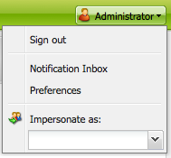

# Configurar o ambiente da sua conta{#configuring-your-account-environment}

O Adobe Experience Manager (AEM) fornece a capacidade de configurar a sua conta e determinados aspectos do ambiente de Autor.

Usando as [configurações da conta](#account-settings) e as [preferências do usuário](#user-preferences), as seguintes opções e preferências podem ser definidas:

* **Barra de Ferramentas de Edição**
Selecione se deseja ter a barra de ferramentas de edição global. Esta barra de ferramentas, que é mostrada na parte superior da janela do navegador, oferece botões **Copiar**, **Recortar**, **Colar**, **Excluir** para usar com os componentes de parágrafo desta página:

  * Mostrar quando necessário (Padrão)
  * Sempre mostrar
  * Manter oculto

* **Representar como**
A funcionalidade de [Representar como](/help/sites-administering/security.md#impersonating-another-user) permite que um usuário trabalhe em nome de outro usuário.

* **Idioma**
O idioma a ser usado para a interface do usuário do ambiente de criação. Selecione o idioma apropriado na lista.

* **Gerenciamento de Janelas**
Selecione:

  * Diversas janelas (padrão)
    As páginas são abertas em uma nova janela.
  * Uma janela
    As páginas são abertas na janela atual.

## Configurações de conta {#account-settings}

O ícone de usuário fornece acesso às seguintes opções:

* Sair
* [Representar como](/help/sites-administering/security.md#impersonating-another-user)
* [Preferências de usuário](#user-preferences)
* [Caixa de entrada de notificações](/help/sites-classic-ui-authoring/author-env-inbox.md)

### Preferências de usuário {#user-preferences}

Cada usuário pode definir determinadas propriedades para si mesmo. Isso está disponível na caixa de diálogo **Preferências**, no canto superior direito dos consoles.

A caixa de diálogo oferece as seguintes opções:

