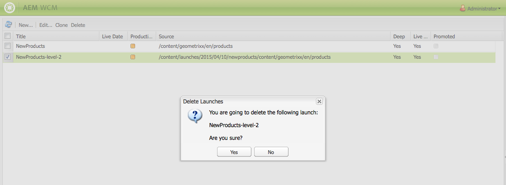

# Criação de inicializações{#creating-launches}

Crie um lançamento para permitir a atualização de uma nova versão de páginas da Web para ativação futura. Ao criar a inicialização, especifique um título e a página de origem:

* O título aparece no **Sidekick**, onde os autores podem acessá-lo para trabalhar nele.
* As páginas filhas da página de origem são incluídas no lançamento por padrão. Você pode usar somente a página de origem, se desejar.
* Por padrão, [Live Copy](/help/sites-administering/msm.md) atualiza automaticamente as páginas de lançamento à medida que as páginas de origem são alteradas. É possível especificar que uma cópia estática seja criada para impedir alterações automáticas.

Como opção, especifique a **Data de inicialização** (e a hora) para definir quando as páginas de inicialização devem ser promovidas e ativadas. No entanto, a **Data de inicialização** só funciona em combinação com o sinalizador **Pronto para produção** (consulte [Editar uma configuração de inicialização](/help/sites-classic-ui-authoring/classic-launches-editing.md#editing-a-launch-configuration)); para que as ações realmente ocorram automaticamente, ambas devem ser definidas.

## Criação de um lançamento {#creating-a-launch}

O procedimento a seguir cria um lançamento.

1. Abra a página de administração do site ([http://localhost:4502/siteadmin](http://localhost:4502/siteadmin)).
1. Clique em **Novo...** e depois em **Novo Lançamento...**.
1. Na caixa de diálogo **Criar Inicialização**, especifique valores para as seguintes propriedades:

   * **Título do lançamento**: o nome do lançamento. O nome deve ser significativo para os autores.
   * **Página do Source**: o caminho para a página para a qual criar a inicialização. Por padrão, todas as páginas secundárias são incluídas.
   * **Excluir subpáginas**: selecione essa opção para criar a inicialização somente para a página de origem e não para as páginas secundárias. Por padrão, essa opção não está selecionada.
   * **Manter em Sincronia**: selecione esta opção para atualizar automaticamente o conteúdo das páginas de inicialização quando as páginas de origem forem alteradas. Isso é feito fazendo da inicialização uma [live copy](/help/sites-administering/msm.md).
   * **Data da inicialização**: a data e a hora em que a cópia de inicialização deve ser ativada (dependendo do sinalizador de **Pronto para produção**; consulte [Inicializações - a ordem dos eventos](/help/sites-authoring/launches.md#launches-the-order-of-events)).

   

1. Clique em **Criar**.

## Exclusão de um lançamento {#deleting-a-launch}

Você também pode excluir um lançamento.

1. No [console de inicializações](/help/sites-classic-ui-authoring/classic-launches.md), selecione a inicialização necessária.
1. Clique em **Excluir** - confirmação necessária:

   

   >[!CAUTION]
   >
   >Ao excluir inicializações aninhadas, você deve excluir os níveis mais baixos primeiro.
