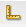
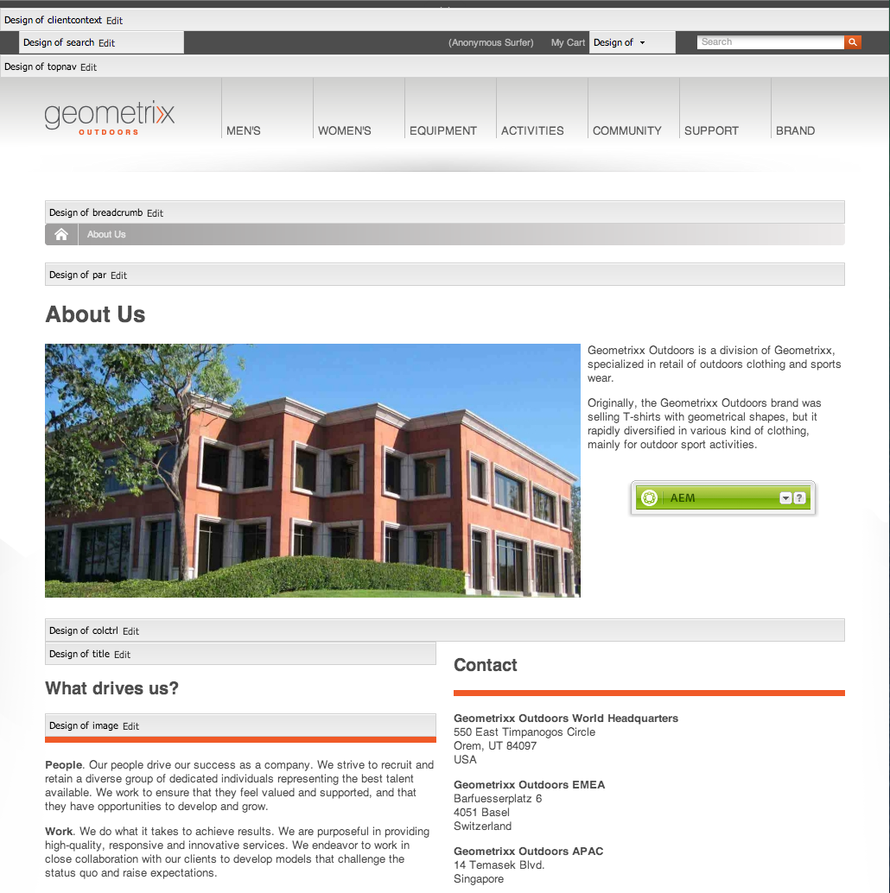
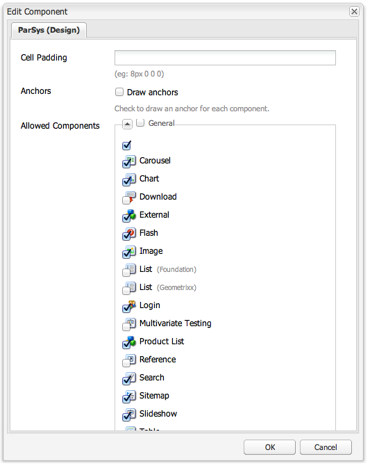
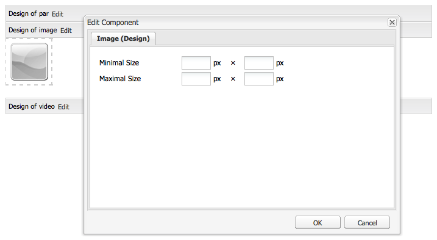

# Configuração de componentes no modo de design{#configuring-components-in-design-mode}

Quando a instância do AEM é instalada pronta para uso, uma seleção de componentes é disponibilizada imediatamente no sidekick.

Além desses, vários outros componentes também estão disponíveis. Você pode usar o modo Design para [Habilitar/desabilitar esses componentes](#enabledisablecomponentsusingdesignmode). Quando habilitado e localizado na sua página, você pode usar o modo de Design para [configurar aspectos do design do componente](#configuringcomponentsusingdesignmode) editando os parâmetros do atributo.

>[!NOTE]
>
>Tenha cuidado ao editar esses componentes. As configurações de design geralmente são parte integrante do design de todo o site, portanto, elas só devem ser alteradas por alguém com os privilégios apropriados (e experiência), geralmente um administrador ou desenvolvedor. Consulte [Desenvolvendo componentes](/help/sites-developing/components.md) para obter mais informações.

Na verdade, isso envolve adicionar ou remover os componentes permitidos no sistema de parágrafos da página. O sistema de parágrafo ( `parsys`) é um componente composto que contém todos os outros componentes de parágrafo. O sistema de parágrafo permite que os autores adicionem componentes de diferentes tipos a uma página, pois ela contém todos os outros componentes de parágrafo. Cada tipo de parágrafo é representado como um componente.

Por exemplo, o conteúdo de uma página de produto pode conter um sistema de parágrafo que contenha o seguinte:

* Uma imagem do produto (no formato de uma imagem ou de um parágrafo de imagem de texto)
* A descrição do produto (como um parágrafo de texto)
* Uma tabela com dados técnicos (como um parágrafo de tabela)
* Um formulário que os usuários preenchem (no início dos formulários, elemento de formulários e parágrafo final dos formulários)

>[!NOTE]
>
>Consulte [Desenvolvendo componentes](/help/sites-developing/components.md#paragraphsystem) e [Diretrizes para Usar Modelos e Componentes](/help/sites-developing/dev-guidelines-bestpractices.md#guidelines-for-using-templates-and-components) para obter mais informações sobre `parsys`.

## Ativar/desativar componentes {#enable-disable-components}

No modo Design, o sidekick é minimizado e existe a possibilidade de configurar os componentes acessíveis para criação:

1. Para entrar no modo Design, abra uma página para edição e use o ícone Sidekick:

   

1. Clique em **Editar** no Sistema de parágrafos (**Design do par**).

   

1. Uma caixa de diálogo será aberta, listando os grupos de componentes mostrados no Sidekick junto com os componentes individuais que eles contêm.

   Selecione conforme necessário para adicionar ou remover os componentes que estarão disponíveis no sidekick.

   

1. O Sidekick é minimizado no modo Design. Ao clicar na seta, é possível maximizar o Sidekick e retornar ao Modo de edição:

   

## Configuração do design de um componente {#configuring-the-design-of-a-component}

No modo Design, você também pode configurar atributos para os componentes individuais. Cada componente tem seus próprios parâmetros. O exemplo a seguir mostra o componente **Imagem**:

1. Para entrar no modo Design, abra uma página para edição e use o ícone Sidekick:

   

1. Você pode configurar o design de componentes.

   Por exemplo, se você clicar em **Editar** no componente de Imagem (**Design de imagem**), será possível configurar os parâmetros específicos do componente:

   

1. Clique em **OK** para salvar suas alterações.

1. O Sidekick é minimizado no modo Design. Ao clicar na seta, é possível maximizar o Sidekick e retornar ao Modo de edição:

   
