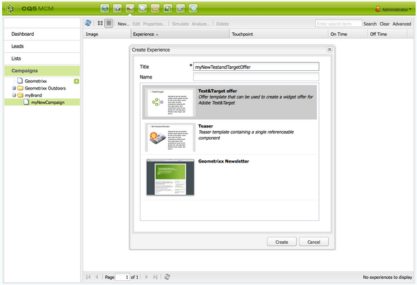

# Ofertas do Target{#target-offers}

## Criação de uma experiência de oferta do Test&amp;Target {#creating-a-test-target-offer-experience}

1. Selecione a nova campanha no painel esquerdo ou clique duas vezes nela no painel direito.
1. Selecione a exibição de lista usando o ícone:

   

1. Clique em **Novo...**
1. Você pode especificar o **Título**, **Nome** e o tipo de experiência a ser criada; neste caso, Oferta do Test&amp;Target.

   

1. Clique em **Criar**.

   >[!NOTE]
   >
   >As experiências Test&amp;Target não estão listadas no MCM. Eles podem ser acessados no console **Sites**, em Campanhas.

## Integração com o Adobe Target {#integrating-with-adobe-target}

Consulte [Integrar com o Adobe](/help/sites-administering/target.md) [Target](/help/sites-administering/target.md) para obter detalhes completos.
