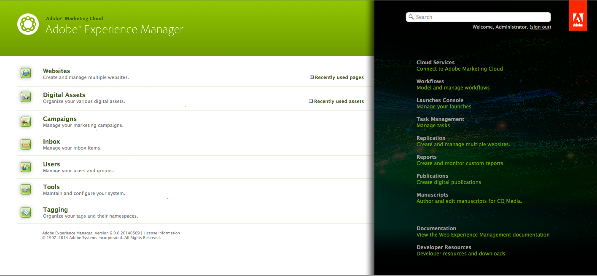
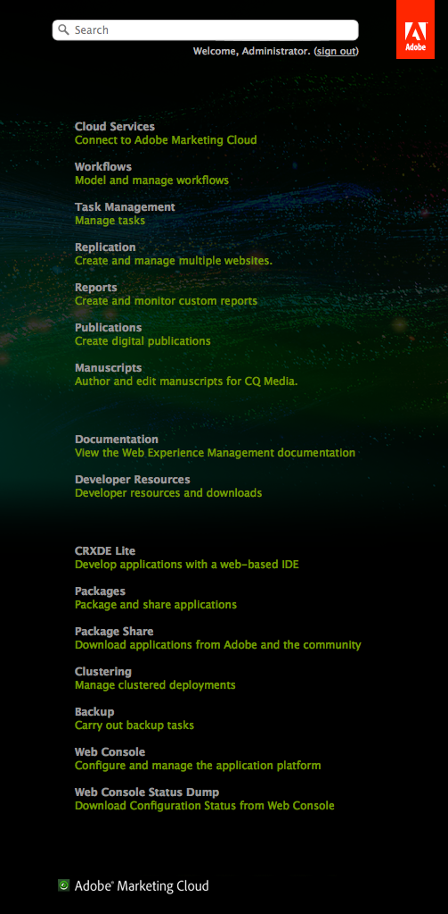

# Personalização do console de boas-vindas (interface clássica){#customizing-the-welcome-console-classic-ui}

>[!CAUTION]
>
>Esta página lida com a interface clássica do usuário.
>
>Consulte [Personalização dos Consoles](/help/sites-developing/customizing-consoles-touch.md) para obter detalhes sobre a interface padrão habilitada para toque.

O console de Boas-vindas fornece uma lista de links para os vários consoles e funcionalidades no AEM.

É possível configurar os links que estão visíveis. Isso pode ser definido para usuários e/ou grupos específicos. As ações a serem tomadas dependem do tipo de target (que se correlaciona à seção do console em que estão):

* [Consoles Principais](#links-in-main-console-left-pane) - Links no console principal (painel esquerdo)
* [Recursos, Documentação e Referência, Recursos](#links-in-sidebar-right-pane) - Links na barra lateral (painel direito)

## Links no console principal (painel esquerdo) {#links-in-main-console-left-pane}

Isso lista os principais consoles do AEM.

### Configuração da visibilidade dos links do console principal {#configuring-whether-main-console-links-are-visible}

As permissões de nível de nó determinam se o link pode ser visto ou não. Os nós em questão são:

* **Sites:** `/libs/wcm/core/content/siteadmin`

* **Assets Digital:** `/libs/wcm/core/content/damadmin`

* **Comunidade:** `/libs/collab/core/content/admin`

* **Campanhas:** `/libs/mcm/content/admin`

* **Caixa de entrada:** `/libs/cq/workflow/content/inbox`

* **Usuários:** `/libs/cq/security/content/admin`

* **Ferramentas:** `/libs/wcm/core/content/misc`

* **Marcação:** `/libs/cq/tagging/content/tagadmin`

Por exemplo:

* Para restringir o acesso a **Ferramentas**, remova o acesso de leitura de

  `/libs/wcm/core/content/misc`

Consulte a [seção Segurança](/help/sites-administering/security.md) para obter mais informações sobre como definir as permissões desejadas.

### Links na barra lateral (painel direito) {#links-in-sidebar-right-pane}

Estes links são baseados na existência de acesso de leitura *e* para nós no seguinte caminho:

`/libs/cq/core/content/welcome`

Há três seções (espaçadas levemente afastadas) fornecidas por padrão:

<table>
 <tbody>
  <tr>
   <td><strong>Recursos</strong></td>
   <td> </td>
  </tr>
  <tr>
   <td> Cloud Services</td>
   <td><code>/libs/cq/core/content/welcome/resources/cloudservices</code></td>
  </tr>
  <tr>
   <td> Fluxos de trabalhos</td>
   <td><code>/libs/cq/core/content/welcome/resources/workflows</code></td>
  </tr>
  <tr>
   <td> Gerenciamento de tarefas</td>
   <td><code>/libs/cq/core/content/welcome/resources/taskmanager</code></td>
  </tr>
  <tr>
   <td> Replicação</td>
   <td><code>/libs/cq/core/content/welcome/resources/replication</code></td>
  </tr>
  <tr>
   <td> Relatórios</td>
   <td><code>/libs/cq/core/content/welcome/resources/reports</code></td>
  </tr>
  <tr>
   <td> Publicações</td>
   <td><code>/libs/cq/core/content/welcome/resources/publishingadmin</code></td>
  </tr>
  <tr>
   <td> Manuscritos</td>
   <td><code>/libs/cq/core/content/welcome/resources/manuscriptsadmin</code></td>
  </tr>
  <tr>
   <td><strong>Documentação e referência</strong></td>
   <td> </td>
  </tr>
  <tr>
   <td> Documentação</td>
   <td><code>/libs/cq/core/content/welcome/docs/docs</code></td>
  </tr>
  <tr>
   <td> Recursos do desenvolvedor</td>
   <td><code>/libs/cq/core/content/welcome/docs/dev</code></td>
  </tr>
  <tr>
   <td><strong>Recursos</strong></td>
   <td> </td>
  </tr>
  <tr>
   <td> CRXDE Lite</td>
   <td><code>/libs/cq/core/content/welcome/features/crxde</code></td>
  </tr>
  <tr>
   <td> Pacotes</td>
   <td><code>/libs/cq/core/content/welcome/features/packages</code></td>
  </tr>
  <tr>
   <td> Compartilhamento de pacotes</td>
   <td><code>/libs/cq/core/content/welcome/features/share</code></td>
  </tr>
  <tr>
   <td> Gerando cluster</td>
   <td><code>/libs/cq/core/content/welcome/features/cluster</code></td>
  </tr>
  <tr>
   <td> Backup</td>
   <td><code>/libs/cq/core/content/welcome/features/backup</code></td>
  </tr>
  <tr>
   <td> Console da Web  </td>
   <td><code>/libs/cq/core/content/welcome/features/config</code></td>
  </tr>
  <tr>
   <td> Despejo de Status do Console da Web  </td>
   <td><code>/libs/cq/core/content/welcome/features/statusdump</code></td>
  </tr>
 </tbody>
</table>

#### Configurar se os links da barra lateral estão visíveis {#configuring-whether-sidebar-links-are-visible}

É possível ocultar um link de usuários ou grupos específicos removendo o acesso de leitura aos nós que representam o link.

* Recursos - remover acesso a:

  `/libs/cq/core/content/welcome/resources/<link-target>`

* Documentação - remover acesso a:

  `/libs/cq/core/content/welcome/docs/<link-target>`

* Recursos - remover acesso a:

  `/libs/cq/core/content/welcome/features/<link-target>`

Por exemplo:

* Para remover o link para **Relatórios**, remova o acesso de leitura de

  `/libs/cq/core/content/welcome/resources/reports`

* Para remover o link para **Pacotes**, remova o acesso de leitura de

  `/libs/cq/core/content/welcome/features/packages`

Consulte a [seção Segurança](/help/sites-administering/security.md) para obter mais informações sobre como definir as permissões desejadas.

### Mecanismo de seleção de link {#link-selection-mechanism}

No `/libs/cq/core/components/welcome/welcome.jsp`, é usado o [ConsoleUtil](https://helpx.adobe.com/experience-manager/6-5/sites/developing/using/reference-materials/javadoc/com/day/cq/commons/ConsoleUtil.html), que executa uma consulta nos nós que possuem a propriedade:

* `jcr:mixinTypes` com o valor: `cq:Console`

>[!NOTE]
>
>Execute a seguinte consulta para ver a lista existente:
>
>* `select * from cq:Console`
>

Quando um usuário ou grupo não tem permissão de leitura em um nó com o mixin `cq:Console`, esse nó não é recuperado pela pesquisa `ConsoleUtil`, portanto, não está listado no console.

### Adicionar um item personalizado {#adding-a-custom-item}

O [mecanismo de seleção de link](#link-selection-mechanism) pode ser usado para adicionar seu próprio item personalizado à lista de links.

Adicione o item personalizado à lista adicionando o mixin `cq:Console` ao widget ou recurso. Isso é feito definindo a propriedade:

* `jcr:mixinTypes` com o valor: `cq:Console`
