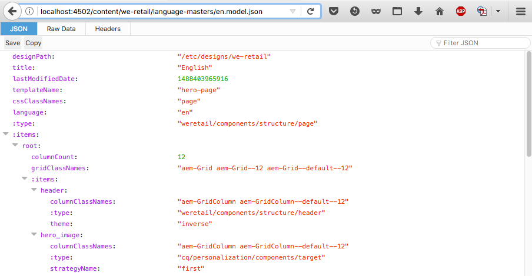
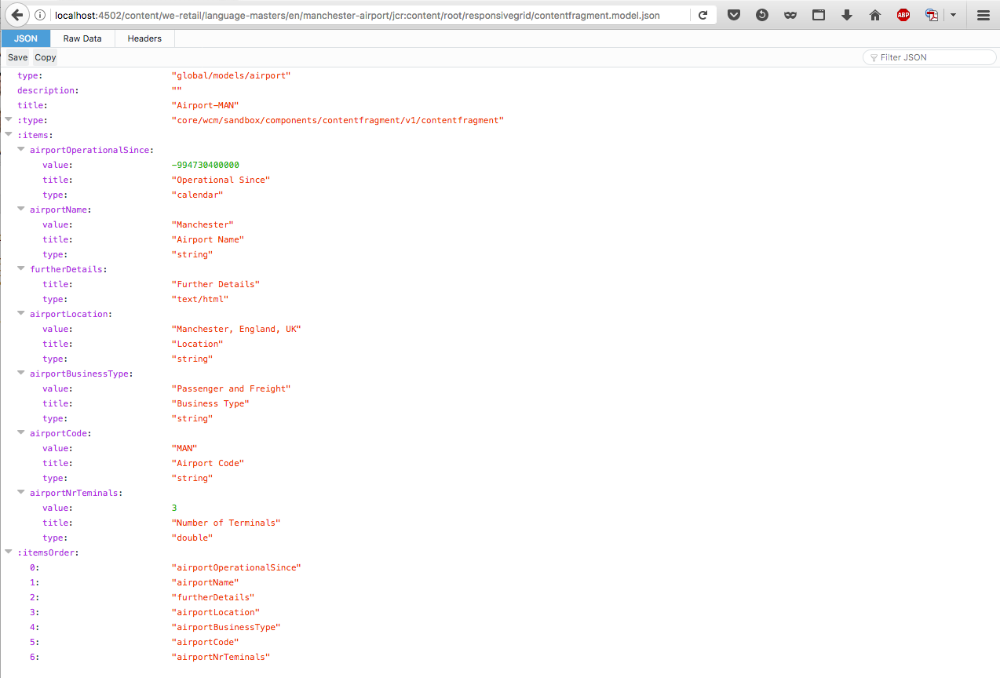

# Exportador JSON para serviços de conteúdo{#json-exporter-for-content-services}

Os Serviços de conteúdo do AEM foram criados para generalizar a descrição e a entrega de conteúdo de e para o AEM para além do foco em páginas da Web.

Eles realizam a entrega de conteúdo para canais que não são páginas da Web tradicionais do AEM, usando métodos padronizados que podem ser consumidos por qualquer cliente. Esses canais podem incluir:

* [Aplicativos de página única](spa-walkthrough.md)
* Aplicativos nativos para dispositivos móveis
* outros canais e pontos de contato externos ao AEM

Com fragmentos de conteúdo que usam conteúdo estruturado, você pode fornecer serviços de conteúdo usando o exportador JSON para fornecer o conteúdo de qualquer página do AEM no formato de modelo de dados JSON. Esse método pode ser consumido pelos seus próprios aplicativos.

>[!NOTE]
>
>A funcionalidade descrita aqui está disponível para todos os Componentes Principais desde a [versão 1.1.0 dos Componentes Principais](https://experienceleague.adobe.com/pt-br/docs/experience-manager-core-components/using/introduction).

## Exportador JSON com componentes principais de fragmento de conteúdo {#json-exporter-with-content-fragment-core-components}

Usando o exportador JSON do AEM, você pode fornecer o conteúdo de qualquer página do AEM no formato do modelo de dados JSON. Esse método pode ser consumido pelos seus próprios aplicativos.

No AEM, a entrega é obtida usando o seletor `model` e a extensão `.json`.

`.model.json`

1. Por exemplo, um URL como:

   ```shell
   http://localhost:4502/content/we-retail/language-masters/en.model.json
   ```

1. Fornece conteúdo como:

   

Como alternativa, você pode fornecer o conteúdo de um fragmento de conteúdo estruturado direcionando-o especificamente.

Use o caminho inteiro para o fragmento (por meio de `jcr:content`); por exemplo, com um sufixo como.

`.../jcr:content/root/responsivegrid/contentfragment.model.json`

Sua página pode conter um único fragmento de conteúdo ou vários componentes de vários tipos. Você também pode usar mecanismos como componentes de lista para pesquisar automaticamente conteúdo relevante.

* Por exemplo, um URL como:

  ```shell
  http://localhost:4502/content/we-retail/language-masters/en/manchester-airport/jcr:content/root/responsivegrid/contentfragment.model.json
  ```

* Fornece conteúdo como:

  

  >[!NOTE]
  >
  >Você pode [adaptar seus próprios componentes](/help/sites-developing/json-exporter-components.md) para acessar e usar esses dados.

  >[!NOTE]
  >
  >Embora não seja uma implementação padrão, [há suporte para vários seletores,](json-exporter-components.md#multiple-selectors) mas `model` deve ser o primeiro.

### Informações adicionais {#further-information}

Consulte também:

* API HTTP de ativos

  * [API HTTP de ativos](/help/assets/mac-api-assets.md)

* Modelos Sling:

  * [Modelos Sling - Associando uma classe de modelo a um tipo de recurso desde 130](https://sling.apache.org/documentation/bundles/models.html#associating-a-model-class-with-a-resource-type-since-130)

* AEM com JSON:

  * [Obtendo informações de página no formato JSON](/help/sites-developing/pageinfo.md)

## Documentação relacionada {#related-documentation}

Para obter mais detalhes, consulte:

* O [tópico Fragmentos de conteúdo no guia do usuário do Assets](/help/assets/content-fragments/content-fragments.md)

* [Modelos de fragmentos de conteúdo](/help/assets/content-fragments/content-fragments-models.md)
* [Criação com fragmentos de conteúdo](/help/sites-authoring/content-fragments.md)
* [Habilitação de exportação em JSON para um componente](/help/sites-developing/json-exporter-components.md)

* [Componentes principais](https://experienceleague.adobe.com/pt-br/docs/experience-manager-core-components/using/introduction) e o [componente de Fragmento de Conteúdo](https://experienceleague.adobe.com/docs/experience-manager-core-components/using/wcm-components/content-fragment-component.html?lang=pt-BR)
